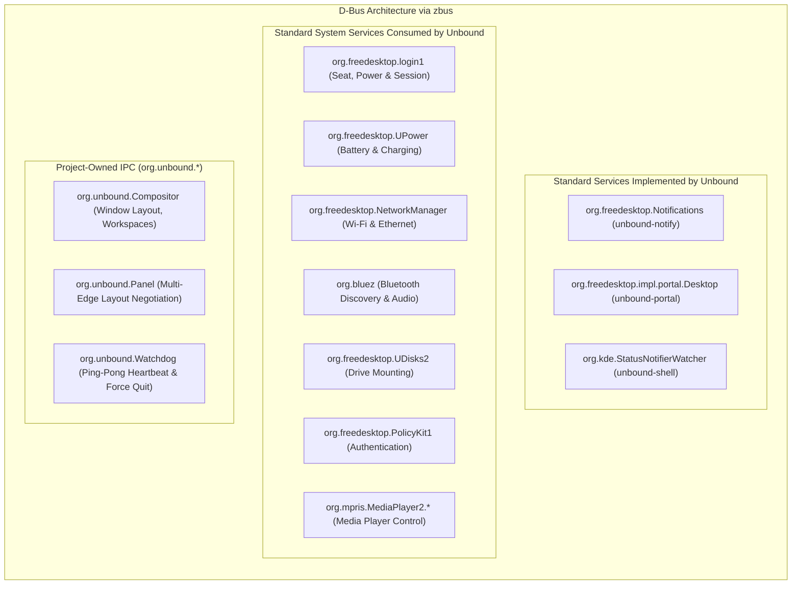
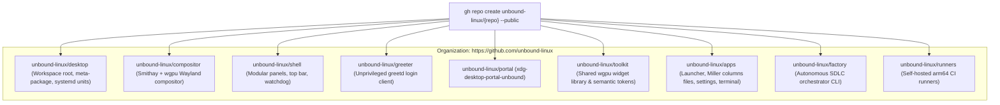
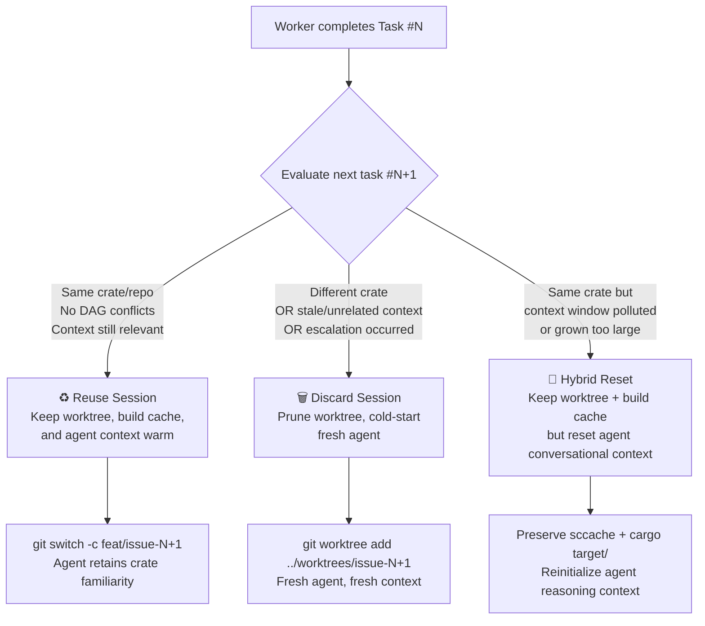
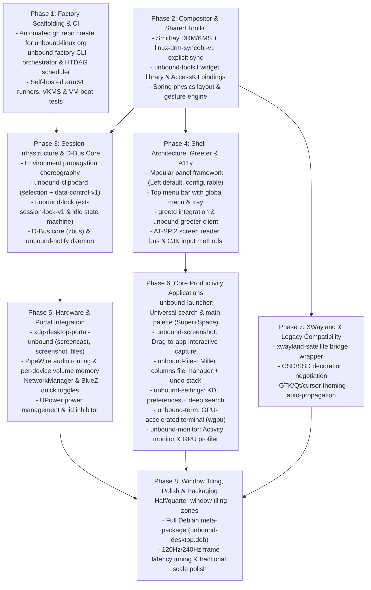
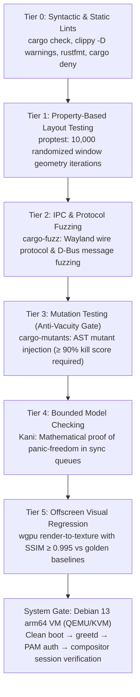

# Unbound: Master Architecture & Execution Plan
## Next-Generation Rust Desktop Environment (Debian / Wayland) & Autonomous Software Factory
**GitHub Organization**: [`https://github.com/unbound-linux`](https://github.com/unbound-linux)

## Goal Description
Build **Unbound** (`unbound-desktop`), an ultra-modern, production-grade Linux Desktop Environment built in **Rust**, targeting **Debian** as its primary operating system.

Unbound marries the organizational depth and workflow polish of **macOS** (Miller columns, exhaustive settings taxonomy, instant file previews, unkillable force-quit watchdog) with the desktop layout ergonomics of modern Linux (modular, repositionable panels—defaulting to an ergonomic left vertical taskbar, with seamless support for bottom, right, or top layouts).

The project is hosted under the official GitHub organization **[`unbound-linux`](https://github.com/unbound-linux)**, with all component repositories programmatically provisioned and managed via the GitHub CLI (`gh`).

Following an exhaustive architectural audit, Unbound implements a pragmatic, rock-solid systems foundation:
1. **Layered Graphics Engine**: Leverages **Smithay** for kernel DRM/KMS atomic modesetting, libinput, and session management, while building a **100% custom Vulkan/wgpu scene graph, render pipeline, physics layout engine, and shell** above it.
2. **Seamless Legacy & Gaming Compatibility**: Clean **XWayland isolation via `xwayland-satellite`**, ensuring full compatibility with Steam, Proton, Wine, and legacy GUI apps with zero X11 pollution inside the core compositor.
3. **Full Desktop Session Infrastructure**: Complete implementation of all essential desktop services—XDG Desktop Portals (PipeWire screen sharing, file pickers), clipboard managers (primary & selection), idle/lock state machines (`ext-session-lock-v1`), polkit agent, power management, audio/media key routing, and input methods (CJK).
4. **Robust Display Management**: Privileged session handling via **`greetd`**, pairing with an unprivileged, beautiful Rust client (`unbound-greeter`).
5. **Zero-Human-in-the-Loop Software Factory**: An autonomous SDLC orchestrator (`unbound-factory`) managing git worktrees, automated out-of-scope task discovery, pre-PR peer reviewer agents, and CI verification on self-hosted arm64 runners (headless Wayland via Lavapipe + ephemeral Debian 13 arm64 VM boot tests).

---

```mermaid
graph TB
    subgraph "Hardware & Kernel Abstraction (Smithay Core)"
        DRM[DRM/KMS Atomic API: /dev/dri/card0 + Card Hotplug]
        INPUT[libinput / evdev Multi-Touch Gestures]
        GBM[GBM / DMA-BUF Zero-Copy Buffer Import + Explicit Sync]
        SEAT[libseat / systemd-logind Session Management]
    end

    subgraph "Core Server (unbound-linux/compositor)"
        SMITHAY[Smithay Kernel & Protocol Core]
        SYNC[linux-drm-syncobj-v1: Explicit Sync]
        RENDER[Custom Vulkan / wgpu Multi-Pass Render Pipeline]
        SCENE[Spatial Scene Graph & Damage Tracker]
        PHYSICS[Apple-Grade Spring Physics Engine]
        XWAYLAND[External XWayland Bridge: xwayland-satellite]
        WATCHDOG[Wayland Ping-Pong Heartbeat Watchdog]

        SMITHAY --> RENDER
        SYNC --> RENDER
        RENDER --> SCENE
        SCENE --> PHYSICS
        SMITHAY <--> XWAYLAND
    end

    subgraph "Two-Tier IPC Architecture"
        DBUS[Control Plane: D-Bus via zbus / org.freedesktop.* + org.unbound.*]
        SOCKETS[Data Plane: Zero-Copy Sockets for Frame Damage & Buffers]
    end

    subgraph "Desktop Session Services (Essential Infrastructure)"
        PORTAL[unbound-portal: xdg-desktop-portal Backend - PipeWire Screencast]
        NOTIF[unbound-notify: org.freedesktop.Notifications Daemon]
        POLKIT[unbound-polkit: Native Privilege Escalation Agent]
        CLIPBOARD[unbound-clipboard: Clipboard Manager & Primary Selection]
        IDLE_LOCK[unbound-lock: ext-session-lock-v1 & ext-idle-notify-v1]
        POWER[unbound-power: UPower & logind Inhibitor Service]
    end

    subgraph "Shell & Productivity Applications (unbound-linux/shell & unbound-linux/apps)"
        PANEL[Modular Panel Framework: Edge = Left | Bottom | Top | Right]
        TOPBAR[Top Menu Bar: Global Menu + Status Notifier Tray]
        FILES[unbound-files: Miller Columns File Manager + Quick Look]
        MONITOR[unbound-monitor: Activity Monitor & Hardware Profiler]
        SETTINGS[unbound-settings: KDL Config & System Preferences]
    end

    subgraph "Display Manager & Boot Pipeline (unbound-linux/greeter)"
        GREETD[greetd: Privileged PAM Session Daemon]
        GREETER[unbound-greeter: Unprivileged Modern Login UI]
        GREETD <--> GREETER
    end

    DRM & INPUT & GBM & SEAT --> SMITHAY
    COMPOSITOR_CORE --> DBUS & SOCKETS
    DBUS <--> PORTAL & NOTIF & POLKIT & CLIPBOARD & IDLE_LOCK & POWER
    DBUS <--> PANEL & TOPBAR & FILES & MONITOR & SETTINGS
    GREETD --> SMITHAY
```

---

## 1. Architectural Strategy & Technical Foundations

### 1.1 The Layered Compositor Architecture (`unbound-linux/compositor`)
To avoid 8–12 months of low-level DRM/KMS resource-lifetime debugging and kernel edge-case panics, Unbound employs a high-velocity, production-grade layered design (the proven COSMIC/niri architecture):
- **Kernel/Protocol Abstraction**: **`smithay`** handles low-level DRM/KMS atomic modesetting, libinput device management, multi-GPU dmabuf import/export, and standard Wayland protocol dispatching.
- **Custom Scene Graph & Vulkan Pipeline**: 100% custom Vulkan renderer on `ash`; the choice over `wgpu` and Smithay's GLES renderer, and the performance targets, are recorded in [`RENDERING.md`](RENDERING.md). Implements dual-pass Kawase blur shaders, subpixel font rendering, dynamic rounded-corner clipping, and damage-region tracking.
  - Implemented in `crates/unbound-render`: one Vulkan 1.3 device with push descriptors and dynamic rendering. Each surface keeps a texture for its lifetime, and a commit's buffer is held until the next frame uploads only its damaged rows and releases it. A frame repaints the merged damage rectangles of a persistent output image, starting each at the topmost opaque window that covers it, and is read back only for tests. Blur, rounded corners and scaling are not built yet.
  - `linux-dmabuf-v1` is served at version 3 (feedback needs a DRM device) for single-plane ARGB8888 and XRGB8888 buffers with the LINEAR modifier. A dma-buf is imported once as a Vulkan buffer and its damaged rows are copied into the surface's texture, so any stride works on drivers without `VK_EXT_image_drm_format_modifier`; buffers are released after the frame that read them completes. Waiting for a client's implicit fence is not implemented, so a dma-buf must be finished when it is committed.
  - Frames are paced by a vblank clock (virtual at 120 Hz in the headless backend, advertised as the `wl_output` mode). A commit is latched into the frame whose deadline it arrives before: the vblank minus the longest time from deadline to finished render over the last 16 frames, minus 1 ms. Frame callbacks and `wp_presentation` feedback (vblank time, refresh, sequence, `vsync`) are taken when the frame is latched and sent at its vblank; a superseded commit's feedback is discarded, and a render that overruns its vblank is presented at the next one.
- **Physics Layout Engine**: Custom spring dynamics simulation ($\ddot{x} + 2\zeta\omega\dot{x} + \omega^2\Delta x = 0$) powering fluid window snapping, minimize-to-panel curves, and workspace sliding.
  - Implemented in `crates/unbound-spring` as the closed-form solution for under-, critically and overdamped springs, parameterised by angular frequency $\omega$ and damping ratio $\zeta$. A trajectory depends only on elapsed time, never on frame rate, and retargeting keeps position and velocity continuous.

### 1.2 XWayland Compatibility via `xwayland-satellite`
Instead of polluting the compositor with legacy X11 C-libraries or abandoning gaming entirely:
- **Architecture**: Unbound embeds an external bridge utilizing **`xwayland-satellite`** (pioneered by niri).
- **Mechanism**: Connects to `unbound-compositor` strictly as a standard Wayland client using `xdg_wm_base` and `wp_viewporter`.
- **Isolation**: Keeps **zero X11 code** inside `unbound-compositor`. Automatically spawns on demand when Steam, Proton, Wine, or legacy GTK2 apps start, and auto-restarts cleanly if the XWayland server crashes.

### 1.3 Two-Tier IPC Strategy
- **Control Plane (D-Bus via `zbus`)**: Used for all policy, state negotiation, and desktop integration (`org.freedesktop.*` standards and `org.unbound.*` domain). Fully inspectable via `busctl`, robustly typed, async, and pure Rust.
- **Data Plane (Zero-Copy Unix Sockets)**: High-throughput Unix domain sockets transferring raw damage regions, frame submission handles, and DMA-BUF file descriptors.

### 1.4 Human-Readable Configuration Format (KDL) & Atomic Hot-Reload
- Unbound adopts **KDL (KDL Document Language)** for all user configuration (`~/.config/unbound/config.kdl`):
  - Node-based, human-readable, schema-validated syntax.
  - Live inotify hot-reloading with zero session restarts.
  - **Shadow Buffer Validation Pipeline**:
    1. Inotify detects file change and triggers parsing into an isolated shadow memory structure.
    2. If validation passes: atomically swaps the active runtime configuration and emits D-Bus property signals (`org.unbound.Config`) to trigger live subscriber redraws.
    3. If validation fails: current active configuration remains untouched in memory with zero interruption. The compositor posts a non-modal on-screen toast detailing the exact syntax error, file line/column, and an actionable "Open in Editor" button.
- **Implemented schema (`crates/unbound-config`)**: KDL 2.0 syntax. The file is `$XDG_CONFIG_HOME/unbound/config.kdl`, or `~/.config/unbound/config.kdl` when `XDG_CONFIG_HOME` is unset or relative. Every setting is optional; unknown settings, duplicates and out-of-range values are rejected with the line and column of the offending node or value.
  ```kdl
  appearance "automatic"        // "dark" | "light" | "automatic"
  panel {
      edge "left"               // "left" | "bottom" | "right" | "top"
  }
  idle {
      dim-after "5m"            // positive "<n>s" | "<n>m" | "<n>h"
      lock-after "10m"          // not shorter than dim-after
      suspend-after "10m"       // not shorter than lock-after, or "never"
  }
  output "eDP-1" {              // once per connector
      scale 1.5                 // 1.0 to 2.0 (100%-200%)
      refresh-rate 120          // 60 to 240 Hz
      variable-refresh-rate #true
  }
  ```
  The values shown for `appearance`, `panel` and `idle` are the defaults. A valid file is parsed into a shadow `Config` and swapped in as one `Arc`, so readers see either the old or the new configuration, never a mix. `ConfigService` owns `org.unbound.Config` on the session bus and serves the active values as properties of interface `org.unbound.Config` at `/org/unbound/Config` (`Appearance`, `PanelEdge`, `IdleDimAfter`, `IdleLockAfter` and `IdleSuspendAfter` in seconds, 0 meaning never, `Outputs` as `a{sa{sv}}`). It watches the directory and reloads when the file is closed after writing or renamed into place; `PropertiesChanged` lists only the properties that changed. The `unbound-config` daemon runs the service for the session and posts an invalid file as a notification through `unbound-notify` with the line, column and message and an "Open in Editor" action (`xdg-open` on the file); a later error replaces it and a valid file closes it. The compositor does not draw a toast of its own. The scalar properties are writable and `SetOutput(s connector, a{sv} settings)` replaces one output's settings (an empty dictionary removes it): a write edits only the affected node of the file, keeping the user's comments and layout, validates the whole result, replaces the file by rename and applies it, so the file stays the single source of truth. A value the schema rejects fails with `InvalidArgs`, and a file that is invalid on disk is never overwritten.

### 1.5 Semantic Keyboard Modifier & Text Navigation Architecture
To solve Linux's historical `Ctrl+C` collision (where `Ctrl+C` conflates clipboard copy with terminal `SIGINT` and forces awkward `Ctrl+Shift+C` exceptions), Unbound establishes an immutable, system-wide semantic modifier hierarchy:

| Modifier | Semantic Role in Unbound | Examples |
| :--- | :--- | :--- |
| **`Super`** | **Primary Action Verb** across all GUI apps and terminal | `Super+C` (copy), `Super+V` (paste), `Super+X` (cut), `Super+Z` (undo), `Super+W` (close), `Super+Q` (quit), `Super+,` (preferences) |
| **`Ctrl`** | **Terminal Signals & Readline Navigation** | `Ctrl+C` (SIGINT interrupt), `Ctrl+D` (EOF), `Ctrl+Z` (SIGTSTP), `Ctrl+A` (home), `Ctrl+E` (end), `Ctrl+K` (kill to line end) |
| **`Alt`** | **Alternate / Precision Modification** | `Alt+Drag` (duplicate / precise move), `Alt+Click` (toggle disclosure) |
| **`Shift`** | **Reversal & Selection Expansion** | `Super+Shift+Z` (redo), `Super+Shift+3/4/5` (screenshot workflows) |

- **Universal Text Navigation**: All native input widgets uniformly support `Super+Left/Right` (line start/end), `Alt+Left/Right` (jump word backward/forward), with `Shift` expanding selection across both.
- In `unbound-term`, `Super+C` cleanly copies and `Super+V` pastes, freeing `Ctrl+C` strictly for process interruption without modal ambiguity.

### 1.6 Shared UI Toolkit Foundation (`unbound-linux/toolkit`)
To prevent visual fragmentation, inconsistent shortcut handling, and toolkit drift across desktop applications (`unbound-files`, `unbound-settings`, `unbound-monitor`, `unbound-launcher`, `unbound-term`):
- All native Unbound apps share a common Rust UI widget library (**`unbound-toolkit`**) rendered over **`wgpu`**.
- **Semantic Color Tokens**: Built on dynamic roles (`surfaceBackground`, `surfaceElevated`, `labelPrimary`, `labelMuted`, `accentColor`, `separatorColor`) with live D-Bus dark/light mode switching.
- **Built-in Accessibility**: Every primitive widget directly produces and maintains an **`AccessKit`** accessibility tree node, making AT-SPI2 screen-reader integration native to the toolkit rather than an afterthought.
- **Standard Controls**: Reusable spring-physics scroll views, text fields, sliders, toggle switches, and tab views with identical keyboard and gesture ergonomics.
- **Implemented so far (`crates/unbound-toolkit`)**: the six colour roles for light and dark schemes, each label meeting WCAG AA contrast (4.5:1) and the accent 3:1 on both surfaces; a spacing scale of 2, 4, 8, 12, 16, 24 and 32 px; and an offscreen wgpu renderer for solid fills and text. Text is laid out with `ab_glyph` (advance plus kerning, glyph origins snapped to whole pixels) and drawn from an 8-bit coverage atlas.

---

### 1.7 macOS as the Behaviour Reference
Where this plan does not settle how the desktop behaves, Unbound does what macOS does. Each such decision is recorded here with its macOS precedent:
- **Background clipboard access**: macOS treats reading the pasteboard without a user paste as a per-app privacy permission, while copy and paste by the user always work. Unbound keeps `wl_data_device` and primary selection as they are, since both already require keyboard focus, and offers `ext-data-control-v1`, the background read path, on one connection only: the compositor creates a socket pair, starts `/usr/bin/unbound-clipboard` with the other end as `WAYLAND_SOCKET`, and marks its own end as the clipboard daemon. A connection from the listening socket is never trusted, whatever executable or pid is behind it, so a process of the same user cannot obtain data control by exec'ing the daemon binary or starting it with `LD_PRELOAD`. The daemon sets `PR_SET_DUMPABLE` to 0, so other non-root processes cannot ptrace it or read its memory. If the daemon exits, the compositor restarts it, at most once every 10 seconds, launchd's default throttle.
- **Clipboard persistence**: the macOS pasteboard keeps its contents after the copying app quits. `unbound-clipboard` reads every MIME type of each new clipboard and primary selection and offers it as its own, so a paste works after the source has exited.
- **Keyboard focus**: closing or hiding the focused window focuses the frontmost remaining window of the same app; if the app has none, no window is focused, as a macOS app stays active without a key window. When the app quits, the frontmost window of another app is focused, as macOS activates the next app. Focusing a window raises it. An app that is not focused does not take focus by opening another window; the window opens behind the focused one. An app's first window takes focus, standing in for app launch until `xdg_activation_v1` is implemented.
- **Notification presentation**: as on macOS, a notification appears as a banner and is kept in the Notification Center after the banner leaves, so `unbound-notify` advertises the specification's `persistence` capability. A banner stays for 5 seconds, or until the notification expires when the sender asks for a timeout; an expiry of 0 or the server default keeps the notification in the center until the user or the sender closes it. A critical notification stays on screen until it is dismissed, as a macOS alert does, and a `transient` one is never kept: it closes as expired when its banner leaves. Notifications are grouped by their `desktop-entry` hint, or their app name without one, into stacks ordered newest first, both on screen and in the center, as macOS groups by app. A replacement keeps its id and is presented again, as a macOS notification re-posted with the same identifier is. Do Not Disturb (the `DoNotDisturb` property of `org.unbound.NotificationCenter` on the daemon's object) works like a macOS Focus: notifications go to the center without a banner, critical ones still break through, and banners missed meanwhile are not replayed when it ends. The model (`unbound_notify::Center`) is driven by an injected clock and hands each change to a presenter as a `Presentation` of banner stacks and center stacks; the toolkit will draw it.
- **Sleep when idle**: a desktop Mac turns its display off after 10 minutes of inactivity and, with "Prevent automatic sleeping when the display is off" unset by default, sleeps at the same moment (`pmset` `sleep 1`, `displaysleep 10`), asking for the password on wake. Unbound's lock stage is the display turning off, so without `idle suspend-after` the computer suspends when the session locks, and follows `lock-after` when that changes; an explicit `suspend-after` delays it and `"never"` turns it off.
- **Daemon start**: `unbound-notify` is started by D-Bus activation on the first notification, as Debian's notification daemons are. Services that must run for the whole session ship a systemd user unit wanted by `graphical-session.target`, enabled for every user by `deb-systemd-helper --user` in the package's `postinst` as debhelper does, and a D-Bus activation file that defers to that unit through `SystemdService=`; `unbound-config`, `unbound-power`, `unbound-tray` and `unbound-automount` do so. `unbound-clipboard` is started by the compositor, because its trusted connection has to come from the compositor.

## 2. Desktop Session Infrastructure Specification

A real desktop environment requires extensive invisible infrastructure to function. Unbound categorizes these into strict delivery tiers:

### Tier 1 Subsystems (v1.0 Baseline — Daily Driver Mandates)

```mermaid
graph LR
    subgraph "Tier 1: Mandatory v1.0 Session Subsystems"
        T1_CLIP[Clipboard & Selection<br/>wl_data_device, zwp_primary_selection, ext-data-control-v1]
        T1_LOCK[Screen Lock & Idle<br/>ext-session-lock-v1, ext-idle-notify-v1, zwp_idle_inhibit_v1]
        T1_NOTIF[Notification Daemon<br/>org.freedesktop.Notifications + Actionable Buttons]
        T1_PORTAL[XDG Portal Backend<br/>xdg-desktop-portal-unbound: PipeWire ScreenCast, Screenshot, FileChooser]
        T1_POLKIT[Polkit Agent<br/>org.freedesktop.PolicyKit1 GUI authentication agent]
        T1_AUDIO[Audio Routing & Keys<br/>PipeWire native, WirePlumber per-device memory, Media Keys + OSD]
        T1_POWER[Power Management<br/>UPower battery tracking, logind lid-close & sleep inhibitor]
        T1_INPUT[Input Methods (CJK)<br/>zwp_text_input_v3 + zwp_input_method_v2 (Fcitx5 / IBus)]
        T1_LAUNCH[Universal Launcher & Search<br/>XDG Desktop Entry parsing, Tantivy FTS index, math eval]
        T1_A11Y[Accessibility Core<br/>AccessKit widget tree + AT-SPI2 D-Bus bus integration]
        T1_ENV[Session Choreography<br/>systemctl --user import-environment & dbus activation]
    end
```

1. **Clipboard Management (`unbound-clipboard`)**:
   - Primary selection (middle-click paste) via `zwp_primary_selection_v1`.
   - Standard clipboard via `wl_data_device_manager`.
   - Persistent clipboard history daemon via `ext-data-control-v1` (retains copied contents after source application exits).
   - Implemented: `wl_data_device_manager` v3, `zwp_primary_selection_device_manager_v1` and `ext_data_control_manager_v1` on one seat, with selections offered to the keyboard-focused client only. Data control is offered to `unbound-clipboard` alone (section 1.7). The daemon takes each new clipboard and primary selection over as soon as it has read it; a selection it set itself is recognised while its source is live, and a source that stays silent for two seconds is skipped. History is not implemented.
2. **Screen Lock & Idle State Machine (`unbound-lock`)**:
   - Built on `ext-session-lock-v1`.
   - **Crash Resilience**: If the lock-screen UI crashes, the compositor maintains lock enforcement by rendering a blank fallback color and re-spawning the lock client.
   - Idle pipeline: `ext-idle-notify-v1` dims display after 5m -> locks after 10m -> suspends system via logind.
   - Video inhibition: `zwp_idle_inhibit_manager_v1` allows media players and browsers to prevent sleep.
   - Implemented in `crates/unbound-power` (`unbound-power`, a session service): before the computer sleeps, the session is locked through logind (`Session.Lock`) while a `delay` sleep inhibitor holds the suspend back until the lock screen sets `LockedHint`, or 3 seconds pass (below logind's default `InhibitDelayMaxSec` of 5); the inhibitor is taken again on wake. macOS likewise asks for the password after sleep by default. The service owns `org.freedesktop.ScreenSaver` (`Inhibit`/`UnInhibit` at `/org/freedesktop/ScreenSaver` and `/ScreenSaver`) and holds one logind `idle` block inhibitor per request, released by `UnInhibit` from the same client or when the client leaves the bus, so every inhibitor shows in `systemd-inhibit --list` as macOS lists power assertions. Battery alerts follow UPower's `WarningLevel` of the display device: a "Low Battery" notification at `Low`, replaced by a critical one that stays on screen at `Critical` or `Action`, closed when the level clears. The idle state machine (`unbound_power::idle`) maps idle time to dim, lock and suspend, skips locking an already locked session, undims on activity without unlocking, and restarts the idle timers when an inhibitor ends; `IdleController` runs it in the service with the policy of `org.unbound.Config` (followed as it changes), the session's `LockedHint`, and logind's `Session.Lock` and `Suspend` as actions; suspend is skipped when `CanSuspend` is not `yes`. Idle time is not fed in yet, because the compositor does not offer `ext-idle-notify-v1`, and dimming waits for backlight control.
3. **XDG Desktop Portal Backend (`xdg-desktop-portal-unbound`)**:
   - `org.freedesktop.impl.portal.ScreenCast`: Zero-copy PipeWire screen and window streaming for Discord, Chrome, Zoom.
   - `org.freedesktop.impl.portal.Screenshot`: Interactive regional and full-display grabber paired with `unbound-screenshot`.
   - `org.freedesktop.impl.portal.Settings`: Propagates color scheme (prefers-dark/prefers-light) to Flatpak and sandbox apps.
   - `org.freedesktop.impl.portal.FileChooser`: Invokes native Miller columns file picker.
   - Implemented in `crates/xdg-desktop-portal-unbound`: `Settings` (version 2) publishes `org.freedesktop.appearance` from `org.unbound.Config`, with `color-scheme` 1 for dark, 2 for light and 0 for automatic until the automatic schedule exists, `accent-color` from the toolkit's accent token of that scheme, and `contrast` 0, signalling changes. `FileChooser` (open, save, save many, with filters, choices, folders, `file://` URIs and request cancellation), `Screenshot` (with the permission question when the frontend has not checked the permission store, and `PickColor`) and `ScreenCast` (sessions, source and cursor validation, PipeWire streams, `persist_mode` with restore data that skips the picker, closing stops the streams) are implemented over `FileChooserUi`, `ScreenshotUi` and `ScreenCastBackend` traits, which the toolkit and the compositor's capture will implement. Until then the package registers only `Settings` and prefers the GTK backend for everything else (`unbound-portals.conf`, picked when `XDG_CURRENT_DESKTOP=Unbound`). The backend lives in `/usr/libexec` and is started by D-Bus activation through its user unit, as Debian's portal backends are. `ci/portal` installs the packages into Debian 13 with its `xdg-desktop-portal` and reads `color-scheme` through `org.freedesktop.portal.Settings` before and after switching the appearance.
4. **Audio & Device Volume Memory**:
   - Native PipeWire / WirePlumber integration tracking per-device volume profiles (automatically restores headphone volume on plug).
5. **Accessibility Core (`AccessKit` & AT-SPI2)**:
   - Base widget tree generation in `unbound-toolkit` mapped directly to AT-SPI2 D-Bus objects for day-one screen reader and assistive tool support.
6. **Session Startup Choreography**:
   - Prior to launching any shell components, the compositor executes:
     ```bash
     systemctl --user import-environment WAYLAND_DISPLAY XDG_SESSION_TYPE XDG_CURRENT_DESKTOP
     dbus-update-activation-environment --systemd WAYLAND_DISPLAY XDG_SESSION_TYPE XDG_CURRENT_DESKTOP
     ```
   - Launches core services bound to `graphical-session.target`: PipeWire, wireplumber, `unbound-portal`, `unbound-polkit`. `unbound-notify` is started by D-Bus activation and `unbound-clipboard` by the compositor.

7. **Polkit Authentication Agent (`unbound-polkit`)**:
   - Implemented in `crates/unbound-polkit` as a library: an `org.freedesktop.PolicyKit1.AuthenticationAgent` object that registers with polkitd for a logind session or a process, runs `/usr/lib/polkit-1/polkit-agent-helper-1` for the chosen user (the cookie on standard input, PAM prompts and results as escaped lines, as polkit 126's own agent library does) and answers `CancelAuthentication` by stopping the helper. It authenticates as the requesting user when polkitd lists them, otherwise as the first listed user, as macOS pre-fills the dialog with the current administrator. A wrong password is reported and asked for again until the user cancels, as the macOS authorization dialog shakes and stays open. The dialog itself is the `Conversation` trait (prompt, notices, close), waiting for a toolkit window; until then no agent binary is packaged. `ci/polkit` runs the agent against the real polkitd and PAM of Debian 13 in a container.

### Tier 2 Subsystems (v1.1 Enhanced Desktop Polish)
- **Status Notifier Item (System Tray)**: Implementation of `org.kde.StatusNotifierWatcher` and `org.kde.StatusNotifierItem` for third-party background icons (Steam, Nextcloud, Slack).
  - Implemented in `crates/unbound-tray` (`unbound-tray`, a session service): `org.kde.StatusNotifierWatcher` at `/StatusNotifierWatcher`. An item registered by bus name is listed as `<name>/StatusNotifierItem`, one registered by object path (libappindicator, Ayatana) as `<caller><path>`, as KDE's watcher does; items and hosts are dropped when their connection leaves the bus. The panel's tray host is not built yet.
- **Network & Bluetooth UIs**: Direct integration with NetworkManager (`org.freedesktop.NetworkManager`) and BlueZ (`org.bluez`) for one-click Wi-Fi selection and Bluetooth pairing in the control panel.
- **Removable Media Auto-Mount**: Listens to `org.freedesktop.UDisks2` to auto-mount USB drives and surface notifications with eject buttons.
  - Implemented in `crates/unbound-automount` (`unbound-automount`, a session service): every filesystem UDisks2 hints for automounting (`HintAuto`, not `HintIgnore` or `HintSystem`) is mounted when it appears, including drives present at login, as macOS mounts external volumes; a drive removed while still mounted posts "Disk Not Ejected Properly", as macOS does. Encrypted volumes and the eject control wait for the UI.
- **Theming Propagation**: Automatic synchronization of GTK3/GTK4 (`settings.ini`, `dconf`), Qt (`QT_QPA_PLATFORMTHEME`), and cursor themes (`XCURSOR_THEME`, `XCURSOR_SIZE`).
- **Emulated Input**: `libei` integration for remote desktop and virtual input appliances.

---

## 3. Wayland Protocol Implementation Matrix

To ensure absolute completeness, `unbound-compositor` implements the standard protocol suite categorized by priority tier:

| Protocol Name | Purpose | Tier | Target Phase |
| :--- | :--- | :---: | :---: |
| `wl_compositor` / `wl_subcompositor` | Core surfaces & hierarchy | **P0** | Phase 2 |
| `wl_shm` | Shared memory fallback rendering | **P0** | Phase 2 |
| `wl_seat` (`pointer`, `keyboard`, `touch`) | Multi-device user input | **P0** | Phase 2 |
| `linux-dmabuf-v1` | Zero-copy hardware GPU memory import | **P0** | Phase 2 |
| `linux-drm-syncobj-v1` | Explicit sync | **P0** | Phase 2 |
| `xdg_wm_base` | Desktop application windows | **P0** | Phase 2 |
| `wlr-layer-shell-unstable-v1` | Top bar, taskbar, notifications, overlays | **P0** | Phase 2 |
| `wp_fractional_scale_v1` / `wp_viewporter` | Pristine Retina/HiDPI rendering | **P0** | Phase 2 |
| `wp_presentation_time` | VSync / VRR display synchronization | **P0** | Phase 2 |
| `ext-session-lock-v1` | Screen locking security | **P0** | Phase 3 |
| `wl_data_device_manager` | Clipboard & Drag-and-Drop | **P0** | Phase 3 |
| `zwp_primary_selection_v1` | Middle-click paste | **P0** | Phase 3 |
| `ext-data-control-v1` | Clipboard history manager access | **P0** | Phase 3 |
| `ext-idle-notify-v1` / `idle-inhibit-v1` | Idle state transitions & video playback | **P0** | Phase 3 |
| `xdg_activation_v1` | Window focus stealing prevention | **P0** | Phase 3 |
| `ext-foreign-toplevel-list-v1` | Window listing for taskbar & preview popovers | **P0** | Phase 4 |
| `zwp_text_input_v3` / `input_method_v2` | CJK and complex input methods | **P0** | Phase 4 |
| `zxdg_decoration_manager_v1` | Server-Side / Client-Side decoration negotiation | **P1** | Phase 4 |
| `wlr-output-management-v1` | Multi-monitor arrangement & hotplug config | **P1** | Phase 5 |
| `ext-image-copy-capture-v1` | Screencopy protocol for PipeWire portals | **P1** | Phase 5 |
| `zwp_pointer_constraints_v1` / `relative_pointer` | Mouse lock for gaming (FPS / 3D) | **P1** | Phase 7 |
| `cursor-shape-v1` | Wayland native cursor theme glyphs | **P1** | Phase 7 |
| `zwp_keyboard_shortcuts_inhibit_v1` | Full keyboard passthrough for VMs & RDP | **P2** | Phase 7 |

---

## 4. D-Bus Integration Matrix (`zbus` Pure Rust)



---

## 5. Display Manager & Boot Architecture (`greetd` + `unbound-greeter`)

To eliminate PAM blocking UI freezes, FFI memory vulnerabilities, and privilege leakage:
1. **The Daemon**: Unbound packages and utilizes **`greetd`** (the established, battle-tested Rust session daemon) running as root on `seat0`.
2. **The Greeter**: We engineer **`unbound-greeter`** as an **unprivileged client**:
   - Runs under the isolated `greeter` system user.
   - Connects to `greetd` via its standard JSON-over-fd IPC protocol (`/run/greetd.sock`).
   - Renders a GPU-accelerated login UI (custom wallpaper, user avatar selection, password field, accessibility toggles, power/reboot menu).
3. **Session Handover**: Upon successful authentication, `greetd` initializes the PAM session via `pam_systemd.so` and cleanly executes `unbound-session`, which launches `unbound-compositor` and hands over the seat.

---

## 6. Curated Feature Specification (macOS & Linux Power Workflows)

Rather than delaying development with a bloated extraction phase, the feature specification is pre-curated from macOS, GNOME, KDE, and COSMIC:

### 1. `unbound-files` (Miller Columns File Manager)
- **Miller Columns**: Multi-pane navigation with arrow keys (`Right` drills into child folder in new column, `Left` retreats, `Up`/`Down` selects).
- **Quick Look**: Pressing `Spacebar` summons an instant overlay rendering images, videos, markdown, PDFs, or syntax-highlighted code.
- **Side-Pane Inspector**: Displays EXIF data, permissions, MIME type, file size, SHA-256 hash, and audio metadata.
- **Productivity Tools**: Batch renaming engine (regex, find-and-replace, numbering), breadcrumb path bar with drag-and-drop.
- **Undo Stack (`Super+Z`)**: Multi-level undo for file operations (renames, folder moves, trashing) via XDG Trash specification (`~/.local/share/Trash`) with "Put Back" restoring files to their original paths.

### 2. `unbound-settings` (Unified System Preferences)
- Modular KDL-backed settings categorized into logical panes:
  - **Displays**: Resolution, fractional scale (100%–200%), refresh rate (60Hz–240Hz), VRR/FreeSync, visual multi-monitor arrangement.
  - **Sound**: PipeWire default sinks/sources, per-device volume profiles, microphone noise gate.
  - **Network**: Wi-Fi network scanner, VPN toggles, DNS configuration.
  - **Panels & Dock**: Edge anchor selection (Left, Bottom, Right, Top), icon size, autohide timing, multi-monitor behavior.
  - **Gestures & Shortcuts**: 3-finger trackpad swipe mappings, global keyboard hotkeys.
- **Deep Full-Text Search**: In-memory index across all setting labels, sub-options, and descriptions, filtering matching sections and highlighting controls in real-time without hunting through menus.

### 3. `unbound-watchdog` (Force Quit & Unresponsive App Monitor)
- Works via the compositor's `wl_display.ping` heartbeat. If a client stops responding to `pong` for >3s, its window is desaturated and marked unresponsive.
- Pressing `Super+Escape` opens an unkillable, lightweight process viewer showing unresponsive apps, CPU/RAM stats, and instant `SIGTERM` / `SIGKILL` termination.

### 4. `unbound-monitor` (Activity Monitor & Profiler)
- Real-time CPU per-core utilization topology.
- Memory pressure gauge: Active, Wired, Cached, and zram/swap.
- GPU engine load and VRAM occupancy via DRM sysfs.
- Disk and Network I/O real-time streaming bandwidth.

### 5. `unbound-launcher` (Universal Application Launcher & Search Palette)
- **Global Invocation (`Super+Space`)**: Rendered on the `wlr-layer-shell` overlay layer with instant sub-16ms response time.
- **Search & Adaptive Ranking**: In-memory Tantivy / SQLite FTS5 index spanning installed desktop applications (`.desktop`), recent documents, and system preference panes. Adaptive frequency-recency ranking prioritizes frequently accessed items.
- **Math & Conversion Engine**: Inline evaluation of mathematical expressions and unit/currency conversions (pure Rust via `evalexpr`) with `Enter` or `Super+C` copying results directly to clipboard.
- **Quick Look Integration**: Arrowing over any file or media result and pressing `Space` displays an inline `unbound-ql` preview directly within the launcher card.

### 6. `unbound-screenshot` (Interactive Capture & Drag-to-App Workflow)
- **Workflow Keybindings**:
  - `Super+Shift+3`: Instant full-screen capture.
  - `Super+Shift+4`: Interactive crosshair with real-time dimension readout; pressing `Space` toggles window selection mode with automatic rounded-corner drop shadow and transparent background clipping.
  - `Super+Shift+5`: Floating control palette for regional/full screen recording, audio source selection, and timer delays.
- **Floating Thumbnail & Zero-Clutter Drag-to-App**:
  - Captured screenshots display an ephemeral thumbnail in the bottom-right corner for 4 seconds.
  - Clicking opens in-place annotation, cropping, and markup.
  - **Direct Drag**: Users can drag the thumbnail directly into chat applications, browser windows, or emails—transferring the image buffer immediately via Wayland `wl_data_device` without creating temporary files on disk.

### 7. Workspaces & Continuous Gesture Navigation
- **Workspace Architecture**: Linear horizontal workspaces with dynamic creation and per-workspace window tracking.
- **Continuous Gesture Kinematics**:
  - 3-finger horizontal trackpad swipe tracks finger displacement 1:1 using `zwp_pointer_gestures_v1`.
  - Reversing direction mid-swipe moves the workspace view backward seamlessly.
  - Upon finger lift, the instantaneous velocity vector feeds the compositor's spring physics solver ($\ddot{x} + 2\zeta\omega\dot{x} + \omega^2\Delta x = 0$) to complete the transition or settle back.
- **Workspace Overview**: 3-finger swipe up scales all workspace windows into a non-overlapping spatial overview with workspace switcher strip.
- **Keyboard Navigation**: `Super+1..9` jumps directly to workspace $N$; `Super+Ctrl+Left/Right` navigates sequentially.

### 8. Window Snapping & Tiling Zones
- **Edge & Corner Snapping**: Dragging a window to the left/right screen edge previews a 50% split-screen tile; dragging to any corner previews a 25% quarter-screen tile.
- **Keyboard Shortcuts**: `Super+Left/Right` splits active window to half screen, `Super+Up` maximizes, `Super+Down` restores or minimizes.
- **Layout Persistence**: Tiled windows maintain their proportional splits when display resolution or orientation changes.

### 9. `unbound-term` (GPU-Accelerated Terminal Emulator)
- Built in pure Rust on **`wgpu`** and **`unbound-toolkit`** with glyph caching and subpixel font rendering.
- **Semantic Shortcut Cleanliness**: `Super+C` copies selected text and `Super+V` pastes from clipboard; `Ctrl+C` sends standard `SIGINT` to the running process without collision or mode switching.
- **Productivity Features**: Native split panes, tabs, scrollback search, clickable URL detection, and automatic theme synchronization with desktop light/dark appearance.

---

## 7. Autonomous Software Factory SDLC & Automated GitHub Provisioning

The software factory runs autonomously without human intervention, maintaining code, issues, PRs, and test suites across the **`unbound-linux`** organization.

### 7.1 Automated GitHub Organization Bootstrapping (`gh` CLI)

The Software Factory orchestrator (`unbound-factory`) automatically provisions and standardizes all organization repositories under **`unbound-linux`** using the GitHub CLI (`gh`).



#### Automated Repository Creation Script
```bash
#!/usr/bin/env bash
set -euo pipefail

ORG="unbound-linux"

repos=(
  "desktop:Unbound Desktop Environment - Session, meta-package & workspace definitions"
  "compositor:Next-gen Wayland compositor built with Smithay, wgpu, and fluid spring physics"
  "shell:Modular, repositionable shell panel framework, top menu bar & watchdog"
  "greeter:Modern, unprivileged login greeter for greetd"
  "portal:xdg-desktop-portal backend for Unbound (PipeWire screencast, screenshot, file picker)"
  "toolkit:Shared Rust UI widget library (wgpu, semantic colors, text navigation, AccessKit)"
  "apps:Core productivity applications (launcher, Miller columns file manager, settings, terminal)"
  "factory:Zero-human-in-the-loop autonomous SDLC orchestrator CLI"
  "runners:Self-hosted arm64 CI runners (Docker on Apple Silicon)"
)

packaged=" desktop compositor shell greeter portal apps "

for entry in "${repos[@]}"; do
  name="${entry%%:*}"
  desc="${entry#*:}"
  echo "==> Creating $ORG/$name..."
  gh repo create "$ORG/$name" --public --description "$desc" --enable-issues --enable-wiki=false || true

  [[ "$packaged" == *" $name "* ]] || continue

  # Only repos that ship a .deb can pass the lavapipe and VM boot checks
  gh api "repos/$ORG/$name/branches/main/protection" --input - <<EOF || true
{
  "required_status_checks": {
    "strict": true,
    "contexts": ["ci/lavapipe-test", "ci/vm-boot"]
  },
  "enforce_admins": false,
  "required_pull_request_reviews": null,
  "restrictions": null
}
EOF
done
```

### 7.2 Hierarchical Task Dependency Graph (HTDAG) & SDLC Execution Loop

In an autonomous factory, tasks cannot be flat lists; they form a **Directed Acyclic Graph (DAG)** where downstream tasks remain locked until prerequisites are verified:

$$\text{Task Priority} = \text{Severity} \times \text{Reachability} \times \text{Downstream DAG Weight}$$

- **P0 (Critical)**: Compositor crashes, security/PAM regressions, blocking $\ge 3$ downstream tasks.
- **P1 (High)**: Panel render faults, daemon memory leaks, API contract breaks.
- **P2 (Medium)**: Layout jitter under fractional scaling, non-critical styling flaws.
- **P3 (Low)**: Internal refactorings and logging cleanups.

```mermaid
sequenceDiagram
    autonumber
    participant DAG as HTDAG Engine (unbound-factory)
    participant Outbox as SQLite Event Store & Leaser
    participant Git as Git Repo / Worktree Manager
    participant Worker as Autonomous Worker Agent
    participant Reviewer as Pre-PR Reviewer Agent
    participant CI as CI (self-hosted runners) & Merge Queue
    participant Main as Git main Branch

    loop Continuous Autonomous SDLC Loop
        DAG->>Outbox: Poll next unblocked task with highest priority score
        Outbox->>Outbox: Acquire atomic lease (TTL 5m, 60s heartbeat)
        alt Session Qualifies for Warm Context Reuse
            DAG->>Git: Re-use active worktree & warm build cache (switch branch)
        else Cold Start Required
            DAG->>Git: git worktree add ../worktrees/issue-$ID -b feat/issue-$ID
        end
        DAG->>Worker: Dispatch worker agent with structured task descriptor
        activate Worker
        Worker->>Worker: Author code + unit, property & fuzz tests
        opt Out-of-Scope Task or Defect Discovered
            Worker->>DAG: unbound-factory task create (deduplicated via AST + embeddings)
            Note over Worker,DAG: Zero discoveries lost; auto-linked in DAG
        end
        Worker->>Worker: Local gate (cargo check, clippy -D warnings, cargo-mutants)
        Worker->>Reviewer: Structured handoff artifact (diff, AST delta, mutant scores)
        deactivate Worker

        activate Reviewer
        Reviewer->>Reviewer: Adversarial review (anti-patterns, safety, error handling)
        alt Defects Detected
            Reviewer-->>Worker: Remediation instructions (max 3 cycles)
        else Review Passed
            Reviewer->>Git: Push feat/issue-$ID & create PR via gh pr create
        end
        deactivate Reviewer

        Reviewer->>CI: Submit PR to Serialized Merge Queue (Bors-NG / GH Queue)
        CI->>CI: Rebase onto main tip + run Lavapipe & VM boot tests
        CI->>Main: Atomic squash merge to main
        CI->>DAG: Mark task VERIFIED_COMPLETE (unlock downstream dependencies)
        CI->>Outbox: Release lease & record state transition event
    end
```

### 7.3 Intelligent Session Lifecycle & Warm Context Reuse

A naive factory discards every agent session after each task — spinning up a fresh worktree, cold build cache, and blank agent context for each issue. This wastes significant tokens and compilation time when consecutive tasks target the same crate or subsystem.

#### Session Reuse Strategy

When a worker agent completes Task #N, the orchestrator evaluates whether the **next topologically-ready task** (#N+1) qualifies for session reuse rather than a cold start:



#### Reuse Criteria (all must hold):
1. **Same component**: Next task targets the same crate or closely coupled crate within the same repository.
2. **No DAG conflicts**: The next task does not depend on work being done in a different parallel worktree that hasn't merged yet.
3. **Context relevance**: The agent's accumulated understanding (module structure, coding conventions, API surface) is directly applicable to the next task.
4. **Session health**: The agent hasn't hit an escalation trigger, excessive retry loops, or context window saturation during the prior task.

#### Discard Criteria (any triggers discard):
1. **Different subsystem**: Next task is in a different repository or architecturally unrelated crate.
2. **Stale session**: Agent has been idle for longer than the configured timeout (e.g. >30 minutes).
3. **Prior escalation**: The session encountered a human escalation, blast-radius violation, or cyclic regression.
4. **Context pollution**: The agent's conversational context has grown beyond a quality threshold where reasoning accuracy degrades (measured by context window utilization or token count).

#### Efficiency Gains:
- **Build cache preservation**: Warm `cargo` incremental compilation and `sccache` hits cut rebuild times from minutes to seconds for consecutive tasks on the same crate.
- **Token savings**: Reusing a session avoids re-reading and re-analyzing the same source files, architecture docs, and module structures — estimated 40–60% token reduction for related sequential tasks.
- **Faster ramp-up**: The agent already understands local conventions, error handling patterns, and test infrastructure, eliminating the "orientation phase" of each task.

### 7.4 Human-in-the-Loop (HITL) Escalation Circuit Breakers

The factory operates fully autonomous-first and **only stops when human judgment is strictly unavoidable**. Six deterministic triggers automatically pause execution and file an Incident Brief:

| Trigger | Deterministic Threshold | Automated Action |
| :--- | :--- | :--- |
| **1. Cyclic Regression** | Worker fails review/CI **3 consecutive times** with cyclic or repetitive diffs | Revert to base, snapshot trajectory to `quarantine/issue-$ID`, pause task |
| **2. Resource Bounds** | Token spend $> 500\text{k}$ tokens OR wall-clock $> 45\text{ minutes}$ | Terminate worker subprocess, lock lease as `EXHAUSTED_BUDGET` |
| **3. Blast Radius Violation** | Agent modifies files outside task scope (e.g. root `Cargo.toml`, CI workflows, other crates) | Abort transaction, quarantine worktree, alert sandbox violation |
| **4. Security Boundary** | Modifies PAM authentication, polkit authorization, crypto key paths, or DRM master | Require mandatory human sign-off on PR before merge |
| **5. Specification Ambiguity** | Contradictory requirements discovered in specs OR model confidence $< 0.70$ | Generate Clarification RFC with options A and B, pause branch |
| **6. Semantic Merge Conflict** | Trunk rebase yields conflict requiring architectural judgment | Freeze branch, post diff matrix to issue with recommendation |

#### Escalation Incident Brief Format
When an escalation triggers, the orchestrator posts a structured markdown brief directly to the GitHub issue and emits an alert webhook:
```markdown
### 🚨 Autonomous Factory Escalation Brief
- **Task**: #42 (Implement atomic DRM modeset state commit)
- **Trigger**: Cyclic Regression (3 failed review cycles)
- **Quarantined Branch**: `quarantine/issue-42-escalation`
- **Root Impasse**: Smithay connector property lifetime conflicts with driver drop semantics
- **Pre-computed Decision Options**:
  - **Option A**: Relax lifetime constraint by introducing `Arc<DrmConnector>` in compositor state.
  - **Option B**: Delegate connector polling to dedicated worker thread via channel.
```

### 7.5 Agent-Computer Interface (ACI) Specification

Unrestricted bash shells generate excessive token noise and cause hallucination loops. `unbound-factory` restricts worker agents to a curated **Agent-Computer Interface (ACI)**:
- **`view_source`**: Bounded line-window viewer with syntax metadata (avoids dumping 2,000-line files).
- **`search_ast`**: AST-aware symbol and reference locator powered by `tree-sitter`.
- **`apply_patch`**: Deterministic hunk-based file editor with atomic rollback on mismatch.
- **`check_diagnostics`**: Summarizer that parses `cargo check`/`clippy` JSON outputs into compact structured errors.
- **`run_verification`**: Runs the exact quality gate tier required for the current task.
- **`create_discovered_task`**: Emits discovered tasks directly into the dedup engine.

### 7.6 Multi-Tier Issue Deduplication Pipeline

To prevent background fuzzers, unit tests, and agents from flooding the backlog with duplicate tickets:
1. **Hard Metadata Filter**: Matches identical target repository, crate, module path, and error enum variant.
2. **AST Structural Locus Fingerprinting**: Call-graph locus normalization stripping line numbers and hashing AST syntax trees.
3. **Dense Vector Embeddings**: Sentence-BERT / CodeBERT embeddings stored in `pgvector` / `Qdrant` with Approximate Nearest Neighbor (ANN) search.
4. **Borderline LLM Arbiter**: If cosine similarity is between $0.80$ and $0.92$, a fast LLM arbiter verifies whether the root cause is distinct.
5. **Automatic Grouping**: If similarity $\ge 0.92$, the finding is automatically appended to the existing canonical issue with incremented frequency counters.

### 7.7 Event Sourcing & Transactional Outbox Pattern

All factory operations (task leasing, branch creation, test runs, CI merges, and escalation alerts) are recorded as an append-only event stream in an embedded SQLite database (`~/.local/share/unbound-factory/events.db`).
- Network dispatches (GitHub API calls, CI triggers) use a **Transactional Outbox Worker** that executes events idempotently.
- If the factory host is interrupted or rebooted, the daemon restarts, recovers active leases, and continues execution with zero lost tasks.

---

## 8. CI Infrastructure & Test Harness

All CI runs on the organization's self-hosted runners: Docker containers on an Apple Silicon Mac mini, registered to `unbound-linux` with the labels `self-hosted, Linux, ARM64, unbound` (setup: [`unbound-linux/runners`](https://github.com/unbound-linux/runners)). Workflows select them with `runs-on: [self-hosted, unbound]`. Builds and tests run natively on arm64, the architecture Unbound targets.

### 8.1 Headless Wayland Graphics Testing (VKMS + Lavapipe + SSIM Visual Regression)
- **VKMS (Virtual Kernel Mode Setting)**:
  - Runs inside a QEMU/KVM guest, not in the job containers: the runners' Docker engine kernel cannot load modules, and neither Debian 12's nor Debian 13's stock kernel ships `vkms`. VKMS tests boot a guest kernel we build with `CONFIG_DRM_VKMS`.
  - Provides virtual CRTCs, planes, connectors, and VBLANK timers, allowing Smithay to execute true atomic DRM modesetting without physical GPU hardware.
- **Lavapipe Software Vulkan**:
  - Runs directly in the job containers; needs no kernel support.
  - Jobs install `mesa-vulkan-drivers` and `libvulkan1`; lavapipe is then the only Vulkan device in the container. The renderer accepts any Vulkan adapter, and the render test prints the one it ran on.
- **Offscreen Render-to-Texture Unit Testing**:
  - The compositor renders directly to CPU-accessible offscreen framebuffer textures.
  - Geometry calculations, rounded corners, Kawase blur shaders, and damage tracking regions are verified with zero screen attached.
- **Automated SSIM Visual Regression Pipeline**:
  - Key UI components (panels, launcher, greeter, dialogs) render test scenes compared against committed golden baseline images.
  - Asserts Structural Similarity Index (SSIM) $\ge 0.995$; changes falling below threshold reject the PR unless accompanied by an explicit baseline update artifact.
  - Baselines live next to the tests (`crates/<crate>/tests/golden/*.png`) and are computed from the scene description, not captured from the renderer. Besides SSIM, the first test also bounds every channel to within 2 of the baseline, since SSIM alone tolerates small uniform colour shifts. On failure CI uploads the rendered frames.

### 8.1.1 CI Workflow (`.github/workflows/ci.yml`)
Runs on every push to any branch and on pull requests. Job names are the status-check contexts:
- `ci/lint`: `cargo fmt --check` and `cargo clippy --workspace --all-targets -- -D warnings`.
- `ci/lavapipe-test`: `cargo test --workspace`, including the compositor and toolkit render tests on lavapipe. D-Bus tests start a private `dbus-daemon` session bus each (`crates/unbound-test-bus`). The toolkit's text test uses DejaVu Sans from `fonts-dejavu-core`; its expected image is built in the test from the scene with `ab_glyph`, so it does not depend on the font version.
- `ci/polkit`: builds the `unbound-polkit` polkitd test, starts a Debian 13 container (through the runner's Docker socket) with a system bus, polkitd, a test action and a user with a random password, and runs the test there: `pkcheck` must be authorized after the agent enters the password, after a wrong password and a retry, and must be refused when the dialog is cancelled.
- `ci/portal`: after `ci/deb`, installs the `unbound-config` and `xdg-desktop-portal-unbound` packages with Debian 13's `xdg-desktop-portal` in a container and checks the colour scheme the frontend reports follows `config.kdl`.
- `ci/perf`: builds `unbound-compositor` and `unbound-bench` in release mode and measures frame times, compositor start time and idle memory on lavapipe against the budgets in [`RENDERING.md`](RENDERING.md); the table goes to the job summary and `perf.json` is uploaded.
- `ci/deb`: `cargo deb` for `unbound-compositor`, `unbound-notify`, `unbound-clipboard` and `unbound-config`, then checks each package's architecture, the notification daemon's D-Bus activation file, the user units and activation files of `unbound-config`, `unbound-power` and `unbound-tray`, the portal backend's registration, starts the packaged settings service on a private bus to read a property, that the clipboard daemon is packaged and recommended by the compositor, starts the packaged compositor as a smoke test, and uploads the `.deb` files as artifacts.

The Rust toolchain is pinned in `rust-toolchain.toml`, dependencies are pinned to exact versions, and `Cargo.lock` is committed. Until `ci-builder` exists, jobs install system packages with `apt-get` on the runner image (Ubuntu 24.04), so `.deb` files are built against Ubuntu's glibc rather than Debian 13's.

### 8.2 Ephemeral Debian 13 arm64 VM Boot Validation (QEMU/KVM)
Testing desktop sessions requires true `systemd` PID 1, PAM, and seat management. Rather than brittle privileged docker-in-docker setups:
- **Base Image**:
  - Vanilla Debian 13 (Trixie) arm64 minimal disk image, published as `ghcr.io/unbound-linux/ci-debian-13:latest`.
- **VM Lifecycle**:
  - The CI job boots an ephemeral arm64 QEMU VM with KVM acceleration from the base image. The runners' Docker engine VM has nested virtualization enabled and passes `/dev/kvm` to the runner containers; QEMU runs with `-machine virt,its=off`.
  - `cloud-init` injects compiled `.deb` packages and runs:
    ```bash
    apt-get update && apt-get install -y ./unbound-desktop_arm64.deb
    systemctl enable greetd
    reboot
    ```
- **Automated Verification Harness**:
  - **Serial Console**: Confirms `greetd.service` starts and reaches `active (running)`.
  - **Synthetic PAM Login**: Submits synthetic credentials over virtual terminal to verify pam_systemd seat handover.
  - **Compositor Startup**: Verifies `unbound-compositor` binds `wayland-1` and claims `seat0`.
  - **QMP Framebuffer Grab**: QEMU QMP socket captures screen buffer (`screendump /tmp/boot.ppm`), confirming login greeter and panels render cleanly.
- **Teardown**: The VM and its disk overlay are removed when the job ends.
- **Real Hardware**: Boot tests on an Apple Silicon Mac running Unbound Linux follow once the hardware test rig has its own runner.

### 8.3 Compilation Cache with `sccache`
- Each runner keeps an `sccache` cache in a Docker volume that persists between jobs:
  ```env
  SCCACHE_DIR=/cache/sccache
  SCCACHE_CACHE_SIZE=50G
  ```
- Cuts clean crate build times from minutes down to $< 15$ seconds.

### 8.4 CI Container Image Pipeline (`ci-builder`)
- Canonical builder image: `ghcr.io/unbound-linux/ci-builder:latest`, built for `linux/arm64` on the runners.
- Bundles: Debian 13, the Rust toolchain pinned in `rust-toolchain.toml`, Mesa Lavapipe/LLVMpipe, `sccache`, `cargo-deb`, `cargo-mutants`, and `kani-verifier`.
- Rebuilt automatically on weekly schedule or toolchain updates.

### 8.5 Factory & CI Observability
- `unbound-factory` exposes a Prometheus `/metrics` endpoint:
  - `unbound_tasks_completed_total{status="merged|escalated"}`
  - `unbound_ci_duration_seconds{tier="lavapipe|vm-boot"}`
  - `unbound_token_spend_total{model="reasoning|fast"}`
  - `unbound_sccache_hit_ratio`
- Central Grafana dashboard for multi-agent throughput, test flakiness tracking, and queue depth.

---

## 9. Parallelized 8-Phase Implementation Roadmap

Rather than a slow, single-threaded waterfall, the project is structured into parallel workstreams to maximize autonomous multi-agent throughput:



---

## 10. Debian Packaging Dependencies (`unbound-desktop`)

The meta-package `unbound-desktop_arm64.deb` pulls the complete, verified Debian runtime stack:

```control
Package: unbound-desktop
Version: 0.1.0
Section: x11
Priority: optional
Architecture: arm64
Depends: 
  unbound-compositor (= 0.1.0),
  unbound-shell (= 0.1.0),
  unbound-greeter (= 0.1.0),
  unbound-portal (= 0.1.0),
  unbound-apps (= 0.1.0),
  greetd (>= 0.9.0),
  xwayland,
  xdg-desktop-portal (>= 1.16.0),
  libpam0g,
  libseat1,
  libgl1-mesa-dri,
  mesa-vulkan-drivers,
  pipewire (>= 0.3.65),
  pipewire-pulse,
  wireplumber,
  gstreamer1.0-pipewire,
  network-manager,
  bluez,
  udisks2,
  polkitd,
  libpam-systemd,
  fonts-inter,
  fonts-noto-core,
  fonts-noto-cjk,
  adwaita-icon-theme
Recommends:
  libvulkan1
Description: Unbound Desktop Environment (Complete Meta-Package)
 Full-featured, modern, high-performance desktop environment written in Rust
 for Debian, featuring Wayland, modular panels, Miller column file browsing,
 universal search, and fluid physics-based window management.
```

---

## 11. Multi-Tier Verification Funnel & Acceptance Plan

To ensure bulletproof reliability in an autonomous factory where AI agents write code and tests, Unbound enforces a **6-Tier Verification Funnel** (Tiers 0–5) followed by a VM boot system gate:



### Automated CI Quality Gates:
1. **Tier 0 (Linters & Security)**: `cargo check --workspace`, `cargo clippy --workspace -- -D warnings`, and `cargo deny check` (zero disallowed licenses or unvetted crates).
2. **Tier 1 (Property Testing)**: `proptest` exercises layout algorithms, coordinate transforms, and fractional scaling across edge-case bounding boxes.
3. **Tier 2 (Fuzzing)**: 10-minute continuous fuzzing of Wayland wire deserializers and D-Bus IPC methods.
4. **Tier 3 (Mutation Gate via `cargo-mutants`)**: Injects mutations into the Rust AST (swapping operators, replacing functions with defaults). **PR is blocked if mutant survival rate exceeds 10%**, guaranteeing agent-authored tests assert real behavioral semantics.
5. **Tier 4 (Formal Verification via `Kani`)**: Proves panic-freedom and invariant preservation in Smithay explicit sync buffer queues and PAM authentication helpers.
6. **Tier 5 (Visual Regression via SSIM)**: Offscreen render-to-texture compared against golden baselines (SSIM $\ge 0.995$).
7. **System Gate (QEMU/KVM VM Boot)**: Ephemeral arm64 VM boots clean Debian 13 server, installs `.deb`, and verifies end-to-end `greetd` -> PAM login -> `unbound-compositor` startup.

---

## 12. Crash Reporting & Diagnostic Infrastructure

To maintain production stability without invading user privacy:
- **`unbound-crashpad` / `minidump-writer`**:
  - Automatically captures structured minidumps and stack traces if any component panics.
  - Stored strictly locally in `~/.local/share/unbound/crashes/` with symbolicated Rust frames.
- **Process Supervision**:
  - `unbound-compositor` supervises session services (`unbound-shell`, `unbound-notify`, `unbound-portal`). If a daemon fails, the compositor re-spawns it with exponential backoff while preserving the graphical user session.

---

## 13. First-Run Setup & Session-Safe Upgrade Strategy

### 13.1 First-Run Setup Assistant (`unbound-setup-assistant`)
On initial login to a fresh Debian installation, a lightweight, non-blocking setup wizard opens:
1. **Appearance Preference**: Dark, Light, or Automatic (solar elevation schedule).
2. **Panel Ergonomics**: Left vertical taskbar (default) or bottom dock.
3. **Trackpad Direction**: Natural (content follows fingers) or traditional.
4. **Quick Tour**: Visual overview of essential shortcuts (`Super+Space` launcher, `Super+Shift+4` screenshot, `Super+Escape` force-quit).

### 13.2 Session-Safe Upgrade Strategy (`unbound-updater`)
- Debian APT repository with cryptographically signed release manifests.
- Background check via timer unit; notifies user via `unbound-notify` with release notes and a single "Update Now" action.
- **Zero-Downtime Session Updates**: Subordinate daemons (`unbound-portal`, `unbound-notify`, `unbound-files`) update and restart individually without dropping the running Wayland compositor session.
