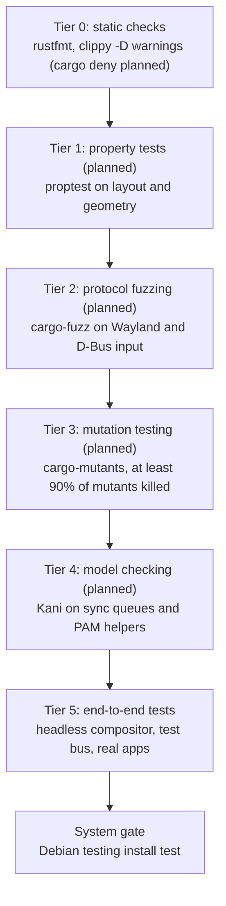

# CI and verification

## Runners

The gating workflow, `release.yml`, runs on GitHub-hosted runners only: `ubuntu-24.04-arm` for
arm64 and `ubuntu-24.04` for amd64. Every job runs in a `debian:testing` container, so packages
are built and tested against the Debian release they ship for, and every job installs what it
needs with `ci/apt-install.sh` (the build libraries are listed in `ci/release/build-depends`)
and the toolchain pinned in `rust-toolchain.toml` with Debian's `rustup`.

There are no self-hosted runners and no other workflow. Everything else (fmt, workspace clippy
and the workspace tests on a hermetic session bus) runs locally before every merge to `main`,
through `~/bande-linux/bin/desktop-gate` on the build machine.

The repository is public, so only maintainers start runs: `release.yml` runs on a version
tag and on dispatch, never on pushes or pull requests.

## Headless graphics

- **Lavapipe**: Mesa's CPU Vulkan runs directly in the job containers and needs no kernel
  support. Jobs install `mesa-vulkan-drivers` and `libvulkan1`; lavapipe is then the only Vulkan
  device in the container. The renderer accepts any Vulkan adapter, and the render test prints
  the one it ran on.
- **VKMS**: virtual CRTCs, planes, connectors and vblank timers, so Smithay performs real atomic
  modesetting without a GPU. It runs inside a QEMU/KVM guest, not in the job containers: a
  container cannot load kernel modules, and neither Debian 12's nor Debian 13's stock kernel
  ships `vkms`. The guest boots a kernel built with `CONFIG_DRM_VKMS`.
- **Offscreen rendering**: the compositor renders into an offscreen image, so its tests run
  with no screen attached. Tests assert behaviour (focus, keys, protocol events, the
  accessibility tree), never pixels against stored images; see
  [`../quality/tests.md`](../quality/tests.md).

## Release workflow (`.github/workflows/release.yml`)

`release.yml` runs when a version is tagged (`git tag vX.Y.Z && git push origin vX.Y.Z`) and
when dispatched by hand for a test build (`gh workflow run release.yml --ref <branch>`). A newer
run on the same ref cancels the older one. Only a tag's run is published, and `deb-all` fails a tag
whose commit is not on `main`. Day-to-day correctness still comes from the local gate (`cargo fmt --check`, workspace
clippy with `-D warnings`, and the workspace tests on the hermetic bus) before every push to
`main`. The packaging steps are scripts in `ci/release/`, so the same build and checks run
natively on a developer machine:

```bash
ci/release/build-debs.sh && ci/release/check-debs.sh && ci/release/smoke.sh
ci/release/build-all.sh
```

Jobs:

- `lint` (arm64): `actionlint` with shellcheck over the workflows, then `ci/release/lint.sh`:
  `cargo fmt --all --check`, `cargo clippy --workspace --all-targets --locked -- -D warnings`,
  and the dependency rules: no session service except the polkit agent, which shows a dialog,
  depends on the widget crates, and the graphics and widget crates stay off Wayland.
- `test` (arm64): `cargo test --workspace`, the few tests listed in
  [`../quality/tests.md`](../quality/tests.md), on lavapipe. D-Bus tests start a private
  `dbus-daemon` session bus each (`crates/testing/test-bus`) from
  `crates/testing/test-bus/data/session.conf`, which lists no service directories: a test bus
  never D-Bus-activates the services installed on the machine (an installed `bande-config`
  would read the developer's own `config.kdl` and post into the test), so a test talks only to
  the services it starts itself. To run tests the same way on a machine with a live Bande
  session, wrap them in a bus from that file:
  `dbus-run-session --config-file=crates/testing/test-bus/data/session.conf -- cargo test -p <package>`.
- `debs (arm64)`, `debs (amd64)`: each on its native runner, `ci/release/build-debs.sh` runs
  `cargo build --profile dist` for the crates in `ci/release/packages` and `cargo deb` for each
  at the version from `ci/deb/version.sh`. cargo-deb takes the architecture from the native
  target and the shared-library dependencies from Debian testing's `dpkg-shlibdeps`.
  `ci/release/check-debs.sh` checks that every package is there for `dpkg --print-architecture`
  at that version with no build paths inside, the D-Bus activation files, the user units, the
  portal backend's registration and the login session; `ci/release/smoke.sh` starts the
  packaged settings service on a private bus to read a property and the packaged compositor
  headless. The job uploads `bande-debs-<arch>`.
- `deb-all`: `ci/release/build-all.sh` builds the architecture-independent meta-package
  `bande-desktop`, checks that it pins its packages at the build's version, that it depends on
  `bande-greeter | x-display-manager` and `pipewire-audio` and recommends `bande-greeter`,
  `network-manager`, `bande-apt-source` and `systemd-zram-generator`, and lints it with
  `lintian`. It uploads
  `bande-debs-all`. The APT source and keyring packages are built by the APT repository
  itself.
- `install (arm64)`, `install (amd64)`: in a clean `debian:testing` on the native runner,
  `ci/deb/install-test/run.sh` installs `bande-desktop` from that architecture's packages and
  the `all` packages alone without recommends and checks that it brings the login window,
  greetd and PipeWire, then installs every package and checks that they have the same version,
  that every package it recommends has an installation candidate (`bande-apt-source` comes from
  the APT repository), that no X server, XWayland or X session came along, that greetd is the
  display manager with the Bande login window, the greeter's wallpaper permissions, and that the
  installed compositor serves Wayland clients. Last, next to LightDM: installing the greeter keeps
  LightDM the default and offers greetd, `dpkg-reconfigure greetd` switches to it, removing
  greetd hands the display back to LightDM.
  `ci/deb/install-test/portal-frontend.sh` then reads the colour scheme through Debian's
  `xdg-desktop-portal` and checks it follows `config.kdl`.
The APT repository publishes on its own: every 30 minutes it looks for new green `release.yml`
runs for tags and takes their `bande-debs-arm64`, `bande-debs-amd64` and
`bande-debs-all` artifacts into the `main` component of its `rolling` suite. It refuses a run
whose architectures do not carry the same packages at the tag's version, and after each deploy
it installs `bande-desktop` from the live site on amd64 and on arm64 and checks that every
package is that architecture's build (or `all`) at the published version
([`bande-linux/apt`](https://github.com/bande-linux/apt)).

Versions come from `ci/deb/version.sh`. A tag `vX.Y.Z` builds version `X.Y.Z` and must equal
the `[workspace.package] version` in `Cargo.toml`, so a release is: bump the version, merge to
`main`, tag. Test builds and local builds get `X.Y.Z+gitDATE.COUNT.sha`, counted from the last
tag, which sorts above that tag and below the next.

Hosted runners start from a clean machine, so `Swatinem/rust-cache` restores the cargo
registry, the installed `cargo-deb` and the target directory, keyed per job and architecture
and saved only from runs on `main`, whose caches every branch and tag can read. The `test` and `debs` jobs first free disk on the host by emptying
the .NET, Android and GHC installations they mount, and `debs` builds two crates at a time so
the fat-LTO links stay within the runner's memory.

## Planned infrastructure

- **Full login in the VM** (not built): boot the guest into `greetd`, log in through PAM with
  synthetic credentials, check that `pam_systemd` hands the seat over and that
  `bande-compositor` claims `seat0`, and grab the screen over QMP to check that the greeter
  and the shell render.
- **Real hardware**: boot tests on an Apple Silicon Mac running Bande follow once the
  hardware test rig has its own runner.

## Verification funnel

Every change passes a series of gates, cheapest first. Tiers marked *planned* are not in the
workflow yet.



1. **Tier 0, static checks** (implemented: `lint`): `cargo fmt --check` and
   `cargo clippy --workspace --all-targets -- -D warnings`. Planned: `cargo deny check` for
   licences and unvetted crates.
2. **Tier 1, property tests** (planned): `proptest` over layout algorithms, coordinate
   transforms and fractional scaling at edge-case geometry.
3. **Tier 2, fuzzing** (planned): continuous fuzzing of Wayland wire deserializers and D-Bus
   methods.
4. **Tier 3, mutation testing** (planned): `cargo-mutants` mutates the code (swapped operators,
   functions replaced by defaults); a change is blocked if more than 10% of mutants survive, so
   tests must assert real behaviour.
5. **Tier 4, formal verification** (planned): Kani proofs of panic freedom and invariants in
   explicit-sync buffer queues and PAM helpers.
6. **Tier 5, end-to-end tests** (implemented: `test`): a couple of scenarios per app or
   feature and the security regressions, listed in [`../quality/tests.md`](../quality/tests.md).
7. **System gate** (partly implemented: `install`): packages install into a clean Debian
   testing. Running the compositor and shell on real DRM in a KVM guest and the full
   `greetd` → PAM → compositor login are planned (see above).
