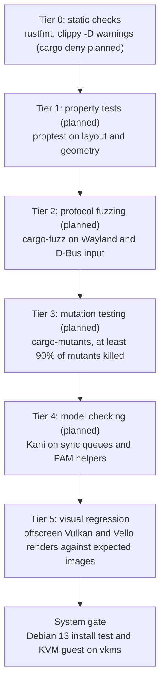

# CI and verification

## Runners

All CI runs on the organization's self-hosted runners: Docker containers on two Apple Silicon
Macs, the M4 Mac mini and the laptop, four on each (setup:
[`unbound-linux/runners`](https://github.com/unbound-linux/runners)). Three per Mac carry the
labels `self-hosted, Linux, ARM64, unbound` and run builds and tests; workflows select them with
`runs-on: [self-hosted, unbound]`. The fourth carries `unbound-kvm`, has `/dev/kvm` and runs the
jobs that boot a KVM guest (`runs-on: [self-hosted, unbound-kvm]`). GitHub gives each job to any
free runner with matching labels, so pushing a branch is how it is tested; with the laptop off,
everything runs on the mini. Builds and tests run natively on arm64, the architecture Unbound
targets.

The Rust toolchain is pinned in `rust-toolchain.toml`, dependencies are pinned to exact versions,
and `Cargo.lock` is committed. Jobs install system packages with `apt-get` on the runner image
(Ubuntu 24.04), so `.deb` files are built against Ubuntu's glibc rather than Debian 13's, until
the `ci-builder` image below exists.

## Headless graphics

- **Lavapipe**: Mesa's CPU Vulkan runs directly in the job containers and needs no kernel
  support. Jobs install `mesa-vulkan-drivers` and `libvulkan1`; lavapipe is then the only Vulkan
  device in the container. The renderer accepts any Vulkan adapter, and the render test prints
  the one it ran on.
- **VKMS**: virtual CRTCs, planes, connectors and vblank timers, so Smithay performs real atomic
  modesetting without a GPU. It runs inside a QEMU/KVM guest, not in the job containers: the
  runners' Docker engine kernel cannot load modules, and neither Debian 12's nor Debian 13's
  stock kernel ships `vkms`. The guest boots a kernel built with `CONFIG_DRM_VKMS`.
- **Offscreen rendering**: the compositor renders into an offscreen image that tests read back,
  so geometry, damage tracking and pixels are checked with no screen attached.
- **Visual regression**: render tests compare against expected images. The compositor's
  baselines live next to the tests (`crates/<crate>/tests/golden/*.png`) and are computed from
  the scene description, not captured from the renderer; a test asserts SSIM ≥ 0.995 and bounds
  every channel to within 2 of the baseline, since SSIM alone tolerates small uniform colour
  shifts. The toolkit computes its expected images in the test (see `ci/lavapipe-test` below).
  On failure CI uploads the rendered frames.

## Workflow (`.github/workflows/ci.yml`)

Runs on every push to any branch, on pull requests and on manual dispatch. Job names are the
status-check contexts:

- `ci/lint`: `cargo fmt --all --check` and
  `cargo clippy --workspace --all-targets --locked -- -D warnings`.
- `ci/lavapipe-test`: `cargo test --workspace`, including the compositor and toolkit render
  tests on lavapipe. D-Bus tests start a private `dbus-daemon` session bus each
  (`crates/testing/test-bus`). The toolkit's render tests use Inter (`fonts-inter`) and Noto
  Sans CJK (`fonts-noto-cjk`) through fontconfig; their expected images are computed in the test
  from the scene (exact area coverage of shapes and of glyph outlines read with `ab_glyph`,
  Gaussian shadows by numeric integration), so they depend neither on Vello nor on the font
  version, and both renderers must match them.
- `ci/deb`: `cargo deb --profile dist` for every packaged crate (compositor, session services, portal backend,
  shell clients and apps), then checks each package's architecture and version, the D-Bus
  activation files, the user units, the portal backend's registration and the login session,
  starts the packaged settings service on a private bus to read a property, starts the packaged
  compositor as a smoke test, and uploads the `.deb` files as artifacts.
- `ci/deb-all`: builds the architecture-independent packages (`unbound-desktop`, the APT source
  and keyring packages), lints them with `lintian` and checks the repository configuration and
  signing key.
- `ci/deb-install`: installs `unbound-desktop` from the built packages alone into a clean
  Debian 13 container and checks that every package has the same version, that no X server,
  XWayland or X session came along, and that every packaged program and the Wayland session
  file are in place.
- `ci/vm` (on an `unbound-kvm` runner): builds or reuses a guest kernel with vkms and a
  Debian 13 root image, and runs the workspace's `guest` test executables in a KVM guest with
  vkms and virtio-gpu, on real DRM. Guest screendumps are uploaded as artifacts.
- `ci/polkit`: builds the `unbound-polkit` polkitd test, starts a Debian 13 container (through
  the runner's Docker socket) with a system bus, polkitd, a test action and a user with a random
  password, and runs the test there: `pkcheck` must be authorized after the agent enters the
  password, after a wrong password and a retry, and must be refused when the dialog is
  cancelled.
- `ci/portal`: after `ci/deb`, installs the `unbound-config` and `xdg-desktop-portal-unbound`
  packages with Debian 13's `xdg-desktop-portal` in a container and checks the colour scheme
  the frontend reports follows `config.kdl`.
- `ci/perf` (on `main`, and on a branch commit whose message contains `[perf]`): takes the
  release `unbound-compositor` that `ci/deb` packages, with `unbound-bench` and `unbound-sample`
  built alongside it, and measures frame times (also while the overview opens and closes over
  20 windows, when nothing but a window title may be uploaded), compositor start time and idle
  memory on lavapipe, for the compositor and for the toolkit sample; it gates the exact work counts and
  idle memory and reports the wall-clock numbers against the budgets in
  [`../decisions/0001-rendering.md`](../decisions/0001-rendering.md); the tables go to the job
  summary and `perf.json` and `perf-toolkit.json` are uploaded.
- `ci/publish` (on `main`, and on a manually dispatched tag): when every job above is green,
  starts the publish of the packages in `unbound-linux/apt` (the testing channel).

`.github/workflows/release.yml` (`release/promote`) runs on a version tag: it finds the green
`main` build of the tagged commit and starts the release publish in `unbound-linux/apt`.

`ci/hil` holds scripts for hardware-in-the-loop tests that boot a guest test on an Apple Silicon
Mac over debug USB; they are not part of the workflow.

## Compilation cache

Jobs build through `sccache` (`RUSTC_WRAPPER: sccache`). Each runner keeps the cache in a
Docker volume that persists between jobs:

```env
SCCACHE_DIR=/cache/sccache
SCCACHE_CACHE_SIZE=50G
```

## Planned infrastructure

- **`ci-builder` image** (not built): `ghcr.io/unbound-linux/ci-builder:latest` for
  `linux/arm64`, with Debian 13, the pinned Rust toolchain, Mesa lavapipe, `sccache`,
  `cargo-deb`, `cargo-mutants` and `kani-verifier`, rebuilt weekly and on toolchain updates.
- **Full login in the VM** (not built): boot the guest into `greetd`, log in through PAM with
  synthetic credentials, check that `pam_systemd` hands the seat over and that
  `unbound-compositor` claims `seat0`, and grab the screen over QMP to check that the greeter
  and the shell render. Today `ci/vm` runs test executables in the guest instead of a full
  login.
- **Real hardware**: boot tests on an Apple Silicon Mac running Unbound follow once the
  hardware test rig has its own runner.

## Verification funnel

Every change passes a series of gates, cheapest first. Tiers marked *planned* are not in the
workflow yet.



1. **Tier 0, static checks** (implemented: `ci/lint`): `cargo fmt --check` and
   `cargo clippy --workspace --all-targets -- -D warnings`. Planned: `cargo deny check` for
   licences and unvetted crates.
2. **Tier 1, property tests** (planned): `proptest` over layout algorithms, coordinate
   transforms and fractional scaling at edge-case geometry.
3. **Tier 2, fuzzing** (planned): continuous fuzzing of Wayland wire deserializers and D-Bus
   methods.
4. **Tier 3, mutation testing** (planned): `cargo-mutants` mutates the code (swapped operators,
   functions replaced by defaults); a change is blocked if more than 10% of mutants survive, so
   tests must assert real behaviour.
5. **Tier 4, formal verification** (planned): Kani proofs of panic freedom and invariants in
   explicit-sync buffer queues and PAM helpers.
6. **Tier 5, visual regression** (implemented: `ci/lavapipe-test`): offscreen renders compared
   with expected images, SSIM ≥ 0.995 for the compositor, computed coverage for the toolkit.
7. **System gate** (partly implemented: `ci/deb-install`, `ci/vm`): packages install into a
   clean Debian 13, and the compositor and shell run on real DRM in a KVM guest. The full
   `greetd` → PAM → compositor login is planned (see above).
