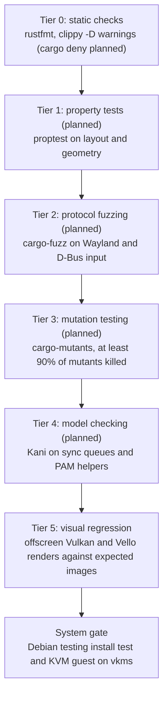

# CI and verification

## Runners

The gating workflow, `release.yml`, runs on GitHub-hosted runners only: `ubuntu-24.04-arm` for
arm64 and `ubuntu-24.04` for amd64. Every job runs in a `debian:testing` container, so packages
are built and tested against the Debian release they ship for, and every job installs what it
needs with `ci/apt-install.sh` (the build libraries are listed in `ci/release/build-depends`)
and the toolchain pinned in `rust-toolchain.toml` with Debian's `rustup`.

The non-gating `extended.yml` keeps the jobs that need a KVM guest or a Docker engine on the
organization's self-hosted runners, Docker containers on Apple Silicon (setup:
[`bande-linux/runners`](https://github.com/bande-linux/runners)): `bande-runner-1` and
`bande-runner-2` carry `self-hosted, Linux, ARM64, bande`, and `bande-runner-kvm`
carries `bande-kvm` and has `/dev/kvm`.

The repository will be public, so only maintainers start runs: `release.yml` runs on a version
tag and on dispatch, `extended.yml` on dispatch only, and neither runs on pull requests.

## Headless graphics

- **Lavapipe**: Mesa's CPU Vulkan runs directly in the job containers and needs no kernel
  support. Jobs install `mesa-vulkan-drivers` and `libvulkan1`; lavapipe is then the only Vulkan
  device in the container. The renderer accepts any Vulkan adapter, and the render test prints
  the one it ran on.
- **VKMS**: virtual CRTCs, planes, connectors and vblank timers, so Smithay performs real atomic
  modesetting without a GPU. It runs inside a QEMU/KVM guest, not in the job containers: a
  container cannot load kernel modules, and neither Debian 12's nor Debian 13's stock kernel
  ships `vkms`. The guest boots a kernel built with `CONFIG_DRM_VKMS`.
- **Offscreen rendering**: the compositor renders into an offscreen image that tests read back,
  so geometry, damage tracking and pixels are checked with no screen attached.
- **Visual regression**: render tests compare against expected images. The compositor's
  baselines live next to the tests (`crates/<crate>/tests/golden/*.png`) and are computed from
  the scene description, not captured from the renderer; a test asserts SSIM ≥ 0.995 and bounds
  every channel to within 2 of the baseline, since SSIM alone tolerates small uniform colour
  shifts. The toolkit computes its expected images in the test (see the `test` job below).
  On failure CI uploads the rendered frames.

## Release workflow (`.github/workflows/release.yml`)

`release.yml` runs when a version is tagged (`git tag vX.Y.Z && git push origin vX.Y.Z`) and
when dispatched by hand for a test build (`gh workflow run release.yml --ref <branch>`). A newer
run on the same ref cancels the older one. Only a tag's run is published, and `deb-all` fails a tag
whose commit is not on `main`. Day-to-day correctness still comes from the local gate (`cargo fmt --check`, workspace
clippy with `-D warnings`, and the workspace tests on the hermetic bus) before every push to
`main`. The packaging steps are scripts in `ci/release/`, so the same build and checks run
natively on a developer machine:

```bash
ci/release/build-debs.sh && ci/release/check-debs.sh && ci/release/smoke.sh
ci/release/build-all.sh
```

Jobs:

- `lint` (arm64): `actionlint` with shellcheck over the workflows, then `ci/release/lint.sh`:
  `cargo fmt --all --check`, `cargo clippy --workspace --all-targets --locked -- -D warnings`,
  and the dependency rules: no session service except the polkit agent, which shows a dialog,
  depends on the widget crates, and the graphics and widget crates stay off Wayland.
- `test` (arm64): `cargo test --workspace`, including the compositor and toolkit render
  tests on lavapipe. D-Bus tests start a private `dbus-daemon` session bus each
  (`crates/testing/test-bus`) from `crates/testing/test-bus/data/session.conf`, which lists no
  service directories: a test bus never D-Bus-activates the services installed on the machine
  (an installed `bande-config` would read the developer's own `config.kdl` and post into the
  test), so a test talks only to the services it starts itself. To run tests the same way on a
  machine with a live Bande session, wrap them in a bus from that file, which also keeps the
  session's portal settings out of the goldens:
  `dbus-run-session --config-file=crates/testing/test-bus/data/session.conf -- cargo test -p <package>`.
  The toolkit's render tests use Inter (`fonts-inter`) and Noto Sans CJK (`fonts-noto-cjk`)
  through fontconfig; their expected images are computed in the test from the scene (exact
  area coverage of shapes and of glyph outlines read with `ab_glyph`, Gaussian shadows by
  numeric integration), so they depend neither on Vello nor on the font version, and both
  renderers must match them. The apps' and shell's goldens are images rendered on Debian 13
  and do depend on the fonts, so `ci/debian-fonts.sh` installs Debian 13's own font packages
  (DejaVu, Inter, Manrope, JetBrains Mono, Noto Sans CJK, Noto Color Emoji), pinned by version
  and checksum. Updating a pin means regenerating the goldens with `BANDE_UPDATE_GOLDENS=1`.
  On failure the job uploads the rendered frames.
- `debs (arm64)`, `debs (amd64)`: each on its native runner, `ci/release/build-debs.sh` runs
  `cargo build --profile dist` for the crates in `ci/release/packages` and `cargo deb` for each
  at the version from `ci/deb/version.sh`. cargo-deb takes the architecture from the native
  target and the shared-library dependencies from Debian testing's `dpkg-shlibdeps`.
  `ci/release/check-debs.sh` checks that every package is there for `dpkg --print-architecture`
  at that version with no build paths inside, the D-Bus activation files, the user units, the
  portal backend's registration and the login session; `ci/release/smoke.sh` starts the
  packaged settings service on a private bus to read a property and the packaged compositor
  headless. The job uploads `bande-debs-<arch>`.
- `deb-all`: `ci/release/build-all.sh` builds the architecture-independent packages
  (`bande-desktop`, `bande-os`, the APT source and keyring), checks that the meta-packages
  pin their packages at the build's version, that `bande-desktop` never depends on
  `bande-os`, the APT source, pin and signing key, and lints them with `lintian`. It
  uploads `bande-debs-all`.
- `install (arm64)`, `install (amd64)`: in a clean `debian:testing` on the native runner,
  `ci/deb/install-test/run.sh` installs `bande-desktop` from that architecture's packages and
  the `all` packages alone, checks that every package has the same version, that every app it
  recommends has an installation candidate, that no X server, XWayland or X session came
  along, the greetd setup and the greeter's wallpaper permissions, that the installed
  compositor serves Wayland clients, then installs `bande-os` and checks the APT source.
  `crates/services/portal/tests/frontend/run.sh` then reads the colour scheme through Debian's
  `xdg-desktop-portal` and checks it follows `config.kdl`.
The APT repository publishes on its own: every 30 minutes it looks for new green `release.yml`
runs for tags and takes their `bande-debs-arm64`, `bande-debs-amd64` and
`bande-debs-all` artifacts into the `main` component of its `rolling` suite.

Versions come from `ci/deb/version.sh`. A tag `vX.Y.Z` builds version `X.Y.Z` and must equal
the `[workspace.package] version` in `Cargo.toml`, so a release is: bump the version, merge to
`main`, tag. Test builds and local builds get `X.Y.Z+gitDATE.COUNT.sha`, counted from the last
tag, which sorts above that tag and below the next.

Hosted runners start from a clean machine, so `Swatinem/rust-cache` restores the cargo
registry, the installed `cargo-deb` and the target directory, keyed per job and architecture
and saved only from runs on `main`, whose caches every branch and tag can read. The `test` and `debs` jobs first free disk on the host by emptying
the .NET, Android and GHC installations they mount, and `debs` builds two crates at a time so
the fat-LTO links stay within the runner's memory.

## Extended workflow (`.github/workflows/extended.yml`)

Dispatched by hand (`gh workflow run extended.yml --ref <branch>`), on the self-hosted runners;
it gates nothing:

- `ci/vm` (on an `bande-kvm` runner): builds or reuses a guest kernel with vkms and a
  Debian 13 root image, and runs the workspace's `guest` test executables in a KVM guest with
  vkms and virtio-gpu, on real DRM. Guest screendumps are uploaded as artifacts.
- `ci/polkit`: builds the `bande-polkit` polkitd test, starts a Debian testing container
  (through the runner's Docker socket) with a system bus, polkitd, a test action and a user
  with a random password, and runs the test there: `pkcheck` must be authorized after the
  agent enters the password, after a wrong password and a retry, and must be refused when the
  dialog is cancelled.
- `ci/perf`: builds the release binaries with `bande-bench` and `bande-sample`, and
  measures frame times (also while the overview opens and closes over 20 windows, when nothing
  but a window title may be uploaded), compositor start time and idle memory on lavapipe, for
  the compositor and for the toolkit sample; it gates the exact work counts and idle memory and
  reports the wall-clock numbers against the budgets in
  [`../decisions/0001-rendering.md`](../decisions/0001-rendering.md); the tables go to the job
  summary and `perf.json` and `perf-toolkit.json` are uploaded.

Jobs on the self-hosted runners first run `ci/target-dir.sh`, which links the workspace's
`target` to a directory that persists on the runner, `/cache/target/<runner>/<toolchain>`, and
compile through `sccache` (`RUSTC_WRAPPER: sccache`, cached in a Docker volume per runner).

`ci/hil` holds scripts for hardware-in-the-loop tests that boot a guest test on an Apple Silicon
Mac over debug USB; they are not part of either workflow.

## Planned infrastructure

- **Full login in the VM** (not built): boot the guest into `greetd`, log in through PAM with
  synthetic credentials, check that `pam_systemd` hands the seat over and that
  `bande-compositor` claims `seat0`, and grab the screen over QMP to check that the greeter
  and the shell render. Today `ci/vm` runs test executables in the guest instead of a full
  login.
- **Real hardware**: boot tests on an Apple Silicon Mac running Bande follow once the
  hardware test rig has its own runner.

## Verification funnel

Every change passes a series of gates, cheapest first. Tiers marked *planned* are not in the
workflow yet.



1. **Tier 0, static checks** (implemented: `lint`): `cargo fmt --check` and
   `cargo clippy --workspace --all-targets -- -D warnings`. Planned: `cargo deny check` for
   licences and unvetted crates.
2. **Tier 1, property tests** (planned): `proptest` over layout algorithms, coordinate
   transforms and fractional scaling at edge-case geometry.
3. **Tier 2, fuzzing** (planned): continuous fuzzing of Wayland wire deserializers and D-Bus
   methods.
4. **Tier 3, mutation testing** (planned): `cargo-mutants` mutates the code (swapped operators,
   functions replaced by defaults); a change is blocked if more than 10% of mutants survive, so
   tests must assert real behaviour.
5. **Tier 4, formal verification** (planned): Kani proofs of panic freedom and invariants in
   explicit-sync buffer queues and PAM helpers.
6. **Tier 5, visual regression** (implemented: `test`): offscreen renders compared
   with expected images, SSIM ≥ 0.995 for the compositor, computed coverage for the toolkit.
7. **System gate** (partly implemented: `install`, `ci/vm`): packages install into a
   clean Debian testing, and the compositor and shell run on real DRM in a KVM guest. The full
   `greetd` → PAM → compositor login is planned (see above).
