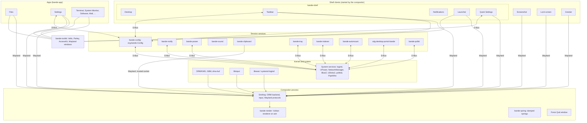

# Architecture overview

## Goal

Bande (`bande-desktop`) is a Linux desktop environment written in Rust for Debian 14 (forky) on
amd64 and arm64. It has its own structure, feature set and look, and aims to feel polished, smooth and finished
in every basic a modern desktop needs. The principles that decide
design questions are in [`../design/DESIGN.md`](../design/DESIGN.md).

Bande lives in one Cargo workspace in this repository: compositor, renderer, toolkit, shell
clients, session services, every app, libraries and test harnesses. Its layout is recorded in
[`../decisions/0003-repository-layout.md`](../decisions/0003-repository-layout.md); the apps are
in [apps.md](apps.md).

The architecture is split by subject:

| Document | Subject |
| :--- | :--- |
| [`compositor.md`](compositor.md) | the compositor, its renderer, frame pacing and the Wayland protocol matrix |
| [`toolkit.md`](toolkit.md) | the UI toolkit that the shell and the apps draw with |
| [`session.md`](session.md) | session services, D-Bus, the greeter, supervision and updates |
| [`behaviour.md`](behaviour.md) | recorded behaviour decisions and their reasons |
| [`apps.md`](apps.md) | the app framework every app is built on |
| [`ci.md`](ci.md) | the local gate, the release workflow and how a release is cut |
| [`packaging.md`](packaging.md) | Debian packages and the meta-package |
| [`performance.md`](performance.md) | how to measure memory, CPU and wake-ups, and the current numbers |
| [`localisation.md`](localisation.md) | translatable strings, catalogs and the language packs |
| [`fault-reports.md`](fault-reports.md) | crash and hang reports, their sending and the report protocol |
| [`lookup.md`](lookup.md) | the Dictionary app, Look Up and the dictionary packs |
| [`glossary.md`](glossary.md) | the names of the taskbar's parts |

## Component map



The desktop and the taskbar of every display, the notifications, Quick Settings and the
launcher are one process, `bande-shell` (`crates/shell/shell`), with one Wayland connection, one
GPU device, one font database and one connection per D-Bus bus. Each part is a library crate
(`bande-desktop-surface`, `bande-bar`, `bande-notifications`, `bande-quick-settings`,
`bande-launcher`) whose surfaces the shell hosts; the taskbar's models live in
`bande-taskbar-model` and `bande-status` (`crates/libs`).

## Process model

Bande has four kinds of component, split by the role a process plays, not by whether the user
thinks of it as part of the system:

- **Compositor.** One process, `bande-compositor`, owns the display, input and every Wayland
  surface. It renders with its own renderer (`bande-render`) and draws what must work when
  every client hangs: Force Quit, the window menu, the switcher and overview, and title bars
  for apps that ask for server-side ones. Everything else is drawn by clients.
- **Shell clients.** Wayland clients that make up the desktop around the apps: the shell (desktop,
  taskbar, notifications, launcher, Quick Settings), the screenshot tool, the lock screen
  and the greeter. The compositor starts them on
  socket pairs and restarts them when they exit; only these connections see the private
  `bande_shell_v1` protocol and `ext-foreign-toplevel-list-v1`
  ([behaviour](behaviour.md)).
- **Apps.** Ordinary Wayland clients started by the user, each one process for all its windows
  on `bande-app` ([apps](apps.md)).
  Settings and System Monitor have no special access. Closing an app's last window leaves it
  running until Quit.
- **Session services.** Processes without windows that own D-Bus names for the session
  (configuration, notifications, power, sound, clipboard, tray, automount, portal, polkit). They are
  started by systemd user units or D-Bus activation ([session](session.md)).

Shared code that is not UI lives in `crates/libs` (`bande-xdg`, `bande-fs`, `bande-audio`,
`bande-network`, `bande-bluetooth`, `bande-printers`, `bande-packages`, `bande-spring` and more), and the shell
and apps draw with `bande-toolkit`.

## Inter-process communication

- **Wayland** carries everything about surfaces, buffers, input, focus, clipboard and drag and
  drop. Buffers travel as `wl_shm` or `linux-dmabuf-v1` file descriptors; there is no separate
  data-plane socket. Desktop-specific requests between the compositor and the shell go through
  `bande_shell_v1` (`crates/platform/protocols`).
- **D-Bus via `zbus`** carries policy, state and desktop integration: the `org.freedesktop.*`
  standards and the `org.bande.*` interfaces Bande owns. Every interface can be inspected
  with `busctl`. The matrix is in [session.md](session.md#d-bus-integration).

## Pure Wayland: no X11

Bande is a Wayland-only desktop by design:

- **Rule**: No X11 code, X libraries, X server or XWayland bridge in any component: compositor,
  shell, toolkit, services or packaging.
- **Not built**: An `xwayland-satellite` bridge (or Smithay's `xwayland`/`xwm` features) is
  deliberately not built. Apps are expected to run natively on Wayland (GTK, Qt, Firefox,
  Chromium, SDL and winit all do).
- **X11-only apps**: `bande_packages::x11` treats a package as X11-only when it needs an X11
  library or a desktop Java runtime and no Wayland toolkit, and treats the Minecraft launcher and
  MultiMC, whose games open only on X11, the same way. Software leaves such apps out, the Package
  Installer says so before installing (Install Anyway is a second, warned choice), and an app of
  such a package that quits or crashes while opening says it needs X11.
- **Compose tables**: `bande-desktop` depends on Debian's `libx11-data`, which is text files and no
  library: the Compose tables xkbcommon reads for dead keys are packaged there.
- **Why**: Every frame, input event and protocol path stays on one modern stack with one
  security model, and nothing in the latency budget pays for X11 translation.

## Keyboard model

Ctrl runs shortcuts inside apps and Super
belongs to the system ([decision 0005](../decisions/0005-ctrl-for-app-shortcuts.md)). Bande's
own apps and third-party apps use the same keys, so the compositor translates nothing.

| Modifier | Role | Examples |
| :--- | :--- | :--- |
| **`Ctrl`** | Shortcuts inside apps and text fields | `Ctrl+C` (copy), `Ctrl+V` (paste), `Ctrl+X` (cut), `Ctrl+Z` (undo), `Ctrl+W` (close window), `Ctrl+Q` (quit), `Ctrl+F` (find), `Ctrl+click` (toggle an item in a selection) |
| **`Super`** | The system only, never an app action | a tap of `Super` (Search), `Super+arrows` (tiling), `Super+H` (minimize), `Super+L` (lock), `Super+W` (overview), `Super+D` (desktop), `Super+V` (clipboard history), `Super+.` (emoji), `Super+N` and `Super+S` (notifications, Quick Settings), `Ctrl+Super+Left/Right` (workspaces), `Shift+Ctrl+Super+Left/Right` (move the window to a workspace), Super+drag (move a window) |
| **`Alt`** | Navigation in apps, alternate actions | `Alt+Left/Right` (back and forward), `Alt+Up` (enclosing folder), `Alt+F4` (close window), `Alt+Space` (window menu), `Alt+Tab` (switcher), `Alt+Click` (toggle disclosure) |
| **`Shift`** | Reversal, extending a selection, the second set of commands | `Shift+Ctrl+Z` (redo), `Shift+Ctrl+N` (new folder), Terminal's `Shift+Ctrl+C/V`, `Shift+Drag` (move) |

- **Screenshots and Terminal**: `Print` (options), `Shift+Print` (the screen),
  `Shift+Super+S` (an area), `Ctrl+Alt+T` (Terminal), `Ctrl+Alt+Esc` (Force Quit). The
  whole system set is `SHORTCUTS` in `crates/libs/keyboard/src/shortcuts.rs`, which the
  compositor matches against and Settings ▸ Keyboard lists.
- **Drag and drop**: `Ctrl` copies and `Shift` moves.

- **Text fields**: `Ctrl+Left/Right` move by word, `Home`/`End` to the line ends,
  `Ctrl+Home/End` to the text ends, `Ctrl+Up/Down` by paragraph, and `Ctrl+Backspace/Delete`
  delete a word; `Shift` extends the selection. `Ctrl+Y` also redoes. Alt and Super are not used
  in text fields.
- **Terminal**: every plain `Ctrl+letter` goes to the shell (`Ctrl+C` interrupts, `Ctrl+D` ends
  input), so the Terminal's own commands are on `Shift+Ctrl`. Find Next is therefore
  `Shift+Ctrl+G`, so Find Previous, `Shift+Ctrl+G` in other apps, is `Shift+Ctrl+H` there.
- **Menus** write shortcuts as words in the order Shift, Ctrl, Alt, Super: "Shift+Ctrl+N",
  "Alt+Super+8".

## Configuration

All user configuration of the desktop is one human-readable [KDL](https://kdl.dev) file,
`$XDG_CONFIG_HOME/bande/config.kdl` (`~/.config/bande/config.kdl`). Every Settings control writes
to it, and it can be edited by hand while the session runs. Apps keep their own settings in one
small `key = value` file each next to it (`files.conf`, `terminal.conf`).

- **Schema** (`crates/services/config`, KDL 2.0): top-level `appearance`, `style`, `accent`,
  `tinted-frame`, `clock`, `reopen-apps`, `remember-recent-files`, `check-updates-automatically`, `automatic-updates`, `update-check-every`, `lock-message`, `show-previews`, and the sections
  `accessibility`, `bar`, `idle`, `keyboard`, `trackpad`, `mouse`, `power`, `sound`, `wallpaper`,
  `night-light`, `do-not-disturb`, `search`, `display "<name>"` (one per display, named by EDID maker, model and serial) and
  `arrangement` (one per set of displays). Every setting is optional and has a default.
  ```kdl
  appearance "dark"             // "dark" (default) | "light" | "automatic"
  bar { edge "left"; size 40; auto-hide #false; floating #true; gap 8 }   // edge "left" | "bottom" | "right" | "top"
  idle { screen-saver-after "5m"; display-off-after "10m"; require-password-after "immediately"; display-off-after-on-battery "5m" }   // or "never"; suspend-after and suspend-after-on-battery follow the display unless set
  keyboard { input-sources "se" "us(dvorak)"; caps-lock "escape"; compose "right-alt"; system-switch #false }   // caps-lock and compose follow XKBOPTIONS unless set (compose "system" is the same as unset); system-switch #false drops its grp: options
  trackpad { tap-to-click #true; natural-scrolling #true }
  search { recent-documents #false; exclude "~/Private" }   // every category is shown unless #false
  display "Example EX27 0001" { scale 1.5; refresh-rate 120; variable-refresh #false }   // variable refresh is on unless #false
  arrangement {
      display "Example Panel 0002" x=0 y=0 main=#true
      display "Example EX27 0001" x=1504 y=-300
  }
  ```
- **Errors**: an unknown setting, a duplicate or an out-of-range value is skipped and reported
  with its line and column while every other setting applies; a file that is not KDL keeps the
  active configuration. `bande-config` posts the errors as one notification with an "Open in
  Editor" action, once per distinct set of errors.
- **Live reload**: the service watches the directory, parses a changed file into a shadow copy
  and swaps it in atomically, so readers never see a mix.
- **`org.bande.Config`** (`/org/bande/Config`, session bus) serves every value as a property and
  signals only the properties that changed. The scalar properties are writable, and
  `SetDisplay` and `SetArrangement` replace one display's settings or one arrangement.
  `TryDisplay` changes one display on trial: the settings before the trial are kept in
  `$XDG_STATE_HOME/bande/display-trial.kdl` and restored after 15 s, or at the service's next
  start, unless `KeepDisplays` arrives first; `RevertDisplays` restores them at once. A write
  edits only the affected node, keeping the user's comments and layout, validates the whole
  result and replaces the file by rename; a value the schema rejects fails with `InvalidArgs`,
  and a file that is not KDL is never overwritten.
