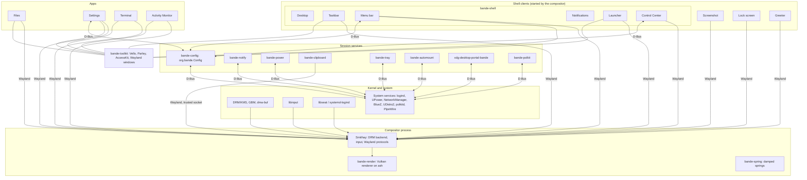

# Architecture overview

## Goal

Bande (`bande-desktop`) is a Linux desktop environment written in Rust for Debian 13 on
arm64, with Apple Silicon as the primary hardware. It is its own desktop: macOS is the bar for
how polished, smooth and finished it feels, and the main reference for which basics a modern
desktop needs, but the structure, feature set and look are ours. The principles that decide
design questions are in [`../design/DESIGN.md`](../design/DESIGN.md).

Everything lives in one Cargo workspace in this repository: compositor, renderer, toolkit, shell
clients, apps, session services, libraries and test harnesses. The layout of that workspace is
recorded in [`../decisions/0003-repository-layout.md`](../decisions/0003-repository-layout.md).
The autonomous software factory that drives development lives in its own repository and is not
described here.

The architecture is split by subject:

| Document | Subject |
| :--- | :--- |
| [`compositor.md`](compositor.md) | the compositor, its renderer, frame pacing and the Wayland protocol matrix |
| [`toolkit.md`](toolkit.md) | the UI toolkit that the shell and the apps draw with |
| [`session.md`](session.md) | session services, D-Bus, the greeter, supervision, setup and updates |
| [`behaviour.md`](behaviour.md) | recorded behaviour decisions and their macOS precedents |
| [`ci.md`](ci.md) | CI runners, jobs and the verification funnel |
| [`packaging.md`](packaging.md) | Debian packages and the meta-package |
| [`performance.md`](performance.md) | measured memory, CPU and size of the shell, and how to measure them |

## Component map



The desktop and the taskbar of every display (with the menu bar when it is separate), the notifications, Control Center and the
launcher are one process, `bande-shell` (`crates/shell/shell`), with one Wayland connection, one
GPU device, one font database and one connection per D-Bus bus. Each part is a library crate
(`bande-desktop-surface`, `bande-bar`, `bande-notifications`, `bande-controlcenter`,
`bande-launcher`) whose surfaces the shell hosts; the taskbar's models live in
`bande-dock-model` and `bande-status` (`crates/libs`).

## Process model

Bande has four kinds of component, split by the role a process plays, not by whether the user
thinks of it as part of the system:

- **Compositor.** One process, `bande-compositor`, owns the display, input and every Wayland
  surface. It renders with its own renderer (`bande-render`); title bars and the rest of the
  visible UI are drawn by clients.
- **Shell clients.** Wayland clients that make up the desktop around the apps: the shell (desktop,
  taskbar, menu bar, notifications, launcher, Control Center), the screenshot tool, the lock screen
  and the greeter. The compositor starts them on
  socket pairs and restarts them when they exit; only these connections see the private
  `bande_shell_v1` protocol and `ext-foreign-toplevel-list-v1`
  ([behaviour](behaviour.md)).
- **Apps.** Ordinary Wayland clients started by the user: Files, Settings, Terminal, Activity
  Monitor. Settings and Activity Monitor are apps like any other; they have no special access.
- **Session services.** Processes without windows that own D-Bus names for the session
  (configuration, notifications, power, clipboard, tray, automount, portal, polkit). They are
  started by systemd user units or D-Bus activation ([session](session.md)).

Shared code that is not UI lives in libraries (`bande-spring`, `bande-xdg`,
`bande-audio`, `bande-network`, `bande-bluetooth`, `bande-protocols`), and the shell
and apps draw with `bande-toolkit`.

## Inter-process communication

- **Wayland** carries everything about surfaces, buffers, input, focus, clipboard and drag and
  drop. Buffers travel as `wl_shm` or `linux-dmabuf-v1` file descriptors; there is no separate
  data-plane socket. Desktop-specific requests between the compositor and the shell go through
  `bande_shell_v1` (`crates/platform/protocols`).
- **D-Bus via `zbus`** carries policy, state and desktop integration: the `org.freedesktop.*`
  standards and the `org.bande.*` interfaces Bande owns. Every interface can be inspected
  with `busctl`. The matrix is in [session.md](session.md#d-bus-integration).

## Pure Wayland: no X11

Bande is a Wayland-only desktop by design:

- **Rule**: No X11 code, X libraries, X server or XWayland bridge in any component: compositor,
  shell, toolkit, services or packaging.
- **Not built**: An `xwayland-satellite` bridge (or Smithay's `xwayland`/`xwm` features) is
  deliberately not built. Apps are expected to run natively on Wayland (GTK, Qt, Firefox,
  Chromium, SDL and winit all do).
- **Why**: Every frame, input event and protocol path stays on one modern stack with one
  security model, and nothing in the latency budget pays for X11 translation.

## Keyboard model

Bande follows the Linux convention of GNOME and KDE: Ctrl runs shortcuts inside apps and Super
belongs to the system ([decision 0005](../decisions/0005-ctrl-for-app-shortcuts.md)). Bande's
own apps and third-party apps use the same keys, so the compositor translates nothing.

| Modifier | Role | Examples |
| :--- | :--- | :--- |
| **`Ctrl`** | Shortcuts inside apps and text fields | `Ctrl+C` (copy), `Ctrl+V` (paste), `Ctrl+X` (cut), `Ctrl+Z` (undo), `Ctrl+W` (close window), `Ctrl+Q` (quit), `Ctrl+F` (find), `Ctrl+click` (toggle an item in a selection) |
| **`Super`** | The compositor and the shell, in every app | `Super+Space` (launcher), `Super+Tab` (switcher), `Super+W` and `Super+Q` (close and quit any app), `Super+H` (hide), `Super+M` (minimize), `Shift+Super+3/4/5` (screenshots), `Ctrl+Super+Q` (lock) |
| **`Alt`** | Navigation in apps, alternate actions | `Alt+Left/Right` (back and forward), `Alt+Up` (enclosing folder), `Alt+F4` (close window), `Alt+Drag` (copy), `Alt+Click` (toggle disclosure) |
| **`Shift`** | Reversal, extending a selection, the second set of commands | `Shift+Ctrl+Z` (redo), `Shift+Ctrl+N` (new folder), Terminal's `Shift+Ctrl+C/V` |

- **Text fields**: `Ctrl+Left/Right` move by word, `Home`/`End` to the line ends,
  `Ctrl+Home/End` to the text ends, `Ctrl+Up/Down` by paragraph, and `Ctrl+Backspace/Delete`
  delete a word; `Shift` extends the selection. `Ctrl+Y` also redoes. Alt and Super are not used
  in text fields.
- **Terminal**: every plain `Ctrl+letter` goes to the shell (`Ctrl+C` interrupts, `Ctrl+D` ends
  input), so the Terminal's own commands are on `Shift+Ctrl`, as in GNOME Terminal and Konsole.
- **Menus** write shortcuts as words in GNOME order (Shift, Ctrl, Alt, Super): "Shift+Ctrl+N",
  "Alt+Super+H".

## Configuration

All user configuration is one human-readable [KDL](https://kdl.dev) file. Every Settings
control writes to it, and it can be edited by hand while the session runs.

- **Design**: node-based, validated against a schema, reloaded live without restarting the
  session. A changed file is parsed into a shadow copy and swapped in atomically, and
  subscribers are told through `org.bande.Config`. A setting that is unknown or invalid is
  skipped and reported with its line, column and message while every other setting applies;
  only a file that is not KDL at all keeps the active configuration as it was.
- **Implemented schema (`crates/services/config`)**: KDL 2.0 syntax. The file is
  `$XDG_CONFIG_HOME/bande/config.kdl`, or `~/.config/bande/config.kdl` when
  `XDG_CONFIG_HOME` is unset or relative. Every setting is optional; unknown settings,
  duplicates and out-of-range values are reported with the line and column of the offending
  node or value and ignored (the first of duplicates wins; an `idle` time shorter than the one
  before it is raised to match), so one mistake never costs the rest of the file. Names from
  earlier versions (`panel`, `dock`, `output`) are no longer read.
  ```kdl
  appearance "automatic"        // "dark" | "light" | "automatic"
  bar {
      edge "left"               // "left" | "bottom" | "right" | "top"
  }
  idle {
      dim-after "5m"            // positive "<n>s" | "<n>m" | "<n>h"
      lock-after "10m"          // not shorter than dim-after
      suspend-after "10m"       // not shorter than lock-after, or "never"
  }
  keyboard {
      repeat-rate 25            // 1 to 60 characters per second
      repeat-delay 600          // 150 to 2000 milliseconds before repeating starts
      input-sources "se" "us(dvorak)" // xkb layout(variant), at most 4; unset means
                                // the layouts of /etc/default/keyboard
      caps-lock "caps-lock"     // "caps-lock" | "escape" | "control" | "compose" | "off"
  }
  trackpad {
      tap-to-click #true
      natural-scrolling #true
      speed 0.0                 // -1.0 to 1.0
      acceleration #true        // #false is libinput's flat profile
      secondary-click "two-fingers" // "two-fingers" | "corner"
      dragging "tap"            // "off" | "tap" | "tap-with-lock"
      scroll-method "two-fingers" // "two-fingers" | "edge"
      disable-while-typing #true
  }
  mouse {
      primary-button "left"     // "left" | "right"
      natural-scrolling #false
      speed 0.0                 // -1.0 to 1.0
      acceleration #true
  }
  sound {
      effects #true             // screenshot, Trash, power and battery sounds
      volume-feedback #true     // a tick on each volume key press
      alert "mallet"            // "mallet" | "knock" | "low" | "tick"
      alert-volume 0.75         // 0.0 to 1.0, scales every event sound
  }
  wallpaper {                   // absolute path or "~/..."; unset means the built-in picture
      light "/usr/share/backgrounds/bande/day.jpg"
      dark "~/Pictures/night.jpg"
  }
  display "Dell DELL U2720Q 7ZD5K53" {  // once per display, named by its EDID maker, model, serial
      resolution 3840 2160      // one of the display's modes; unset means its preferred one
      refresh-rate 120          // 60 to 240 Hz; the closest the resolution offers
      scale 1.5                 // 1.0 to 3.0 (100%-300%); unset means automatic
      rotation 90               // 0, 90, 180 or 270
      variable-refresh-rate #true
  }
  arrangement {                 // once per set of displays connected together
      display "BOE NE135A1M" x=0 y=0 main=#true
      display "Dell DELL U2720Q 7ZD5K53" x=1504 y=-300
      display "LG HDR 4K 104NTAB7K123" mirror="BOE NE135A1M"
  }
  ```
  The values shown for `appearance`, `bar`, `idle`, `keyboard` (except `input-sources`), `trackpad`, `mouse` and `sound` are the defaults. The
  wallpaper used is the one matching the current appearance; the desktop expands a leading `~/`.
  A section left empty by a Settings write is removed from the file. A readable file is parsed
  into a shadow `Config` and swapped in as one `Arc`, so readers see either the old or the new
  configuration, never a mix. `ConfigService` owns `org.bande.Config` on the session bus and
  serves the active values as properties of interface `org.bande.Config` at
  `/org/bande/Config` (`Appearance`, `BarEdge`, `IdleDimAfter`, `IdleLockAfter` and
  `IdleSuspendAfter` in seconds, 0 meaning never, `IdleSuspendWithDisplay` true while
  `suspend-after` is unset and sleep follows the display (writing true removes the explicit
  value), `KeyRepeatRate` per second and
  `KeyRepeatDelay` in milliseconds as `u`, `InputSources` as `as` of layout codes (the system layouts while unset; writing an empty list is rejected), `CapsLock`, `TrackpadTapToClick`, `TrackpadNaturalScrolling`, `TrackpadSpeed` (`d`), `TrackpadAcceleration`, `TrackpadSecondaryClick`, `TrackpadDragging`, `TrackpadScrollMethod`, `TrackpadDisableWhileTyping`, `MousePrimaryButton`, `MouseNaturalScrolling`, `MouseSpeed` (`d`) and `MouseAcceleration`, `WallpaperLight` and `WallpaperDark` as paths, empty
  meaning unset, `Displays` as `a{sa{sv}}` and `Arrangements` as `aa(siibs)`: name, x, y, main
  and the mirrored display's name, empty when it mirrors nothing). It watches the
  directory and reloads when the file is closed after writing or renamed into place;
  `PropertiesChanged` lists only the properties that changed. The `bande-config` daemon runs
  the service for the session and posts the file's errors as one notification through
  `bande-notify` with the first error's line, column and message, how many more lines have
  errors, and an "Open in Editor" action (`xdg-open` on the file). The same set of errors is
  posted once, even after the notification is dismissed and the file is reloaded; a different
  set replaces it and a file without errors closes it. The
  compositor does not draw a toast of its own. The scalar properties are writable and
  `SetDisplay(s name, a{sv} settings)` replaces one display's settings (an empty dictionary
  removes it) and `SetArrangement(a(siibs))` the arrangement of the same set of displays: a
  write edits only the affected node of the file, keeping the user's comments

  and layout, validates the whole result, replaces the file by rename and applies it, so the
  file stays the single source of truth. A value the schema rejects fails with `InvalidArgs`;
  errors already in the file are left for the user and do not block writes, but a file that is
  not KDL is never overwritten.
