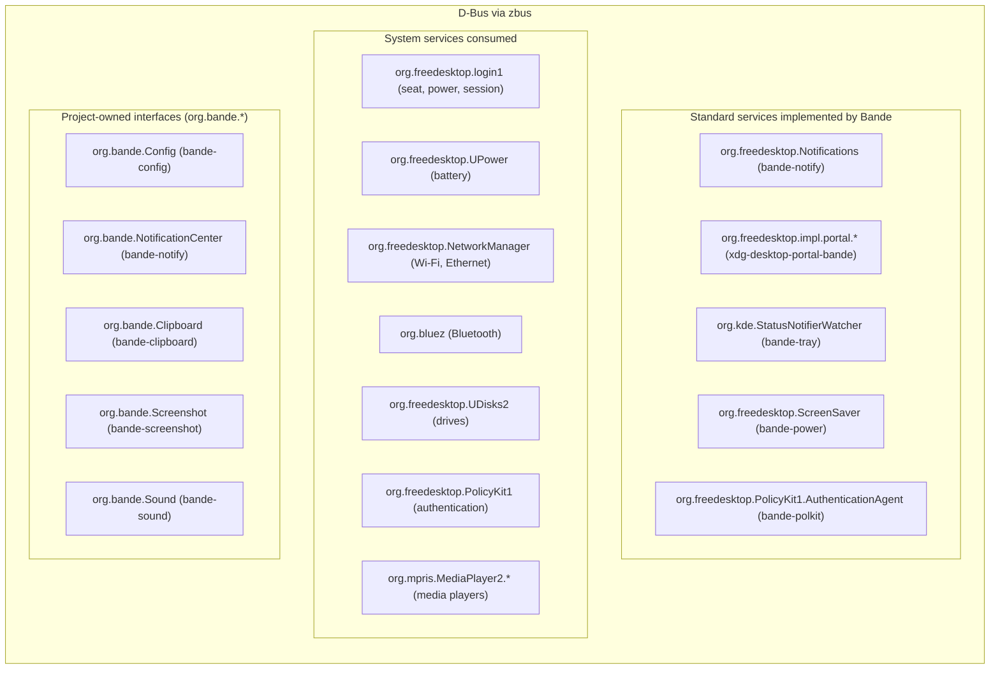

# Session services

A desktop needs a good deal of invisible infrastructure: clipboard, locking, notifications,
portals, power, authentication, audio, input methods. This document describes what Bande
provides and how. Behaviour decisions taken with macOS as the
reference are in [behaviour.md](behaviour.md).

## Core services

```mermaid
graph LR
    subgraph "Session subsystems"
        T1_CLIP[Clipboard and selection<br/>wl_data_device, zwp_primary_selection, ext-data-control-v1]
        T1_LOCK[Screen lock and idle<br/>ext-session-lock-v1, ext-idle-notify-v1, idle-inhibit-v1]
        T1_NOTIF[Notification daemon<br/>org.freedesktop.Notifications with actions]
        T1_PORTAL[XDG portal backend<br/>xdg-desktop-portal-bande: Settings, FileChooser, Screenshot, ScreenCast, Wallpaper]
        T1_POLKIT[Polkit agent<br/>org.freedesktop.PolicyKit1 authentication agent]
        T1_AUDIO[Audio and media keys<br/>PipeWire, WirePlumber per-device memory, volume OSD]
        T1_POWER[Power management<br/>UPower battery, logind lid and sleep inhibitors]
        T1_INPUT[Input methods<br/>zwp_text_input_v3 and zwp_input_method_v2: Fcitx5, IBus]
        T1_LAUNCH[Launcher and search<br/>desktop entries, apps, files, settings]
        T1_A11Y[Accessibility<br/>AccessKit trees on AT-SPI2]
        T1_ENV[Session startup<br/>environment import, D-Bus activation]
    end
```



### Clipboard (`bande-clipboard`)

- Primary selection (middle-click paste) via `zwp_primary_selection_v1`.
- Standard clipboard via `wl_data_device_manager`.
- A daemon on `ext-data-control-v1` keeps copied contents after the source app exits.
- Implemented: `wl_data_device_manager` v3, `zwp_primary_selection_device_manager_v1` and
  `ext_data_control_manager_v1` on one seat, with selections offered to the keyboard-focused
  client only. Data control is offered to `bande-clipboard` alone
  ([behaviour](behaviour.md)). The daemon takes each new clipboard and primary selection over as
  soon as it has read it; a selection it set itself is recognised while its source is live, and
  a source that stays silent for two seconds is skipped. It keeps a history of the clipboard
  (not the primary selection): the last 100 copies of the past seven days, at most 16 MiB each
  and 64 MiB in all, never a copy marked `x-kde-passwordManagerHint: secret` or
  `application/x-nspasteboard-concealed-type`, in `$XDG_STATE_HOME/bande/clipboard` (folder
  0700, files 0600). It serves the history to the launcher as `org.bande.Clipboard` on the
  session bus (`Items`, `Content`, `Paste`, `Remove`, `Clear`).

### Screen lock and idle (`bande-lock`, `bande-power`)

- Locking is built on `ext-session-lock-v1`.
- **Crash resilience**: if the lock screen crashes, the session stays locked; the compositor
  draws a blank frame and a new locker may take over the lock.
- Idle pipeline: `ext-idle-notify-v1` dims the display, then locks, then suspends through
  logind, at the times set in [`config.kdl`](overview.md#configuration).
- Video inhibition: `idle-inhibit-v1` lets media players and browsers hold off idle.
- Implemented in `crates/shell/lock`: date, time, the user's initial and name and a secure
  field; PAM (`/etc/pam.d/bande-lock`) runs off the UI thread, and a rejected password clears
  and shakes the field. `Super+L` and logind's `Lock` signal start it; the compositor sets
  logind's `LockedHint`.
- Implemented in `crates/services/power` (`bande-power`, a session service): before the
  computer sleeps, the session is locked through logind (`Session.Lock`) while a `delay` sleep
  inhibitor holds the suspend back until the lock screen sets `LockedHint`, or 3 seconds pass
  (below logind's default `InhibitDelayMaxSec` of 5); the inhibitor is taken again on wake.
  macOS likewise asks for the password after sleep by default. The service owns
  `org.freedesktop.ScreenSaver` (`Inhibit`/`UnInhibit` at `/org/freedesktop/ScreenSaver` and
  `/ScreenSaver`) and holds one logind `idle` block inhibitor per request, released by
  `UnInhibit` from the same client or when the client leaves the bus, so every inhibitor shows
  in `systemd-inhibit --list` as macOS lists power assertions. Battery alerts follow UPower's
  `WarningLevel` of the display device: a "Low Battery" notification at `Low`, replaced by a
  critical one that stays on screen at `Critical` or `Action`, closed when the level clears.
  The idle state machine (`bande_power::idle`) maps idle time to dim, lock and suspend, skips
  locking an already locked session, undims on activity without unlocking, and restarts the
  idle timers when an inhibitor ends; `IdleController` runs it in the service with the policy of
  `org.bande.Config` (followed as it changes), the session's `LockedHint`, and logind's
  `Session.Lock` and `Suspend` as actions; suspend is skipped when `CanSuspend` is not `yes`.
  Idle time comes from the compositor's `ext-idle-notify-v1`, one notification per policy
  threshold. Dimming sets the preferred backlight (`firmware`, then `platform`, then `raw`) to
  a quarter of its level through logind's `Session.SetBrightness` and restores it on activity;
  displays without a backlight do not dim.

### XDG desktop portal backend (`xdg-desktop-portal-bande`)

- `org.freedesktop.impl.portal.ScreenCast`: zero-copy PipeWire screen and window streams for
  video calls and screen sharing.
- `org.freedesktop.impl.portal.Screenshot`: full-screen and area capture, paired with
  `bande-screenshot`.
- `org.freedesktop.impl.portal.Settings`: colour scheme and accent colour for sandboxed and
  toolkit apps.
- `org.freedesktop.impl.portal.Wallpaper`: "Set as Background" in other apps. A local picture
  is copied to `$XDG_DATA_HOME/backgrounds/<seconds>-<name>` (a picture from the document
  portal or a download folder may not last) and written to `org.bande.Config` as both the
  light and the dark wallpaper, as Settings ▸ Wallpaper's Add Picture does; `set-on` is not
  told apart, since the lock screen shows the desktop picture. When the app asks for a preview
  the frontend skips its own Access dialog, so the preview is the user's consent:
  `bande-file-chooser --set-wallpaper <picture> --app-id <id>` asks "Use “name” as your
  desktop picture?" with the picture as the alert's image, Cancel and Set Desktop Picture; any
  answer but Set is a cancel. Non-file URIs and missing files fail with response 2.
- `org.freedesktop.impl.portal.FileChooser`: the Bande Open and Save dialogs. The portal
  runs `/usr/libexec/bande-file-chooser` (`crates/apps/file-chooser`) per request with the
  dialog as arguments; it answers on standard output with the chosen paths and filter and
  exits 0 when chosen and 1 when cancelled, and closing the request terminates it. If it cannot
  start (not installed, no display, any other exit) the portal forwards the same call to
  `xdg-desktop-portal-gtk`, forwarding a later Close too. The dialog: favourite places,
  bookmarks and volumes in a sidebar (from Files), a path bar from the home folder, a sortable
  Name, Date Modified and Size list with type-to-jump, folder icons from the accent icon
  theme, the app's filters as a pop-up, Save As with the name selected up to its extension,
  "Replace?" before overwriting, New Folder when saving or choosing folders, `Alt+Up` and
  `Alt+Down` to move up and into folders, and the last folder remembered per app in
  `$XDG_STATE_HOME/bande/file-chooser-folders`. Choices are answered with their initial
  values, and the dialog is not yet parented to the app window (xdg-foreign).
- Implemented in `crates/services/portal`: `Settings` (version 2) publishes
  `org.freedesktop.appearance` from `org.bande.Config`, with `color-scheme` 1 for dark and 2
  for light (Automatic is resolved by the portal: dark from sunset to sunrise at the main city
  of the time zone in `zone.tab`, 19:00 to 07:00 when the zone is unknown, re-checked at each
  change and every minute), `accent-color` the exact Datum colour of the chosen accent in that
  scheme, and `contrast` 0, signalling changes. `org.bande.appearance` `frame-tint` carries
  the wallpaper's average colour (as `ad`, empty when "Tinted frame" is off) for the toolkit to
  mix into `chassis`. `org.gnome.desktop.interface` adds `icon-theme` (`Bande`, or
  `Bande-<Accent>` for the accent's folder tabs) and `org.gnome.desktop.sound` turns
  `event-sounds` off with the Sound effects switch. `org.gnome.desktop.wm.preferences`
  serves `button-layout` `close,minimize,maximize:`, so GTK and libadwaita put their window
  controls on the left in our order. libadwaita snaps `accent-color` to its nine
  presets, so the portal also writes `~/.config/gtk-4.0/bande.css` (the accent, `on_accent`,
  frame, sheet, overlay and semantic colours as libadwaita's CSS variables, plus rules that
  draw client-side header bars like our title bar: the `windowcontrols` pill in `well` with
  `hairline` when inactive, glyphs in `ink2`/`ink3`, a `danger` disc under close on hover,
  no shade line and the Manrope window title) and keeps
  `@import url("bande.css");` at the top of the user's own `gtk.css`, leaving the rest of that
  file alone. GTK 4.18 has no `prefers-color-scheme` media query, so the file's unconditional
  block is the current scheme (rewritten when it changes; running GTK apps pick it up at their
  next start) and media-query blocks make GTK 4.20 and later switch live. Checked headlessly
  with gnome-text-editor 48 and Loupe 48 (libadwaita 1.7) in light and dark. `FileChooser`
  (open, save, save many, with filters, choices, folders, `file://` URIs and request
  cancellation), `Screenshot` (with the permission question when the frontend has not checked
  the permission store, and `PickColor`) and `ScreenCast` (sessions, source and cursor
  validation, PipeWire streams, `persist_mode` with restore data that skips the picker, closing
  stops the streams) are implemented over `FileChooserUi`, `ScreenshotUi` and
  `ScreenCastBackend` traits. `bande-portals.conf` (picked when `XDG_CURRENT_DESKTOP=Bande`)
  sends Open and Save dialogs to Bande (GTK second), secrets to GNOME Keyring, Screenshot and
  ScreenCast to Bande, and everything else to GTK.
- **Capture lives in the screenshot tool.** The portal process has no Wayland connection: its
  `ScreenshotUi` and `ScreenCastBackend` forward to `org.bande.Screenshot`, served by
  `bande-screenshot`, which the compositor starts as a shell client and so already holds the
  trusted connection that sees the capture globals (as the clipboard daemon's socket pair does
  for data control). That service answers only the process that owns the portal's bus name, and
  sandboxed apps cannot reach it past the Flatpak bus proxy. The tool captures on a second event
  queue of that same connection, in its own thread, so capturing never waits for its UI.
- **Screen sharing**: `SelectSources` shows a picker on the tool's overlay: each display (named
  by its description when there are several) and every open window as live thumbnails (other workspaces and minimised windows included), the
  first chosen; arrow keys move, Space adds a source when the app allows several, Return
  shares, Escape cancels, a double click shares at once; the dialog, the list and each source
  are published to screen readers. `Start` opens one PipeWire `Video/Source` node per source
  (shared memory, BGRx or BGRA, the source's size, renegotiated when a window is resized, at most
  60 frames per second and only when something on the screen changed), with the cursor
  painted in for `cursor_mode` embedded and left out for hidden. While anything is shared, a
  blue screen symbol sits in the menu bar (a StatusNotifierItem on a connection of its own, so it
  disappears with it); clicking it stops sharing, and the portal then closes the app's session
  with `Session.Closed`, as it does when a shared window closes. `persist_mode` hands back
  restore data with the source ids, and a restored window that has since closed brings the
  picker back.
- **Screenshot portal**: a non-interactive request takes the whole screen at once; when the
  frontend has not checked the permission store the tool first asks "Allow <app> to take a
  screenshot?" (Don't Allow, Allow). An interactive request lets the user drag out an area.
  The picture is saved as a PNG under `$XDG_CACHE_HOME/bande-screenshot` (not the Desktop:
  the app asked for it, the user did not) and returned as a `file://` URI. `PickColor` shows a
  loupe with the colour's hex value under the pointer; a click picks, Escape cancels.
- **Screenshot tool** (`bande-screenshot`): `Shift+Print` saves one picture per display, as
  GNOME does; the overlay lives on the main display, so `Shift+Super+S`
  lets the user drag out an area, and Space there switches to choosing a window (the window under
  the pointer is tinted; a click takes it alone with its rounded corners, transparent around it,
  and a soft shadow drawn by the tool). `Print` (`show_options` on `bande_capture_v1`)
  opens a palette above a scrim near the bottom of the screen: Entire Screen, Window, Area, Record
  Entire Screen, Record Area, an Options menu (save to Desktop, Pictures or the clipboard; a
  timer of none, 5 or 10 seconds; show the pointer), and Capture or Record. Arrow keys move, Space
  picks, Return captures, Escape closes; the palette and its parts are published to screen
  readers. The choices are remembered in `$XDG_STATE_HOME/bande-screenshot/options`. A timer
  shows a click-through countdown. Every picture or recording then floats as a thumbnail in the
  bottom-right corner for five seconds (longer while the pointer rests on it; it slides in and
  out with `standard`, and fades with Reduce Motion): dragging it drops the file (`text/uri-list`
  and, for pictures, `image/png`) into any app, and a click opens Markup. Clipboard captures are
  offered as `image/png` without a file or thumbnail.
- **Markup** (`bande-screenshot --markup <file>`): a window with Crop, Arrow, Rectangle, Text and
  Highlight, Undo (also `Ctrl+Z`), Delete (to the Trash, `Ctrl+Delete`), Copy (`Ctrl+C`,
  the marked-up picture as `image/png` and the file) and Done (Return or Escape, which writes the
  marks into the file; closing the window does the same). Marks are drawn on the picture's own
  pixels by the toolkit's CPU renderer, so what is saved is what was shown.
- **Screen recording**: Record Entire Screen or Record Area opens a private PipeWire stream of the
  screen and runs `gst-launch-1.0` (`pipewiresrc`, `videocrop` for an area, 30 frames per second)
  into an MP4 (H.264 by `x264enc`, from `gstreamer1.0-plugins-ugly`) or, without it, a WebM (VP8
  by `vp8enc`). A red stop symbol sits in the menu bar while recording; clicking it or pressing
  `Print` stops the recorder with an end of stream, so the file is finalised, and the
  recording appears as a thumbnail with a play mark. Without GStreamer the palette explains what to
  install instead of failing silently.
- Qt apps follow dark mode through Qt's own portal platform theme: `bande-session` sets
  `QT_QPA_PLATFORMTHEME=xdgdesktopportal` (unless already set) and `bande-desktop`
  recommends `qt6-xdgdesktopportal-platformtheme`, a 66 kB plugin from Qt itself rather than a
  theming engine. Without it Qt 6.8 reads `color-scheme` but keeps a light palette (checked
  with FeatherPad: light without the plugin, dark with it). The same plugin sends Qt's Open
  and Save dialogs through the portal. libadwaita and GTK 4 apps read `color-scheme` and
  `accent-color` from the Settings portal themselves. GTK 3 reads its settings from GSettings
  unless `GTK_USE_PORTAL=1` (`gdk_should_use_portal`), so `bande-session` sets it: GTK 3 then
  takes `gtk-theme` (`Bande` or `Bande-dark`, or HighContrast under Increase Contrast),
  `font-name` (Inter 10), `document-font-name`, `monospace-font-name` (JetBrains Mono 10),
  `enable-animations` (off under Reduce Motion), the cursor and the text size from the portal's
  `org.gnome.desktop.interface`, and sends its native Open and Save dialogs to our chooser. A
  key the portal leaves out falls to GTK's built-in default, not to GSettings, so the portal
  serves every key above. GTK 3's Adwaita uses literal colours, so `@define-color` cannot
  restyle it: the portal writes two themes to `$XDG_DATA_HOME/themes`, `Bande` and
  `Bande-dark`, whose `gtk-3.0/gtk.css` imports GTK's built-in Adwaita (or Adwaita-dark) and
  adds the title bar (chassis, no gradient or inset shadow, Manrope title, the title buttons as
  one pill like ours) and the accent on selections, suggested actions, switches, checks, radios,
  progress bars and scales, rewritten when the accent changes. Serving them as `gtk-theme`
  makes running GTK 3 apps switch live with the scheme. Their `gtk-4.0/gtk.css` imports GTK's
  `Default` theme, so plain GTK 4 apps that read the same name look as before. Qt apps run natively on Wayland through
  `qt6-wayland`, which Qt's own packages recommend. The backend lives in
  `/usr/libexec` and is started by D-Bus activation through its user unit, as Debian's portal
  backends are.

### Audio

- PipeWire and WirePlumber, with per-device volume memory (headphone volume is restored when
  they are plugged in) and media keys with an on-screen level. `crates/libs/audio` is the
  client library; the compositor forwards volume keys to the shell over `bande_shell_v1`.
- The display and keyboard brightness keys go the same way (`brightness_key`, also while
  locked): Control Center moves the display backlight or the `kbd_backlight` LED one of 16
  steps (a quarter step with Option and Shift) through logind's `Session.SetBrightness` and
  shows the level in the same HUD as the volume, a quarter step filling a quarter segment.

### Accessibility

- Every toolkit widget produces an AccessKit node, published on AT-SPI2 for screen readers
  ([toolkit](toolkit.md)).

### Keyring

- Browsers, editors and GTK apps keep passwords through the Secret Service. `bande-desktop`
  recommends `gnome-keyring` and `libpam-gnome-keyring`: Debian's `/etc/pam.d/greetd` already
  has `pam_gnome_keyring` in its `auth` and `session` stacks (as optional), so signing in
  through `bande-greeter` unlocks the login keyring with the password just typed, and
  `gnome-keyring-daemon.socket` starts the daemon (secrets and PKCS#11 components) in the user
  manager.

### Session startup

- Before starting any shell client, the compositor exports its environment to systemd user
  units and D-Bus activation, equivalent to:
  ```bash
  systemctl --user import-environment WAYLAND_DISPLAY XDG_SESSION_TYPE XDG_CURRENT_DESKTOP
  dbus-update-activation-environment --systemd WAYLAND_DISPLAY XDG_SESSION_TYPE XDG_CURRENT_DESKTOP
  ```
- `bande-session` also sets `ELECTRON_OZONE_PLATFORM_HINT=auto` (unless already set), so
  Electron apps that do not yet default to Wayland run natively instead of failing for want of
  an X server, and `QT_QPA_PLATFORMTHEME` as described under the portal.
- Services bound to `graphical-session.target` start then: PipeWire, WirePlumber,
  `bande-config`, `bande-power`, `bande-sound`, `bande-tray`, `bande-automount`,
  `bande-polkit-agent`. `bande-notify` and
  the portal backend are started by D-Bus activation, and `bande-clipboard` and the shell
  clients by the compositor ([behaviour](behaviour.md)): `bande-shell`, one process for the
  desktop, the bar, the notifications, Control Center and the launcher of every display, and
  `bande-screenshot`. The lock screen, the greeter, the screenshot tool and the file chooser
  stay processes of their own: the lock screen must hold the session even when the shell
  crashes, the greeter runs before any session exists, the screenshot tool owns the trusted
  capture connection, and the portal starts a file chooser process per request.

### Polkit authentication agent (`bande-polkit`)

- Implemented in `crates/services/polkit`, packaged as `bande-polkit` with the
  `bande-polkit-agent` binary and a systemd user unit wanted by `bande-session.target`: an
  `org.freedesktop.PolicyKit1.AuthenticationAgent` object that registers with polkitd for the
  user's logind session (logind's `auto` session, which is the display session for a user
  service), runs `/usr/lib/polkit-1/polkit-agent-helper-1` for the chosen
  user (the cookie on standard input, PAM prompts and results as escaped lines, as polkit 126's
  own agent library does) and answers `CancelAuthentication` by stopping the helper. It
  authenticates as the requesting user when polkitd lists them, otherwise as the first listed
  user, as macOS pre-fills the dialog with the current administrator. Each request opens a
  Datum dialog on an overlay layer with exclusive keyboard focus: a padlock, polkit's message as
  the title, who is asked for, a password field, Cancel (Escape) and Authenticate (Return). A
  wrong password shakes the dialog, clears the field and says so, and the dialog stays open
  until the right password or Cancel, as the macOS authorization dialog does. Requests are
  shown one at a time. Once the field hands the password over, it stays in zeroized buffers
  up to the helper's standard input. Settings checks its actions without interaction and
  leaves rows changeable when polkit answers with a challenge, so changing them brings up the
  dialog. Its polkitd test (ignored; it needs polkitd on the system bus) runs the agent against the real polkitd and PAM.

## Desktop integration

- **System tray**: `org.kde.StatusNotifierWatcher` and `org.kde.StatusNotifierItem` for
  third-party background apps (Steam, Nextcloud, Slack).
  - Implemented in `crates/services/tray` (`bande-tray`, a session service):
    `org.kde.StatusNotifierWatcher` at `/StatusNotifierWatcher`. An item registered by bus name
    is listed as `<name>/StatusNotifierItem`, one registered by object path (libappindicator,
    Ayatana) as `<caller><path>`, as KDE's watcher does; items and hosts are dropped when their
    connection leaves the bus. The menu bar is the host (`org.kde.StatusNotifierHost-<pid>`): it
    shows each item that is not `Passive` by its icon name or pixmap; a click opens the item's
    `com.canonical.dbusmenu` menu below it (or calls `Activate` when it has none), a secondary
    click calls `Activate`. Our own apps use the same menu format for their app menus: an app
    owns its app id as bus name and exports `com.canonical.dbusmenu` at `/org/bande/MenuBar`;
    the first top-level submenu is shown under the bold app name and the others become the
    menu titles beside it. The menu bar asks for the menu when the app becomes active, and only
    when the name has an owner, so it never starts an app by D-Bus activation. Toolkit apps
    export their menus through `crates/libs/app-menu` (`bande-app-menu`), driven by
    `bande-app` ([apps.md](apps.md)), which builds the standard App, Edit and Window menus; an
    app is one process that owns its name for as long as it runs, so the menu bar always talks
    to the process the user is working in. The menu bar reads the menu again on
    `LayoutUpdated` and shows each item's `shortcut` right-aligned as words ("Shift+Ctrl+N";
    `bande-app-menu` exports Ctrl as `Control`, as the dbusmenu spec asks). Items of the
    standard app menu carry `x-bande-shell-action`, which the menu bar performs itself
    through `bande_shell_v1`, since an app cannot hide itself: About (a small window with the
    app's icon and name from its desktop entry and the version in `x-bande-version`), Hide,
    Hide Others and Show All (`show_app` for every running app).
- **Network and Bluetooth**: NetworkManager (`org.freedesktop.NetworkManager`) and BlueZ
  (`org.bluez`) for Wi-Fi selection and Bluetooth pairing in Control Center and Settings, through
  `crates/libs/network` and `crates/libs/bluetooth`.
- **Removable media**: `org.freedesktop.UDisks2` mounts USB drives and posts notifications
  with an eject action.
  - Implemented in `crates/services/automount` (`bande-automount`, a session service): every
    filesystem UDisks2 hints for automounting (`HintAuto`, not `HintIgnore` or `HintSystem`) is
    mounted when it appears, including drives present at login, while the logind session is
    active and unlocked (`Active`, not `LockedHint`), as GNOME does; drives that appear while it
    is locked or inactive are mounted when it is unlocked again, unless removed meanwhile, and
    manual mounts from Files are unaffected; a drive removed while still mounted posts "Disk Not Ejected Properly", as macOS
    does. Encrypted volumes and the eject control wait for the UI.
- **Theme propagation**: GTK 3 and 4 (the Settings portal, with `GTK_USE_PORTAL=1` for GTK 3), Qt (`QT_QPA_PLATFORMTHEME`) and
  cursor themes (`XCURSOR_THEME`, `XCURSOR_SIZE`) follow the desktop's appearance.

## D-Bus integration



## Display manager and greeter

Bande uses `greetd` for the privileged part of login and keeps its own UI unprivileged:

1. **The daemon**: `greetd`, an established session daemon, runs as root on `seat0` and owns
   PAM.
2. **The greeter**: `bande-greeter` is an unprivileged client. It runs as greetd's greeter
   user (`_greetd` on Debian), talks to `greetd` over its JSON IPC socket, and shows the login
   UI: user, password field, and later wallpaper, avatars, accessibility and power menus.
3. **Handover**: after authentication, `greetd` opens the PAM session through `pam_systemd.so`
   and starts the user's session, which runs `bande-compositor`.

Implemented in `crates/shell/greeter`: greetd's IPC inside `bande-compositor --greeter`,
which runs only the greeter and exits with it. The conversation runs on the greeter's event
loop: the typed password answers PAM's first secret prompt; any further prompt (an expired
password's "Current password", "New password", a one-time code) becomes the field's
placeholder and takes the next answer; PAM's information and error messages stay under the
field until the next attempt or Escape, which also clears the field and cancels a pending
further prompt. A refused password shakes the field (the `shake` spring) and says so; other
failures show PAM's or greetd's reason. The field shows a Caps Lock sign while Caps Lock is on
(`WindowEvent::CapsLock` from the toolkit), and the active keyboard layout under the field when
the system has several. The greeter compositor applies the system's input settings, so the
layouts are those localed keeps in `/etc/vconsole.conf` (`XKBLAYOUT`, `XKBVARIANT`), or of
`/etc/default/keyboard` when that has none; Settings > Keyboard offers "Use at Login Screen",
which hands the user's layouts to localed `SetX11Keyboard`. After authentication the greeter asks greetd to
start `bande-session` (the wrapper the `bande.desktop` session entry runs, which starts
`bande-compositor.service` in the user's manager) with `XDG_SESSION_TYPE=wayland`,
`XDG_CURRENT_DESKTOP=Bande` and `XDG_SESSION_DESKTOP=bande`, so `pam_systemd` registers a
Wayland session; the greeter then exits, its compositor with it, releasing the seat and VT
before greetd runs the session. When the session ends greetd starts the greeter again.

**Installation.** `/etc/greetd/config.toml` is greetd's conffile and stays untouched. The
`bande-greeter` package ships its configuration as
`/usr/share/bande-greeter/greetd-config.toml` and a drop-in,
`/usr/lib/systemd/system/greetd.service.d/bande.conf`, that starts greetd with
`--config` pointing at it. Which display manager runs is greetd's business, done the Debian
way (greetd >= 0.10.3-6, which `bande-greeter` depends on): greetd provides
`x-display-manager` and shares the debconf question `shared/default-x-display-manager` with
GDM, SDDM and LightDM. On a system without one, greetd becomes the default; next to another,
debconf asks which to start (a noninteractive install keeps the existing one), and greetd's
scripts write `/etc/X11/default-display-manager` and point `display-manager.service` at the
choice. `bande-greeter` itself never touches either. To override:

- another greetd configuration: copy the drop-in to
  `/etc/systemd/system/greetd.service.d/bande.conf` and change its `--config`, or mask it with
  `ln -s /dev/null /etc/systemd/system/greetd.service.d/bande.conf` to go back to
  `/etc/greetd/config.toml`;
- another display manager: `dpkg-reconfigure greetd` (or `gdm3`, `sddm`, `lightdm`) and pick it.

Either takes effect after `systemctl daemon-reload` and a restart of the display manager,
which ends the sessions it started.

The login window shows the wallpaper of the person it offers,
starting with whoever signed in last (remembered in the greeter user's
`$XDG_STATE_HOME/bande-greeter/last-user`, on Debian under `/var/lib/greetd`, the home that
greetd's package creates owned by `_greetd`, so no state directory of our own is
needed), as the macOS login window shows the user's desktop picture. Debian's
AccountsService lacks Ubuntu's `SetBackgroundFile`, and Debian creates homes as 0700, so
`bande-config` copies the dark picture (at most 64 MiB) whenever the wallpaper changes into
`/var/lib/bande-greeter/pictures/<uid>`, and removes it when the person returns to the
default. The package creates that folder as `root:_greetd` with mode 3733: everyone may create
files in it but no one may list it, the sticky bit keeps people from replacing or deleting each
other's files, and the setgid bit gives every file the `_greetd` group, so a copy written with
mode 0640 is readable by its owner and the login window alone. The greeter opens
`<uid>` without following links and uses it only if it is a regular file owned by that uid
and within the size limit, then decodes it through `/proc/self/fd`, so the file it checked is
the file it shows; anything else falls back to the bundled default. Also not done: a user picker (Up/Down switches users
for now), choosing among several sessions, a visible (non-secret) field for PAM's visible
prompts (they are answered in the secure field), and power and accessibility menus.


## Crash handling and supervision

- **Supervision**: the compositor restarts the shell clients and the clipboard daemon it started
  when they exit, at most once every 10 seconds, and keeps the session locked if the lock screen
  dies. A crash of the shell takes the bar, the desktop, the notifications, Control Center and
  the launcher away for a moment but never the session or its apps; the notifications live in
  `bande-notify` and reappear with the shell. Session services run under systemd user units with
  `Restart=on-failure`.
- **Watchdog**: `bande-compositor.service` has `WatchdogSec=20s` and the compositor's event loop
  pings it, so a hung compositor is killed and the session ends instead of freezing the screen.
- **Memory**: the compositor and the session bus, PipeWire, WirePlumber and the portal sit at the
  OOM floor while apps run in their own scopes where systemd-oomd picks them first
  ([decision 0004](../decisions/0004-memory-pressure.md)).
- **After a crash**: the compositor keeps the open apps in `$XDG_STATE_HOME/bande/running`; a
  session that ended without a clean log out leaves it, and the next session reopens those apps
  only with `reopen-apps-after-crash #true`. An app that crashes posts "<App> quit unexpectedly"
  ([behaviour](behaviour.md)). Core dumps go to `systemd-coredump` where it is installed.

## Updates

Packages come from Bande's signed APT repository ([packaging](packaging.md)). Settings ▸
Software Update checks through PackageKit (`bande-packages`) and classifies each update by name
and by PackageKit's `GetUpdateDetail` restart answer. **Offline** (installed at the next restart):
`libc6`, `systemd`, `libsystemd0`, `udev`, `dbus*`, the running kernel's own packages
(`linux-{image,modules,binary,base}-$(uname -r)`, which an upgrade replaces in place), security
updates to `greetd` or `libpam*`, and anything else PackageKit says needs a system restart.
**Boot** (installed now, "Restart to finish updating"): other kernels, `firmware-*`,
`initramfs-tools` and bootloaders. Everything else is **live**. Update Now first simulates the live
set; if apt would pull in an offline package, or the user may not update without a password
(polkit `system-update`, which PackageKit grants active sudo members), everything goes offline:
download, `Offline.Trigger`, "Restart to install n updates", with no password. Otherwise the live
set installs now with `UpdatePackages`, then the offline set is downloaded and triggered.
needrestart (recommended by `bande-desktop`, `/etc/needrestart/conf.d/bande.conf`) restarts the
system services an update replaced from apt's hook, never greetd, the buses, logind, getty,
`user@`, polkit or PackageKit. Settings then looks at the user's own processes that map a deleted
`/usr` or `/opt` executable or library and groups them by cgroup: services in `session.slice`
restart through the user manager's `TryRestartUnit`; the compositor's service, the session bus or the
login scope ask "Log out to finish updating the desktop" (Log Out / Later); apps in `app.slice`
are listed as "Quit and reopen … to use the new versions", Settings itself left out. A restart is
always the user's: Restart Now / Later, Log Out / Later; Restart Now and Log Out ask for it through
`bande_app_v1.end_session`, the Bande menu's confirmation, so every app is asked to quit first. A pending restart is remembered with the
boot id in `$XDG_STATE_HOME/bande/restart-pending` (or `/run/reboot-required`), and the daily user
timer (also 3 minutes after login) reminds about it, about a prepared offline update, or posts a
notification when updates are waiting. Offline results are read once after the restart; Settings
refreshes the cache when it is older than an hour. An apt "dpkg was interrupted" failure shows
"Finish Installing", which runs PackageKit's `RepairSystem`. While dpkg runs, packagekitd holds
a logind `shutdown:idle` block inhibitor (not sleep), and Settings shows only the progress. There
is no first-run assistant yet.
