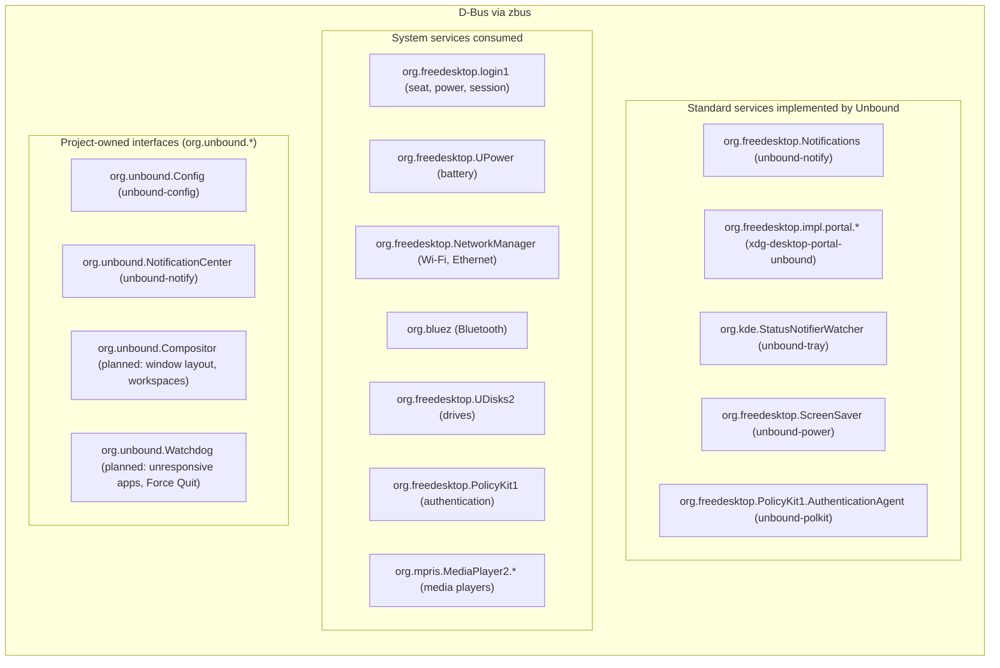

# Session services

A desktop needs a good deal of invisible infrastructure: clipboard, locking, notifications,
portals, power, authentication, audio, input methods. This document lists what Unbound provides,
in two tiers, and records what is implemented. Behaviour decisions taken with macOS as the
reference are in [behaviour.md](behaviour.md).

## Tier 1: needed for a daily-driver desktop

```mermaid
graph LR
    subgraph "Tier 1 session subsystems"
        T1_CLIP[Clipboard and selection<br/>wl_data_device, zwp_primary_selection, ext-data-control-v1]
        T1_LOCK[Screen lock and idle<br/>ext-session-lock-v1, ext-idle-notify-v1, idle-inhibit-v1]
        T1_NOTIF[Notification daemon<br/>org.freedesktop.Notifications with actions]
        T1_PORTAL[XDG portal backend<br/>xdg-desktop-portal-unbound: Settings, FileChooser, Screenshot, ScreenCast]
        T1_POLKIT[Polkit agent<br/>org.freedesktop.PolicyKit1 authentication agent]
        T1_AUDIO[Audio and media keys<br/>PipeWire, WirePlumber per-device memory, volume OSD]
        T1_POWER[Power management<br/>UPower battery, logind lid and sleep inhibitors]
        T1_INPUT[Input methods<br/>zwp_text_input_v3 and zwp_input_method_v2: Fcitx5, IBus]
        T1_LAUNCH[Launcher and search<br/>desktop entries, apps, files, settings]
        T1_A11Y[Accessibility<br/>AccessKit trees on AT-SPI2]
        T1_ENV[Session startup<br/>environment import, D-Bus activation]
    end
```



### Clipboard (`unbound-clipboard`)

- Primary selection (middle-click paste) via `zwp_primary_selection_v1`.
- Standard clipboard via `wl_data_device_manager`.
- A daemon on `ext-data-control-v1` keeps copied contents after the source app exits.
- Implemented: `wl_data_device_manager` v3, `zwp_primary_selection_device_manager_v1` and
  `ext_data_control_manager_v1` on one seat, with selections offered to the keyboard-focused
  client only. Data control is offered to `unbound-clipboard` alone
  ([behaviour](behaviour.md)). The daemon takes each new clipboard and primary selection over as
  soon as it has read it; a selection it set itself is recognised while its source is live, and
  a source that stays silent for two seconds is skipped. History is not implemented.

### Screen lock and idle (`unbound-lock`, `unbound-power`)

- Locking is built on `ext-session-lock-v1`.
- **Crash resilience**: if the lock screen crashes, the session stays locked; the compositor
  draws a blank frame and a new locker may take over the lock.
- Idle pipeline: `ext-idle-notify-v1` dims the display, then locks, then suspends through
  logind, at the times set in [`config.kdl`](overview.md#configuration).
- Video inhibition: `idle-inhibit-v1` lets media players and browsers hold off idle.
- Implemented in `crates/shell/lock`: date, time, the user's initial and name and a secure
  field; PAM (`/etc/pam.d/unbound-lock`) runs off the UI thread, and a rejected password clears
  and shakes the field. `Ctrl+Super+Q` and logind's `Lock` signal start it; the compositor sets
  logind's `LockedHint`.
- Implemented in `crates/services/power` (`unbound-power`, a session service): before the
  computer sleeps, the session is locked through logind (`Session.Lock`) while a `delay` sleep
  inhibitor holds the suspend back until the lock screen sets `LockedHint`, or 3 seconds pass
  (below logind's default `InhibitDelayMaxSec` of 5); the inhibitor is taken again on wake.
  macOS likewise asks for the password after sleep by default. The service owns
  `org.freedesktop.ScreenSaver` (`Inhibit`/`UnInhibit` at `/org/freedesktop/ScreenSaver` and
  `/ScreenSaver`) and holds one logind `idle` block inhibitor per request, released by
  `UnInhibit` from the same client or when the client leaves the bus, so every inhibitor shows
  in `systemd-inhibit --list` as macOS lists power assertions. Battery alerts follow UPower's
  `WarningLevel` of the display device: a "Low Battery" notification at `Low`, replaced by a
  critical one that stays on screen at `Critical` or `Action`, closed when the level clears.
  The idle state machine (`unbound_power::idle`) maps idle time to dim, lock and suspend, skips
  locking an already locked session, undims on activity without unlocking, and restarts the
  idle timers when an inhibitor ends; `IdleController` runs it in the service with the policy of
  `org.unbound.Config` (followed as it changes), the session's `LockedHint`, and logind's
  `Session.Lock` and `Suspend` as actions; suspend is skipped when `CanSuspend` is not `yes`.
  Idle time comes from the compositor's `ext-idle-notify-v1`, one notification per policy
  threshold. Dimming sets the preferred backlight (`firmware`, then `platform`, then `raw`) to
  a quarter of its level through logind's `Session.SetBrightness` and restores it on activity;
  displays without a backlight do not dim.

### XDG desktop portal backend (`xdg-desktop-portal-unbound`)

- `org.freedesktop.impl.portal.ScreenCast`: zero-copy PipeWire screen and window streams for
  video calls and screen sharing.
- `org.freedesktop.impl.portal.Screenshot`: full-screen and area capture, paired with
  `unbound-screenshot`.
- `org.freedesktop.impl.portal.Settings`: colour scheme and accent colour for sandboxed and
  toolkit apps.
- `org.freedesktop.impl.portal.FileChooser`: the Files column browser as the Open and Save
  dialog.
- Implemented in `crates/services/portal`: `Settings` (version 2) publishes
  `org.freedesktop.appearance` from `org.unbound.Config`, with `color-scheme` 1 for dark, 2 for
  light and 0 for automatic until the automatic schedule exists, `accent-color` from the
  toolkit's accent token of that scheme, and `contrast` 0, signalling changes. `FileChooser`
  (open, save, save many, with filters, choices, folders, `file://` URIs and request
  cancellation), `Screenshot` (with the permission question when the frontend has not checked
  the permission store, and `PickColor`) and `ScreenCast` (sessions, source and cursor
  validation, PipeWire streams, `persist_mode` with restore data that skips the picker, closing
  stops the streams) are implemented over `FileChooserUi`, `ScreenshotUi` and
  `ScreenCastBackend` traits. `unbound-portals.conf` (picked when `XDG_CURRENT_DESKTOP=Unbound`)
  sends Open and Save dialogs to the GTK backend, secrets to GNOME Keyring, Screenshot and
  ScreenCast to Unbound, and everything else to GTK.
- **Capture lives in the screenshot tool.** The portal process has no Wayland connection: its
  `ScreenshotUi` and `ScreenCastBackend` forward to `org.unbound.Screenshot`, served by
  `unbound-screenshot`, which the compositor starts as a shell client and so already holds the
  trusted connection that sees the capture globals (as the clipboard daemon's socket pair does
  for data control). That service answers only the current owner of the portal's bus name, and
  sandboxed apps cannot reach it past the Flatpak bus proxy. The tool captures on a second event
  queue of that same connection, in its own thread, so capturing never waits for its UI.
- **Screen sharing**: `SelectSources` shows a picker on the tool's overlay: the entire screen and
  every open window as live thumbnails (other workspaces and minimised windows included), the
  first chosen; arrow keys move, Space adds a source when the app allows several, Return
  shares, Escape cancels, a double click shares at once; the dialog, the list and each source
  are published to screen readers. `Start` opens one PipeWire `Video/Source` node per source
  (shared memory, BGRx or BGRA, the source's size, renegotiated when a window is resized, at most
  60 frames per second and only when something on the screen changed), with the cursor
  painted in for `cursor_mode` embedded and left out for hidden. While anything is shared, a
  blue screen symbol sits in the menu bar (a StatusNotifierItem on a connection of its own, so it
  disappears with it); clicking it stops sharing, and the portal then closes the app's session
  with `Session.Closed`, as it does when a shared window closes. `persist_mode` hands back
  restore data with the source ids, and a restored window that has since closed brings the
  picker back.
- **Screenshot portal**: a non-interactive request takes the whole screen at once; when the
  frontend has not checked the permission store the tool first asks "Allow <app> to take a
  screenshot?" (Don't Allow, Allow). An interactive request lets the user drag out an area.
  The picture is saved as a PNG under `$XDG_CACHE_HOME/unbound-screenshot` (not the Desktop:
  the app asked for it, the user did not) and returned as a `file://` URI. `PickColor` shows a
  loupe with the colour's hex value under the pointer; a click picks, Escape cancels.
- Qt apps follow dark mode through Qt's own portal platform theme: `unbound-session` sets
  `QT_QPA_PLATFORMTHEME=xdgdesktopportal` (unless already set) and `unbound-desktop`
  recommends `qt6-xdgdesktopportal-platformtheme`, a 66 kB plugin from Qt itself rather than a
  theming engine. Without it Qt 6.8 reads `color-scheme` but keeps a light palette (checked
  with FeatherPad: light without the plugin, dark with it). The same plugin sends Qt's Open
  and Save dialogs through the portal. libadwaita and GTK 4 apps read `color-scheme` and
  `accent-color` from the Settings portal themselves. Qt apps run natively on Wayland through
  `qt6-wayland`, which Qt's own packages recommend. The backend lives in
  `/usr/libexec` and is started by D-Bus activation through its user unit, as Debian's portal
  backends are. `ci/portal` installs the packages into Debian 13 with its `xdg-desktop-portal`
  and reads `color-scheme` through `org.freedesktop.portal.Settings` before and after switching
  the appearance.

### Audio

- PipeWire and WirePlumber, with per-device volume memory (headphone volume is restored when
  they are plugged in) and media keys with an on-screen level. `crates/libs/audio` is the
  client library; the compositor forwards volume keys to the shell over `unbound_shell_v1`.
- The display and keyboard brightness keys go the same way (`brightness_key`, also while
  locked): Control Center moves the display backlight or the `kbd_backlight` LED one of 16
  steps (a quarter step with Option and Shift) through logind's `Session.SetBrightness` and
  shows the level in the same HUD as the volume, a quarter step filling a quarter segment.

### Accessibility

- Every toolkit widget produces an AccessKit node, published on AT-SPI2 for screen readers
  ([toolkit](toolkit.md)).

### Keyring

- Browsers, editors and GTK apps keep passwords through the Secret Service. `unbound-desktop`
  recommends `gnome-keyring` and `libpam-gnome-keyring`: Debian's `/etc/pam.d/greetd` already
  has `pam_gnome_keyring` in its `auth` and `session` stacks (as optional), so signing in
  through `unbound-greeter` unlocks the login keyring with the password just typed, and
  `gnome-keyring-daemon.socket` starts the daemon (secrets and PKCS#11 components) in the user
  manager. Verified on the development VM: after a greetd login the `login` collection is
  unlocked and `secret-tool store --collection=login` then `secret-tool lookup` round-trips
  without a prompt.

### Session startup

- Before starting any shell client, the compositor exports its environment to systemd user
  units and D-Bus activation, equivalent to:
  ```bash
  systemctl --user import-environment WAYLAND_DISPLAY XDG_SESSION_TYPE XDG_CURRENT_DESKTOP
  dbus-update-activation-environment --systemd WAYLAND_DISPLAY XDG_SESSION_TYPE XDG_CURRENT_DESKTOP
  ```
- `unbound-session` also sets `ELECTRON_OZONE_PLATFORM_HINT=auto` (unless already set), so
  Electron apps that do not yet default to Wayland run natively instead of failing for want of
  an X server, and `QT_QPA_PLATFORMTHEME` as described under the portal.
- Services bound to `graphical-session.target` start then: PipeWire, WirePlumber,
  `unbound-config`, `unbound-power`, `unbound-tray`, `unbound-automount`. `unbound-notify` and
  the portal backend are started by D-Bus activation, and `unbound-clipboard` and the shell
  clients by the compositor ([behaviour](behaviour.md)).

### Polkit authentication agent (`unbound-polkit`)

- Implemented in `crates/services/polkit` as a library: an
  `org.freedesktop.PolicyKit1.AuthenticationAgent` object that registers with polkitd for a
  logind session or a process, runs `/usr/lib/polkit-1/polkit-agent-helper-1` for the chosen
  user (the cookie on standard input, PAM prompts and results as escaped lines, as polkit 126's
  own agent library does) and answers `CancelAuthentication` by stopping the helper. It
  authenticates as the requesting user when polkitd lists them, otherwise as the first listed
  user, as macOS pre-fills the dialog with the current administrator. A wrong password is
  reported and asked for again until the user cancels, as the macOS authorization dialog shakes
  and stays open. The dialog itself is the `Conversation` trait (prompt, notices, close),
  waiting for a toolkit window; until then no agent binary is packaged. `ci/polkit` runs the
  agent against the real polkitd and PAM of Debian 13 in a container.

## Tier 2: full desktop polish

- **System tray**: `org.kde.StatusNotifierWatcher` and `org.kde.StatusNotifierItem` for
  third-party background apps (Steam, Nextcloud, Slack).
  - Implemented in `crates/services/tray` (`unbound-tray`, a session service):
    `org.kde.StatusNotifierWatcher` at `/StatusNotifierWatcher`. An item registered by bus name
    is listed as `<name>/StatusNotifierItem`, one registered by object path (libappindicator,
    Ayatana) as `<caller><path>`, as KDE's watcher does; items and hosts are dropped when their
    connection leaves the bus. The menu bar is the host (`org.kde.StatusNotifierHost-<pid>`): it
    shows each item that is not `Passive` by its icon name or pixmap; a click opens the item's
    `com.canonical.dbusmenu` menu below it (or calls `Activate` when it has none), a secondary
    click calls `Activate`. Our own apps use the same menu format for their app menus: an app
    owns its app id as bus name and exports `com.canonical.dbusmenu` at `/org/unbound/MenuBar`;
    the first top-level submenu is shown under the bold app name and the others become the
    menu titles beside it. The menu bar asks for the menu when the app becomes active, and only
    when the name has an owner, so it never starts an app by D-Bus activation. Toolkit apps
    export their menus through `crates/libs/app-menu` (`unbound-app-menu`), which also builds
    the standard app and Window menus; the window that gains focus claims the name, so the menu
    bar talks to the process the user is working in. The menu bar reads the menu again on
    `LayoutUpdated` and shows each item's `shortcut` right-aligned with key symbols (⌃ ⌥ ⇧ ⌘,
    Super being ⌘ as the Command key of the Apple keyboards Unbound runs on). Items of the
    standard app menu carry `x-unbound-shell-action`, which the menu bar performs itself
    through `unbound_shell_v1`, since an app cannot hide itself: About (a small window with the
    app's icon and name from its desktop entry and the version in `x-unbound-version`), Hide
    (`Super+H`), Hide Others (`Alt+Super+H`) and Show All (`show_app` for every running app).
- **Network and Bluetooth**: NetworkManager (`org.freedesktop.NetworkManager`) and BlueZ
  (`org.bluez`) for Wi-Fi selection and Bluetooth pairing in Control Center and Settings, through
  `crates/libs/network` and `crates/libs/bluetooth`.
- **Removable media**: `org.freedesktop.UDisks2` mounts USB drives and posts notifications
  with an eject action.
  - Implemented in `crates/services/automount` (`unbound-automount`, a session service): every
    filesystem UDisks2 hints for automounting (`HintAuto`, not `HintIgnore` or `HintSystem`) is
    mounted when it appears, including drives present at login, as macOS mounts external
    volumes; a drive removed while still mounted posts "Disk Not Ejected Properly", as macOS
    does. Encrypted volumes and the eject control wait for the UI.
- **Theme propagation**: GTK 3 and 4 (`settings.ini`, `dconf`), Qt (`QT_QPA_PLATFORMTHEME`) and
  cursor themes (`XCURSOR_THEME`, `XCURSOR_SIZE`) follow the desktop's appearance.
- **Emulated input**: `libei` for remote desktop and virtual input devices.

## D-Bus integration



## Display manager and greeter

Unbound uses `greetd` for the privileged part of login and keeps its own UI unprivileged:

1. **The daemon**: `greetd`, an established session daemon, runs as root on `seat0` and owns
   PAM.
2. **The greeter**: `unbound-greeter` is an unprivileged client. It runs as greetd's greeter
   user (`_greetd` on Debian), talks to `greetd` over its JSON IPC socket, and shows the login
   UI: user, password field, and later wallpaper, avatars, accessibility and power menus.
3. **Handover**: after authentication, `greetd` opens the PAM session through `pam_systemd.so`
   and starts the user's session, which runs `unbound-compositor`.

Implemented in `crates/shell/greeter`: greetd's IPC (create a session, answer the secret
prompt, acknowledge information, start, cancel after a refusal) inside
`unbound-compositor --greeter`, which runs only the greeter and exits with it; the package
ships a greetd configuration. The login window shows the wallpaper of the person it offers,
starting with whoever signed in last (remembered in the greeter user's
`$XDG_STATE_HOME/unbound-greeter/last-user`, on Debian under `/var/lib/greetd`, the home that
greetd's package creates owned by `_greetd`, so no state directory of our own is
needed): `unbound-config` hands the dark picture to
AccountsService (`SetBackgroundFile`, which a user may do for their own account without a
password) whenever the wallpaper changes, and the greeter reads `BackgroundFile` from it, as the
macOS login window shows the user's desktop picture. Pictures inside a home folder that the
greeter user cannot read (Debian creates homes as 0700) fall back to the default; showing them
needs a privileged copy, which is not done. Also not done: a user picker (Up/Down switches users
for now), a second secret prompt, power and accessibility menus, an `unbound-session` wrapper
(greetd starts `unbound-compositor` directly), and installing the greetd configuration.


## Crash reporting and supervision

- **Supervision** (implemented): the compositor restarts the shell clients and the clipboard
  daemon it started when they exit, at most once every 10 seconds, and keeps the session locked
  if the lock screen dies. Session services run under systemd user units, which restart them
  when they fail (`Restart=on-failure`).
- **Crash reports** (planned): structured minidumps and stack traces with symbolicated Rust
  frames when a component panics, kept only on the machine in
  `~/.local/share/unbound/crashes/`.

## First-run setup and updates

- **Setup assistant** (planned): on first login a short, non-blocking assistant asks for the
  appearance (dark, light or automatic), the Dock position, the scrolling direction, and shows
  the essential shortcuts (`Super+Space` launcher, `Super+Shift+4` screenshot, `Super+Escape`
  Force Quit).
- **Updates**: packages come from Unbound's signed APT repository (see the top-level
  `README.md` and [packaging](packaging.md)) and arrive with `apt upgrade`. Planned: a timer
  that checks for updates and posts a notification with the release notes and one "Update Now"
  action, and restarting updated services and apps individually without ending the
  compositor session.
