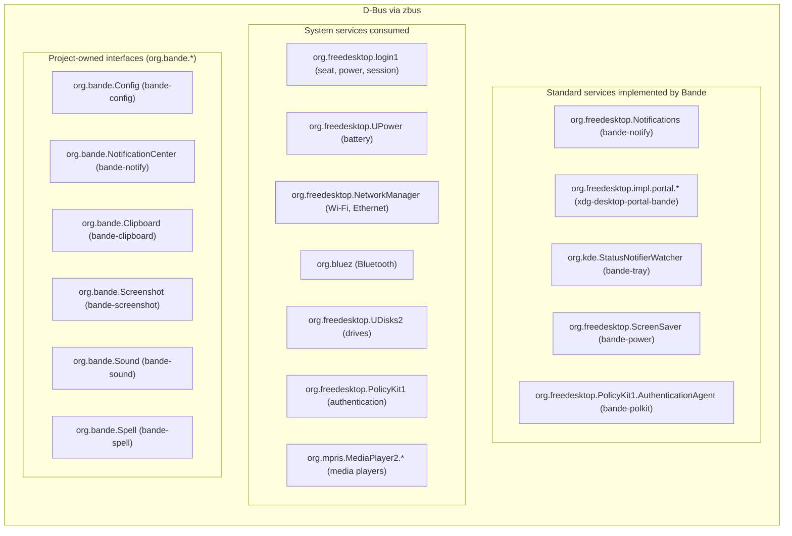

# Session services

A desktop needs a good deal of invisible infrastructure: clipboard, locking, notifications,
portals, power, authentication, audio, input methods. This document describes what Bande
provides and how. Behaviour decisions taken with macOS as the
reference are in [behaviour.md](behaviour.md).

## Core services

```mermaid
graph LR
    subgraph "Session subsystems"
        T1_CLIP[Clipboard and selection<br/>wl_data_device, zwp_primary_selection, ext-data-control-v1]
        T1_LOCK[Screen lock and idle<br/>ext-session-lock-v1, ext-idle-notify-v1, idle-inhibit-v1]
        T1_NOTIF[Notification daemon<br/>org.freedesktop.Notifications with actions]
        T1_PORTAL[XDG portal backend<br/>xdg-desktop-portal-bande: Settings, FileChooser, Screenshot, ScreenCast, Wallpaper]
        T1_POLKIT[Polkit agent<br/>org.freedesktop.PolicyKit1 authentication agent]
        T1_AUDIO[Audio and media keys<br/>PipeWire, WirePlumber per-device memory, volume OSD]
        T1_POWER[Power management<br/>UPower battery, logind lid and sleep inhibitors]
        T1_INPUT[Input methods<br/>zwp_text_input_v3 and zwp_input_method_v2: Fcitx5, IBus]
        T1_LAUNCH[Launcher and search<br/>desktop entries, apps, files, settings]
        T1_A11Y[Accessibility<br/>AccessKit trees on AT-SPI2]
        T1_ENV[Session startup<br/>environment import, D-Bus activation]
    end
```



### Clipboard (`bande-clipboard`)

- Primary selection (middle-click paste) via `zwp_primary_selection_v1`.
- Standard clipboard via `wl_data_device_manager`.
- A daemon on `ext-data-control-v1` keeps copied contents after the source app exits.
- Implemented: `wl_data_device_manager` v3, `zwp_primary_selection_device_manager_v1` and
  `ext_data_control_manager_v1` on one seat, with selections offered to the keyboard-focused
  client only. Data control is offered to `bande-clipboard` alone
  ([behaviour](behaviour.md)). The daemon takes each new clipboard and primary selection over as
  soon as it has read it; a selection it set itself is recognised while its source is live, and
  a source that stays silent for two seconds is skipped. It keeps a history of the clipboard
  (not the primary selection): the last 100 copies of the past seven days, at most 16 MiB each
  and 64 MiB in all, never a copy marked `x-kde-passwordManagerHint: secret` or
  `application/x-nspasteboard-concealed-type`, in `$XDG_STATE_HOME/bande/clipboard` (folder
  0700, files 0600). It serves the history to the launcher as `org.bande.Clipboard` on the
  session bus (`Items`, `Content`, `Paste`, `Remove`, `Clear`).

### Screen lock and idle (`bande-lock`, `bande-power`)

- Locking is built on `ext-session-lock-v1`.
- **Crash resilience**: if the lock screen crashes, the session stays locked; the compositor
  draws a blank frame and a new locker may take over the lock.
- Idle, as in macOS's Lock Screen settings ([`config.kdl`](overview.md#configuration) `idle`,
  Settings ▸ Lock Screen): the displays dim 10 s before the screen saver or the
  display turning off, whichever comes first (default 5 and 10 min). The screen saver is the lock
  screen itself, resting: its clock and date over the blurred desktop picture and nothing
  else, covering the desktop through `ext-session-lock`, as macOS hands its saver over to the
  lock screen. Every lock starts resting; the first key, click, scroll or movement, or waking
  from sleep, fades in the picture, name and password field (a typed letter lands in the
  field), and a minute without input clears the field and rests again. "Require
  password after screen saver begins or display is turned off" (default immediately) is a grace
  period: until it passes, any key, click or movement dismisses the saver without a password.
  Locks from `Super+L`, logind, sleep and the power button always ask for it. The computer
  sleeps with the display unless `suspend-after` is later or `"never"`, and only if logind
  says `CanSuspend` is `yes`: the `bande-power` package ships `AllowSuspend=no` (below).
  A virtual machine never sleeps when idle, as GNOME's power plugin does: a sleeping guest looks
  like a crash and loses its network until the host wakes it.
  The earlier of the screen saver and the display turning off starts the lock, and sleep never
  comes before the display turns off; the settings say so on their rows when a choice is overridden,
  and the sleep row only shows when logind's `CanSuspend` is `yes`.
- Keeping awake: a playing video holds off dimming, the display turning off and the lock, as
  macOS's display-sleep assertion does, through whichever path the player uses:

  | Path | Used by | Bande |
  |---|---|---|
  | `org.freedesktop.ScreenSaver.Inhibit` | Firefox (first choice), Chromium/Electron (after GNOME's) | `bande-power`, held until `UnInhibit` or the caller leaves the bus |
  | `org.freedesktop.portal.Inhibit`, idle flag | sandboxed apps | `xdg-desktop-portal-bande` forwards it to `org.freedesktop.ScreenSaver` |
  | logind `idle` block inhibitor (`systemd-inhibit --what=idle`) | scripts, `caffeinate`-style tools | `bande-power` follows logind's `BlockInhibited` |
  | `zwp_idle_inhibitor_v1` on a surface | Player and Quick Look (on the video's surface), mpv, Chromium (on the focused window), Firefox (last resort) | the compositor, while the surface's window is on screen, covered or not and focused or not; not while minimised, as in KWin and sway |

  Audio alone keeps the computer but not the display awake, as on macOS, and neither CPU load,
  builds nor MPRIS keep anything awake. Idle time restarts when the last inhibitor ends, so a
  finished film does not lock the screen at once.
- Keeping the computer awake only holds back idle sleep. Nothing stops Sleep in a menu, the
  power button or the lid, as macOS's `PreventUserIdleSystemSleep` does not, so these are not
  logind `sleep` block inhibitors (those would turn an explicit Sleep into an administrator
  prompt and hide it from the menus). The paths are any app's running PipeWire stream (output,
  microphone or camera; not a paused one, the system's own filters or Bande's event sounds,
  through `bande-audio`), the portal's suspend flag (`org.bande.Power.KeepAwake`, `Hold` and
  `Release`, freed when the caller leaves the bus) and someone else's logind `sleep` block
  inhibitor. When the last one ends, the computer sleeps after a full `suspend-after` more.
- Sleep is off until s2idle survives ten clean cycles on the mini
  (`~/bande-linux/bin/s2idle-test.sh`, which overrides the switch for its own cycles). The one
  switch is the line `AllowSuspend=no` in `crates/services/power/data/sleep.conf`: `CanSuspend`
  then answers `na`, so Sleep leaves the menus and idle stays awake. Changing it to `yes` brings
  all of it back, including the power button: logind's press always locks, and the compositor
  asks for `Suspend` on a press shorter than the five-second hold when `CanSuspend` is `yes`.
- Implemented in `crates/shell/lock`: date, time, the user's picture (AccountsService's
  `IconFile`, read off the UI thread; the initial on the accent colour without one) and name
  and a secure field. PAM
  (`/etc/pam.d/bande-lock`) runs off the UI thread with a progress row if it takes longer than
  200 ms, and a rejected password clears and shakes the field and says so. `Super+L` and logind's `Lock` signal start it; the compositor sets
  logind's `LockedHint`.
- Implemented in `crates/services/power` (`bande-power`, a session service): before the
  computer sleeps, the session is locked through logind (`Session.Lock`) while a `delay` sleep
  inhibitor holds the suspend back until the lock screen sets `LockedHint`, or 3 seconds pass
  (below logind's default `InhibitDelayMaxSec` of 5); the inhibitor is taken again on wake.
  macOS likewise asks for the password after sleep by default. The service owns
  `org.freedesktop.ScreenSaver` (`Inhibit`/`UnInhibit` at `/org/freedesktop/ScreenSaver` and
  `/ScreenSaver`) and holds one logind `idle` block inhibitor per request, released by
  `UnInhibit` from the same client or when the client leaves the bus, so every inhibitor shows
  in `systemd-inhibit --list` as macOS lists power assertions. Battery alerts follow UPower's
  `WarningLevel` of the display device: a "Low Battery" notification at `Low`, replaced by a
  critical one that stays on screen at `Critical` or `Action`, closed when the level clears.
  The idle state machine (`bande_power::idle`) maps idle time to dim, saver (lock, and logind's
  `IdleHint` until the next input), password required, display off and suspend, skips locking an already locked session, turns the display
  off after 60 s on a lock it did not start, undims on activity without unlocking, and restarts the
  idle timers when an inhibitor ends; `IdleController` runs it in the service with the policy of
  `org.bande.Config` (followed as it changes), the session's `LockedHint`, and logind's
  `Session.Lock` and `Suspend` as actions; suspend is skipped when `CanSuspend` is not `yes`.
  The grace period is `org.bande.Power`'s `PasswordRequired` property (true outside an idle lock
  still in its grace), which the lock screen reads on input; any process of the user could
  lengthen it through `config.kdl` anyway, so it adds no new trust.
  Idle time comes from the compositor's `ext-idle-notify-v1`, one notification per policy
  threshold, sent as soon as it is due. The compositor follows `Lock` on the session's own
  logind object path (from `GetSession("auto")`; logind never signals on `session/auto`).
  Dimming lowers every display: the backlight to a quarter of its level, every other display
  by the compositor's colour transform (no DDC write), and restores them on activity.
- **Display brightness**: `bande-power` owns one model for all displays, `org.bande.Brightness`
  (`Displays`: connector, name and level per display; `SetLevel`; `Refresh`), so Settings and
  Control Center show one bar per connected display and never block on hardware. The displays
  come from the compositor's `org.bande.Displays` (`Connected`, `SetDim`). Each has its own
  worker thread, idle until asked, and one of three controls:
  the backlight through logind's `Session.SetBrightness` for an internal panel (`eDP`, `LVDS`,
  `DSI`); VCP 0x10 over DDC/CI when the monitor answers; otherwise the compositor's CRTC gamma
  ramp or CTM, multiplied with night light, down to a fifth so the screen never goes black.
  DDC is native (`ddc.rs`, `/dev/i2c-N` from the connector's `ddc` link or `i2c-N` child):
  bars move at once, writes go to the monitor at most every 250 ms with the last level always
  sent and unchanged values skipped, because a monitor's memory wears and its bus is slow.
  A monitor keeps its own level: it is read on connect and when a brightness view opens, never
  written on connect. A plugged-in monitor is asked again after 1, 3 and 8 s, since many answer
  late; one that never answers, or stops answering, is dimmed by the compositor instead, and its
  level is kept per display in `$XDG_STATE_HOME/bande/brightness`. Access: `bande-power` ships
  `i2c-dev` in `modules-load.d` and a udev rule giving the active session `uaccess` to I2C
  adapters of PCI display controllers only, never other buses. Apple's `appledrm` exposes no
  DDC adapter, so external displays on a Mac use the compositor control.

### XDG desktop portal backend (`xdg-desktop-portal-bande`)

- `org.freedesktop.impl.portal.ScreenCast`: zero-copy PipeWire screen and window streams for
  video calls and screen sharing.
- `org.freedesktop.impl.portal.Screenshot`: full-screen and area capture, paired with
  `bande-screenshot`.
- `org.freedesktop.impl.portal.Settings`: colour scheme and accent colour for sandboxed and
  toolkit apps.
- `org.freedesktop.impl.portal.Wallpaper`: "Set as Background" in other apps. A local picture
  is copied to `$XDG_DATA_HOME/backgrounds/<seconds>-<name>` (a picture from the document
  portal or a download folder may not last) and written to `org.bande.Config` as both the
  light and the dark wallpaper, as Settings ▸ Wallpaper's Add Picture does; `set-on` is not
  told apart, since the lock screen shows the desktop picture. When the app asks for a preview
  the frontend skips its own Access dialog, so the preview is the user's consent:
  `bande-file-chooser --set-wallpaper <picture> --app-id <id>` asks "Use “name” as your
  desktop picture?" with the picture as the alert's image, Cancel and Set Desktop Picture; any
  answer but Set is a cancel. Non-file URIs and missing files fail with response 2.
- `org.freedesktop.impl.portal.FileChooser`: the Bande Open and Save dialogs. The portal
  runs `/usr/libexec/bande-file-chooser` (`crates/apps/file-chooser`) per request with the
  dialog as arguments; it answers on standard output with the chosen paths and filter and
  exits 0 when chosen and 1 when cancelled, and closing the request terminates it. If it cannot
  start (not installed, no display, any other exit) the request fails with response 2. The
  dialog: favourite places,
  bookmarks and volumes in a sidebar (from Files), a path bar from the home folder, a sortable
  Name, Date Modified and Size list with type-to-jump, folder icons from the accent icon
  theme, the app's filters as a pop-up, Save As with the name selected up to its extension,
  "Replace?" before overwriting, New Folder when saving or choosing folders, Show Hidden Files
  (`Ctrl+H`, starting from the setting in Files, for this dialog only) with hidden items dimmed
  as in Files, `Alt+Up` and `Alt+Down` to move up and into folders, and the last folder
  remembered per app in
  `$XDG_STATE_HOME/bande/file-chooser-folders`. Choices are answered with their initial
  values. The dialog comes up attached to the asking window: `parent_window`'s
  `wayland:` handle (`zxdg_exporter_v2`, which `bande-app` exports for every window) goes to
  `xdg_toplevel` by `zxdg_importer_v2` and the dialog is modal through `xdg_dialog_v1`.
- `org.freedesktop.impl.portal.Access`: the permission questions behind the Screenshot,
  Wallpaper, Camera, Location and Background portals (the frontend exports none of these
  without it). `bande-file-chooser --access` shows an alert with the frontend's title, subtitle
  and body, the given icon or else the app's, Don’t Allow and Allow (or the given labels), and
  each choice as a checkbox, or a labelled pop-up when it has options; the answers come back as
  `choices`. Allow is response 0, anything else 1.
- `org.freedesktop.impl.portal.AppChooser`: Open With for OpenURI, which the frontend exports
  only with an AppChooser backend. The frontend opens the default app itself unless the app
  asks or there is a real choice; then `bande-file-chooser --choose-app` asks "Choose an app to
  open “name”:" with a search field and the frontend's candidates (the last choice selected),
  Cancel and Open, a double click or Return opening at once. The chosen app id and an
  xdg-activation token for it go back as `choice` and `activation_token`; the frontend
  launches it. `UpdateChoices` reaches the open dialog on its standard input, one line of
  NUL-separated ids per update. With no candidate the alert says no app can open it.
- `org.freedesktop.impl.portal.Email`: builds a `mailto:` URI (to, cc, bcc, subject, body and
  `attachment=` paths from the document portal, as the GTK backend does) and opens it with the
  default `x-scheme-handler/mailto` app with the app's activation token.
- `org.freedesktop.impl.portal.Inhibit`: the idle flag takes an `org.freedesktop.ScreenSaver`
  inhibitor from `bande-power` (so the idle chain and its logind idle lock see it), named
  after the app and its reason; the suspend flag holds off idle sleep through
  `org.bande.Power.KeepAwake`; closing the request releases both. Logout and user switch are not inhibited (Bande's
  Log Out asks running apps to quit instead). Monitors report `screensaver-active` from the
  session's `LockedHint` as it changes and `session-state` running; there is no query-end.
- `org.freedesktop.impl.portal.Notification` (version 2): posts to
  `org.freedesktop.Notifications` with the app's name, `desktop-entry` set to the app id,
  `urgency` from the priority (low 0, urgent 2, else 1), `transient`/`resident` from the
  display hints, `suppress-sound` for a silent sound, markup reduced to text, a themed icon as
  the app icon and a picture (sealed file descriptor) kept in
  `$XDG_RUNTIME_DIR/xdg-desktop-portal-bande/pictures` as `image-path` while a notification
  uses it. The default action and buttons become actions; when one is invoked an `app.`
  action goes to the app's `org.freedesktop.Application.ActivateAction` (D-Bus activating it)
  with the activation token, any other one is signalled as `ActionInvoked` with its target and
  the token. Re-adding an id replaces the notification; removing it closes it.
- `org.freedesktop.impl.portal.Background`: lets the frontend export RequestBackground (run in
  the background and start at login; since 1.19 the frontend writes the autostart file itself,
  hence `xdg-desktop-portal (>= 1.20)`). `GetAppState` asks the compositor's `org.bande.Apps`
  (`GetRunningApplications`, shaped like GNOME Shell's Introspect: each app with a mapped
  window, its Flatpak id as `sandboxed-app-id` from the client's `/.flatpak-info`, and
  `active-on-seats` for the frontmost app) and answers running (1) or active (2) per app,
  keyed by the Flatpak id; anything else is in the background, as windowless apps are. Its
  `RunningApplicationsChanged` is passed on. `NotifyBackground` allows, as GNOME does: an app
  in the background keeps its running dot in the Taskbar, as on macOS, rather than a prompt.
- `org.freedesktop.impl.portal.DynamicLauncher` (application and web app launchers, as browsers
  install web apps): `bande-file-chooser --create-launcher` reads the icon from standard input
  and asks "Add this web app to Applications?" with the icon, the name in a text field (a label
  when the app does not let it be edited), the address, Cancel and Add; the name typed and the
  icon go back. `RequestInstallToken` trusts only the app stores the GTK and KDE backends trust
  (GNOME Software, AppCenter, Discover).
- `org.freedesktop.impl.portal.Account`: `bande-file-chooser --share-account` asks "Share your
  name and picture with <app>?" with the app's reason, the account picture, the full name and
  login, Cancel and Share; Share returns `id` (login), `name` (AccountsService `RealName`, else
  the passwd name, else the login) and `image` (the AccountsService picture as a `file://` URI).
- Implemented in `crates/services/portal`: `Settings` (version 2) publishes
  `org.freedesktop.appearance` from `org.bande.Config`, with `color-scheme` 1 for dark (the
  default, and what every client assumes until the portal answers) and 2 for light (Automatic is resolved by the portal: dark from sunset to sunrise at the main city
  of the time zone in `zone.tab`, 19:00 to 07:00 when the zone is unknown, re-checked at each
  change and every minute), `accent-color` the exact Datum colour of the chosen accent in that
  scheme, and `contrast` 0, signalling changes. `org.bande.appearance` `frame-tint` carries
  the wallpaper's average colour (as `ad`, empty when "Tinted frame" is off) for the toolkit to
  mix into `chassis`. `org.gnome.desktop.interface` adds `icon-theme` (`Bande`, or
  `Bande-<Accent>` for the accent's folder tabs) and `org.gnome.desktop.sound` turns
  `event-sounds` off with the Sound effects switch. `org.gnome.desktop.wm.preferences`
  serves `button-layout` `close,minimize,maximize:`, so GTK and libadwaita put their window
  controls on the left in our order. libadwaita snaps `accent-color` to its nine
  presets, so the portal also writes `~/.config/gtk-4.0/bande.css` (the accent, `on_accent`,
  frame, sheet, overlay and semantic colours as libadwaita's CSS variables, plus rules that
  draw client-side header bars like our title bar: the `windowcontrols` pill in `well` with
  `hairline` when inactive, glyphs in `ink2`/`ink3`, a `danger` disc under close on hover,
  no shade line and the Manrope window title) and keeps
  `@import url("bande.css");` at the top of the user's own `gtk.css`, leaving the rest of that
  file alone. GTK 4.18 has no `prefers-color-scheme` media query, so the file's unconditional
  block is the current scheme (rewritten when it changes; running GTK apps pick it up at their
  next start) and media-query blocks make GTK 4.20 and later switch live. Checked headlessly
  with gnome-text-editor 48 and Loupe 48 (libadwaita 1.7) in light and dark. `FileChooser`
  (open, save, save many, with filters, choices, folders, `file://` URIs and request
  cancellation), `Screenshot` (with the permission question when the frontend has not checked
  the permission store, and `PickColor`) and `ScreenCast` (sessions, source and cursor
  validation, PipeWire streams, `persist_mode` with restore data that skips the picker, closing
  stops the streams) are implemented over `FileChooserUi`, `ScreenshotUi` and
  `ScreenCastBackend` traits. `bande-portals.conf` (picked when `XDG_CURRENT_DESKTOP=Bande`)
  sends every interface to Bande, including `Secret`: only for calls from
  `xdg-desktop-portal` itself, it hands a sandboxed app the 64-byte key it keeps in the
  keychain under `app_id`; no GTK or GNOME backend is used. `Print` (`PreparePrint` shows the Bande print dialog and remembers the choice under a token; `Print` with that token goes straight to `bande-printd`, without one it shows the dialog with the app's PDF as the preview). Not implemented: GlobalShortcuts, InputCapture,
  RemoteDesktop, Clipboard and Usb; Lockdown is the frontend's own default (nothing locked
  down).
- **Capture lives in the screenshot tool.** The portal process has no Wayland connection: its
  `ScreenshotUi` and `ScreenCastBackend` forward to `org.bande.Screenshot`, served by
  `bande-screenshot`, which the compositor starts as a shell client and so already holds the
  trusted connection that sees the capture globals (as the clipboard daemon's socket pair does
  for data control). That service answers only the process that owns the portal's bus name, and
  sandboxed apps cannot reach it past the Flatpak bus proxy. The tool captures on a second event
  queue of that same connection, in its own thread, so capturing never waits for its UI.
- **Screen sharing**: `SelectSources` shows a picker on the tool's overlay: each display (named
  by its description when there are several) and every open window as live thumbnails (other workspaces and minimised windows included), the
  first chosen; arrow keys move, Space adds a source when the app allows several, Return
  shares, Escape cancels, a double click shares at once; the dialog, the list and each source
  are published to screen readers. `Start` opens one PipeWire `Video/Source` node per source
  (shared memory, BGRx or BGRA, the source's size, renegotiated when a window is resized, at most
  60 frames per second and only when something on the screen changed), with the cursor
  painted in for `cursor_mode` embedded and left out for hidden. While anything is shared, a
  blue screen symbol sits in the Taskbar (a StatusNotifierItem on a connection of its own, so it
  disappears with it); clicking it stops sharing, and the portal then closes the app's session
  with `Session.Closed`, as it does when a shared window closes. `persist_mode` hands back
  restore data with the source ids, and a restored window that has since closed brings the
  picker back.
- **Screenshot portal**: a non-interactive request takes the whole screen at once; when the
  frontend has not checked the permission store the tool first asks "Allow <app> to take a
  screenshot?" (Don't Allow, Allow). An interactive request lets the user drag out an area.
  The picture is saved as a PNG under `$XDG_CACHE_HOME/bande-screenshot` (not the Desktop:
  the app asked for it, the user did not) and returned as a `file://` URI. `PickColor` shows a
  loupe with the colour's hex value under the pointer; a click picks, Escape cancels.
- **Screenshot tool** (`bande-screenshot`): `Shift+Print` saves one picture per display, as
  GNOME does; the overlay lives on the main display, so `Shift+Super+S`
  lets the user drag out an area, and Space there switches to choosing a window (the window under
  the pointer is tinted; a click takes it alone with its rounded corners, transparent around it,
  and a soft shadow drawn by the tool). `Print` (`show_options` on `bande_capture_v1`)
  opens a palette above a scrim near the bottom of the screen: Entire Screen, Window, Area, Record
  Entire Screen, Record Area, an Options menu (save to Desktop, Pictures or the clipboard; a
  timer of none, 5 or 10 seconds; show the pointer), and Capture or Record. Arrow keys move, Space
  picks, Return captures, Escape closes; the palette and its parts are published to screen
  readers. The choices are remembered in `$XDG_STATE_HOME/bande-screenshot/options`. A timer
  shows a click-through countdown. Every picture or recording then floats as a thumbnail in the
  bottom-right corner for five seconds (longer while the pointer rests on it; it slides in and
  out with `standard`, and fades with Reduce Motion): dragging it drops the file (`text/uri-list`
  and, for pictures, `image/png`) into any app, and a click opens Markup. Clipboard captures are
  offered as `image/png` without a file or thumbnail.
- **Markup** (`bande-screenshot --markup <file>`): a window with Crop, Arrow, Rectangle, Text and
  Highlight, Undo (also `Ctrl+Z`), Delete (to the Trash, `Ctrl+Delete`), Copy (`Ctrl+C`,
  the marked-up picture as `image/png` and the file) and Done (Return or Escape, which writes the
  marks into the file; closing the window does the same). Marks are drawn on the picture's own
  pixels by the toolkit's CPU renderer, so what is saved is what was shown.
- **Screen recording**: Record Entire Screen or Record Area opens a private PipeWire stream of the
  screen and runs `gst-launch-1.0` (`pipewiresrc`, `videocrop` for an area, 30 frames per second)
  into an MP4 (H.264 by `x264enc`, from `gstreamer1.0-plugins-ugly`) or, without it, a WebM (VP8
  by `vp8enc`). A red stop symbol sits in the Taskbar while recording; clicking it or pressing
  `Print` stops the recorder with an end of stream, so the file is finalised, and the
  recording appears as a thumbnail with a play mark. Without GStreamer the palette explains what to
  install instead of failing silently.
- Qt apps follow dark mode through Qt's own portal platform theme: `bande-session` sets
  `QT_QPA_PLATFORMTHEME=xdgdesktopportal` (unless already set), which takes effect once
  `qt6-xdgdesktopportal-platformtheme`, a 66 kB plugin from Qt itself rather than a theming
  engine, is installed; `bande-desktop` does not pull it in, since it brings Qt Quick and GTK 3
  to a system with no Qt app. Without it Qt 6.8 reads `color-scheme` but keeps a light palette (checked
  with FeatherPad: light without the plugin, dark with it). The same plugin sends Qt's Open
  and Save dialogs through the portal. libadwaita and GTK 4 apps read `color-scheme` and
  `accent-color` from the Settings portal themselves. GTK 3 reads its settings from GSettings
  unless `GTK_USE_PORTAL=1` (`gdk_should_use_portal`), so `bande-session` sets it: GTK 3 then
  takes `gtk-theme` (`Bande` or `Bande-dark`, or HighContrast under Increase Contrast),
  `font-name` (Inter 10), `document-font-name`, `monospace-font-name` (JetBrains Mono 10),
  `enable-animations` (off under Reduce Motion), the cursor and the text size from the portal's
  `org.gnome.desktop.interface`, and sends its native Open and Save dialogs to our chooser. A
  key the portal leaves out falls to GTK's built-in default, not to GSettings, so the portal
  serves every key above. GTK 3's Adwaita uses literal colours, so `@define-color` cannot
  restyle it: the portal writes two themes to `$XDG_DATA_HOME/themes`, `Bande` and
  `Bande-dark`, whose `gtk-3.0/gtk.css` imports GTK's built-in Adwaita (or Adwaita-dark) and
  adds the title bar (chassis, no gradient or inset shadow, Manrope title, the title buttons as
  one pill like ours) and the accent on selections, suggested actions, switches, checks, radios,
  progress bars and scales, rewritten when the accent changes. Serving them as `gtk-theme`
  makes running GTK 3 apps switch live with the scheme. Their `gtk-4.0/gtk.css` imports GTK's
  `Default` theme, so plain GTK 4 apps that read the same name look as before. Qt apps run natively on Wayland through
  `qt6-wayland`, which Qt's own packages recommend. The backend lives in
  `/usr/libexec` and is started by D-Bus activation through its user unit, as Debian's portal
  backends are.

### Audio

- PipeWire and WirePlumber, with per-device volume memory (headphone volume is restored when
  they are plugged in) and media keys with an on-screen level. `crates/libs/audio` is the
  client library; the compositor forwards volume keys to the shell over `bande_shell_v1`.
- Every device list (Settings ▸ Sound, Control Center, the sound menu) leaves out a device whose
  port is unavailable, judged as WirePlumber's `haveAvailableRoutes` does and followed live
  through the card's `Route` and `EnumRoute` params, so Headphones and Headset Microphone appear
  only while something is plugged into the jack. As on a Mac, plugging in makes the jack the
  default (`bande-sound` does it, once per session); a later choice holds until the next
  plug-in, and unplugging falls back to WirePlumber's previous choice, the speaker.
  Filter-chain streams (`node.link-group`, such as Asahi's speaker DSP output) are never listed
  as apps, and Asahi's `hide-parent` hides the raw speaker node from clients. Settings ▸ Sound
  shows a Left–Right balance for a stereo (FL, FR) output, set through its channel volumes.
- The display and keyboard brightness keys go the same way (`brightness_key`, also while
  locked): Control Center moves the display under the pointer (through `org.bande.Brightness`)
  or the `kbd_backlight` LED (through logind) one of 16 steps (a quarter step with Option and
  Shift) and shows the level in the same HUD as the volume, a quarter step filling a quarter
  segment. With several displays the HUD names the display.

### Accessibility

- Every toolkit widget produces an AccessKit node, published on AT-SPI2 for screen readers
  ([toolkit](toolkit.md)).

### Keyring (`bande-secrets`)

- `crates/services/secrets`, packaged as `bande-secrets`: the session's
  `org.freedesktop.secrets` (Secret Service: Service, Collection, Item, Session and Prompt
  objects; `plain` and `dh-ietf1024-sha256-aes128-cbc-pkcs7` sessions). It is D-Bus activated
  and socket-activated through `bande-secrets.socket`, and idles blocked in epoll.
- Keychains are oo7's v1 files in `~/.local/share/bande/keyrings/v1/<name>.keyring`
  (PBKDF2-SHA256, AES-128-CBC with HMAC-SHA256, written 0600 through a temporary file):
  `login` (alias `default`), the in-memory `session`, and any an app creates. GNOME Keyring's
  files are not read.
- `libpam-bande-secrets` (`crates/services/secrets-pam`) adds `pam_bande_secrets.so` through
  the pam-auth-update profile `bande-secrets`: `auth` keeps the typed password in PAM data,
  `session` hands it to the daemon over `/run/user/<uid>/bande-secrets/pam` (the module checks
  the socket belongs to the user, the daemon takes messages only from root) and waits for the
  answer (a failed send is logged through `pam_syslog`, never the password), and `password` passes the old and new passwords so
  `passwd` and Users & Groups re-encrypt the login keychain, only when the old password opens
  it. The lock screen runs `auth` only,
  so it unlocks nothing; as on macOS the login keychain stays unlocked while the screen is
  locked. When the login password does not open the keychain, the next unlock offers to update
  its password or start a new one (the old file is kept).
- The daemon is also NetworkManager's secret agent (`org.bande.Secrets`, re-registered when
  NetworkManager restarts, answering only NetworkManager's bus name): agent-owned Wi-Fi, 802.1X,
  mobile, PPPoE and VPN secrets are kept in the login keychain under libnm's attributes
  (`connection-uuid`, `setting-name`, `setting-key`), and when NetworkManager needs a new
  Wi-Fi or 802.1X password it asks through the keychain prompt. Wi-Fi joined from Bande keeps
  its password system-wide, as macOS keeps it in the System keychain.
- Items record the app that saved them (`bande:creator`: the Flatpak id or the executable of
  the D-Bus peer). Another app sees such an item as locked and gets it after confirming with
  the keychain password (`bande:allowed` remembers "Always Allow"). Prompts are
  `bande-secrets-prompt` processes (`crates/apps/secrets-prompt`, installed by `bande-secrets`
  next to the daemon in `/usr/libexec`), so the daemon never links the toolkit; the daemon is not dumpable and has no core limit.

### Updates during a session

The compositor and its private helpers are one build for the life of a session. At start the
compositor opens `bande-shell`, `bande-lock`, `bande-clipboard` and `bande-screenshot`, keeps the
files open and starts them through `/proc/self/fd/N`, so a helper relaunched after an update is the
build the session began with; dpkg replaces by rename, so the kernel keeps the old file until the
compositor exits. A helper running itself again uses `bande_xdg::own_executable()`, never the path.

What does mix across versions is a contract: apps and services are new while the compositor is
old. `bande_app_v1` and the other protocols only grow, with `since` on every addition and clients
checking `version()`; `ci/release/check-protocols.py` compares them with the last release in lint.
`bande_shell_v1` is exempt, since only `Shell`-role clients see it and those are held builds.
`org.bande.*` D-Bus interfaces only grow, and a client treats a missing property as its default.

`bande-audio` reconnects on its own: `Audio::start` keeps one thread connecting and serving, and
while PipeWire is away waits on inotify for its socket, with a few short retries after each change.
`Snapshot.connected` says whether sound is there, and `connection` changes when a meter must be
made again.

### Session startup

- Before starting any shell client, the compositor exports its environment to systemd user
  units and D-Bus activation, equivalent to:
  ```bash
  systemctl --user import-environment WAYLAND_DISPLAY XDG_SESSION_TYPE XDG_CURRENT_DESKTOP
  dbus-update-activation-environment --systemd WAYLAND_DISPLAY XDG_SESSION_TYPE XDG_CURRENT_DESKTOP
  ```
- `bande-session` also sets `ELECTRON_OZONE_PLATFORM_HINT=auto` (unless already set), so
  Electron apps that do not yet default to Wayland run natively instead of failing for want of
  an X server, and `QT_QPA_PLATFORMTHEME` as described under the portal.
- `bande-session` takes the language and formats from `/etc/locale.conf` and replaces those in
  the user manager and in D-Bus activation. greetd and a lingering user manager keep what they had
  when they started, so without this a choice in Settings would only arrive after a restart.
  The login window does the same each time it starts: greetd runs `bande-greeter-session`, which
  reads that file before starting `bande-compositor --greeter`.
- Settings ▸ Language & Region sets `LANG` and the five format categories (`LC_TIME`,
  `LC_NUMERIC`, `LC_MONETARY`, `LC_MEASUREMENT`, `LC_PAPER`) through `bande-locale-helper` under
  `pkexec` (`org.bande.locale-helper`, no prompt for active `sudo` members). Debian forbids
  localed's `SetLocale` and `SetX11Keyboard` even to root, so localed is only read, each time
  the pane opens and again after each change. The helper takes only UTF-8 names from
  `/usr/share/i18n/SUPPORTED`, enables them in `/etc/locale.gen`, runs `locale-gen --keep-existing`,
  and only then replaces `/etc/locale.conf` atomically (`/etc/default/locale` is Debian's symlink to
  it). The pane says "setting up" meanwhile, off the UI thread, and shows any failure on the row.
  The same helper writes the login keyboard: `layout(variant)` codes checked against xkb's
  `evdev.lst`, written to `/etc/default/keyboard` (`/etc/vconsole.conf` is Debian's symlink to it),
  then a udev `change` for input devices and `setupcon --force --save` for the console.
- Settings ▸ Language & Region ▸ Apps gives an app its own language, kept as `<app id>=<code>` lines
  in `$XDG_CONFIG_HOME/bande/app-languages`. `spawn_detached` reads that file and sets `LANGUAGE` for
  the app it starts, so it applies at the app's next start. It keeps the session's value in
  `BANDE_SESSION_LANGUAGE` and restores it for any other app that app launches. `bande-l10n` and
  gettext honour `LANGUAGE` under every locale except plain `C`/`POSIX`.
- Services bound to `graphical-session.target` start then: PipeWire, WirePlumber,
  `bande-config`, `bande-power`, `bande-sound`, `bande-tray`, `bande-indexer`, `bande-automount`,
  `bande-polkit-agent`. `bande-notify`, `bande-spell` (spelling; exits after a minute idle) and
  the portal backend are started by D-Bus activation, and `bande-clipboard` and the shell
  clients by the compositor ([behaviour](behaviour.md)): `bande-shell`, one process for the
  desktop, the bar, the notifications, Control Center and the launcher of every display, and
  `bande-screenshot`. The lock screen, the greeter, the screenshot tool and the file chooser
  stay processes of their own: the lock screen must hold the session even when the shell
  crashes, the greeter runs before any session exists, the screenshot tool owns the trusted
  capture connection, and the portal starts a file chooser process per request.

### Polkit authentication agent (`bande-polkit`)

- Implemented in `crates/services/polkit`, packaged as `bande-polkit` with the
  `bande-polkit-agent` binary and a systemd user unit wanted by `bande-session.target`: an
  `org.freedesktop.PolicyKit1.AuthenticationAgent` object that registers with polkitd for the
  user's logind session (logind's `auto` session, which is the display session for a user
  service), connects to polkit's socket-activated helper at `/run/polkit/agent-helper.socket`
  (Debian's helper is not setuid, so an agent cannot run it itself), sends the chosen user and the
  cookie, exchanges PAM prompts and results as escaped lines, as polkit's own agent library does,
  and answers `CancelAuthentication` by closing the socket. A helper that cannot start or stops
  early is an error in the journal and a refusal to polkitd, never a silent cancel. It
  authenticates as the requesting user when polkitd lists them, otherwise as the first listed
  user, as macOS pre-fills the dialog with the current administrator. Each request opens a
  Datum dialog on an overlay layer with exclusive keyboard focus: a padlock, polkit's message as
  the title, who is asked for, a password field, Cancel (Escape) and Authenticate (Return). A
  wrong password shakes the dialog, clears the field and says so, and the dialog stays open
  until the right password or Cancel, as the macOS authorization dialog does. Requests are
  shown one at a time. Once the field hands the password over, it stays in zeroized buffers
  up to the helper's socket. Settings checks its actions without interaction and
  leaves rows changeable when polkit answers with a challenge, so changing them brings up the
  dialog.

## Desktop integration

- **System tray**: `org.kde.StatusNotifierWatcher` and `org.kde.StatusNotifierItem` for
  third-party background apps (Steam, Nextcloud, Slack).
  - Implemented in `crates/services/tray` (`bande-tray`, a session service):
    `org.kde.StatusNotifierWatcher` at `/StatusNotifierWatcher`. An item registered by bus name
    is listed as `<name>/StatusNotifierItem`, one registered by object path (libappindicator,
    Ayatana) as `<caller><path>`, as KDE's watcher does; items and hosts are dropped when their
    connection leaves the bus. The Taskbar is the host (`org.kde.StatusNotifierHost-<pid>`): it
    shows each item that is not `Passive` by its icon name or pixmap; a click opens the item's
    `com.canonical.dbusmenu` menu below it (or calls `Activate` when it has none), a secondary
    click calls `Activate`. Our own apps use the same menu format for their app menus: an app
    owns its app id as bus name and exports `com.canonical.dbusmenu` at `/org/bande/MenuBar`;
    the App menu of a window's menu button shows that tree (the first top-level
    submenu as the app row; a
    third-party window's at the address it gave with `org_kde_kwin_appmenu`, or a GTK window's
    `org.gtk.Menus` menu bar given on `gtk_shell1`, which `bande_status::gtkmenu` imports with
    `Start` (kept subscribed while followed), enables and ticks from `org.gtk.Actions`
    `DescribeAll`, refreshes on either `Changed` signal from that bus name and runs with
    `Activate`). The shell asks
    for the menu when the app becomes active, and only when the name has an owner, so it never starts an app by D-Bus activation. Toolkit apps
    export their menus through `crates/libs/app-menu` (`bande-app-menu`), driven by
    `bande-app` ([apps.md](apps.md)), which builds the standard App, Edit and Window menus; an
    app is one process that owns its name for as long as it runs, so the shell always talks
    to the process the user is working in. The shell reads the menu again on
    `LayoutUpdated` and shows each item's `shortcut` right-aligned as words ("Shift+Ctrl+N";
    `bande-app-menu` exports Ctrl as `Control`, as the dbusmenu spec asks). Items of the
    standard app menu carry `x-bande-shell-action`, which the shell performs itself
    through `bande_shell_v1`, since an app cannot hide itself: About (a small window with the
    app's icon and name from its desktop entry and the version in `x-bande-version`), Hide
    (which also hands the active app to the frontmost other window when the app has none),
    Hide Others and Show All (`show_app` for every running app).
- **Network and Bluetooth**: NetworkManager (`org.freedesktop.NetworkManager`) and BlueZ
  (`org.bluez`) for Wi-Fi selection and Bluetooth pairing in Control Center and Settings, through
  `crates/libs/network` and `crates/libs/bluetooth`.
- **Removable media**: `org.freedesktop.UDisks2` mounts USB drives and posts notifications
  with an eject action.
  - Implemented in `crates/services/automount` (`bande-automount`, a session service): every
    filesystem UDisks2 hints for automounting (`HintAuto`, not `HintIgnore` or `HintSystem`) is
    mounted when it appears, including drives present at login, while the logind session is
    active and unlocked (`Active`, not `LockedHint`), as GNOME does; drives that appear while it
    is locked or inactive are mounted when it is unlocked again, unless removed meanwhile, and
    manual mounts from Files are unaffected; a drive removed while still mounted posts "Disk Not Ejected Properly", as macOS
    does. Encrypted volumes wait for the UI.
  - `bande-volumes` holds the one UDisks2 client (`udisks::Udisks`: the managed objects, kept
    current from the daemon's signals) that automount, Files, the desktop and Disk Utility share.
    Eject (Files, the desktop, Disk Utility) unmounts every filesystem of the volume's drive and
    locks its unlocked encrypted volumes, then calls `Drive.Eject` when the drive is `Ejectable`
    (optical and removable media, a VM's USB ISO: the device stays), else `PowerOff` when it
    `CanPowerOff` (USB disks), else nothing more; a disk image's loop device is deleted when this
    user set it up. A failure is reported to the caller, not only logged.
- **Theme propagation**: GTK 3 and 4 (the Settings portal, with `GTK_USE_PORTAL=1` for GTK 3), Qt (`QT_QPA_PLATFORMTHEME`) and
  cursor themes (`XCURSOR_THEME`, `XCURSOR_SIZE`) follow the desktop's appearance.

## D-Bus integration



## Display manager and greeter

Bande uses `greetd` for the privileged part of login and keeps its own UI unprivileged:

1. **The daemon**: `greetd`, an established session daemon, runs as root on `seat0` and owns
   PAM.
2. **The greeter**: `bande-greeter` is an unprivileged client. It runs as greetd's greeter
   user (`_greetd` on Debian), talks to `greetd` over its JSON IPC socket, and shows the login
   UI, the same screen as the lock (`bande_lock::LockScreen`): date and time, the user's picture
   and name, password field, the blurred wallpaper, battery, Wi-Fi and input source in the corner,
   and Sleep, Restart and Shut Down below.
3. **Handover**: after authentication, `greetd` opens the PAM session through `pam_systemd.so`
   and starts the user's session, which runs `bande-compositor`.

### First run and recovery

While `/var/lib/bande/setup-pending` exists, `bande-compositor --greeter` runs `bande-setup` in place
of `bande-greeter`, in the same role and as the same unprivileged user. It asks for language,
keyboard, account and password (default: the same password encrypts the disk, then the recovery
key is shown once), Wi-Fi, appearance and automatic updates, in that order so that no secret reaches
the disk before encryption has started. The steps needing root go through `pkexec` to
`/usr/libexec/bande-first-run` in the image, which a polkit rule allows `_greetd` only while the
file exists. The last step removes it and signs in over greetd's IPC, so finishing goes straight to
the desktop.

Recovery boots the image's read-only system partition with `boot=bande-live`: squashfs below, tmpfs
above. greetd there starts an ordinary session for a `recovery` user with no password, with
`bande-recovery-tools` open; this user gets polkit's yes only while `/run/bande-live/device` exists,
so the name means nothing on an installed system. The USB installer is this same system. See
`images/README.md` for the image and the engine.

### From power-on to the desktop

The picture never goes black between stages; each one leaves the last on screen until the next has
something to show.

| Stage | What shows | How |
|---|---|---|
| bootloader, U-Boot | the mark, centred on black | the bootloader's logos; U-Boot's console is silent (`silent=1`) until an EFI program starts, or until no boot entry is found, when it lists what it scanned |
| systemd-boot, kernel | the mark | `timeout 0`; the kernel's console logo (`logo_bande_clut224.ppm`, `fbcon=logo-count:1 fbcon=logo-pos:center`) on the firmware framebuffer, drawn under `quiet` thanks to our kernel patch `fbcon: Draw the logo under quiet`; `quiet` also silences the EFI stub |
| `apple-drm` binds | the mark again after the display comes up | `bande-display-keeper@<card>` draws it into the console's framebuffer (the kernel's own logo is only drawn during boot and never for a module) |
| disk unlock, on an encrypted disk | the mark, a password field and the layout's short name | `bande-unlock`, see below |
| login window | black with the mark, cross-fading to the login window | the compositor holds frames until the greeter is mapped; the greeter draws the same mark and opens once the desktop picture is decoded |
| session | the picture the login window ended on, then the bar and icons fade in | below |

Plymouth was the alternative: its graphical plugins are in `plymouth-themes`, which brings Pango,
Cairo, fontconfig and fonts into the initramfs, it needs root to quit after the first frame, and
it would add a third owner of the display during boot. The console path needs none of this, and
shows text by itself: the mark sits in the console's own framebuffer, so anything the kernel or
systemd prints (a failing boot, the emergency shell) appears over it.

**Disk unlock.** Root is LUKS2, opened in the initramfs by Debian's `cryptsetup-initramfs` with
`bande-unlock-script` as its keyscript. While the image's provisional key is there the script hands it
over and nothing is asked. Otherwise `bande-unlock`, a small program with no fonts or xkb data of its
own, draws on `/dev/fb0` in the same place as the mark and reads evdev keyboards directly (USB
and built-in; Bluetooth does not work this early). `bande-unlock-assets` writes
`bande/unlock.assets` on the ESP whenever the system keyboard or language changes: a key table for
each system layout, dead-key pairs, and the prompt's text already drawn. Control+Space switches
layout, Tab asks for the recovery key. If there is no framebuffer, the console's `askpass` asks.

`bande-disk-encryption` (in `bande-settings`, root) is the only writer: `set-passphrase` adds the
person's slot and a recovery key, removes the provisional one and, on an image with a shared volume
key, starts an online reencrypt that `bande-disk-encryption.service` resumes at each boot. The disk does
not count as encrypted until that finishes, and `/run/bande-disk-encryption/status` says so to
Privacy & Security. On a one-person computer the greeter signs in with the password the disk was
just unlocked with (`for-login`, in RAM, readable only by the greeter, emptied on read), and PAM's
password step keeps the disk slot in step with the login password.

Diagnostics stay one key away: holding Space at power-on opens systemd-boot's menu, where each
kernel has a "(boot messages)" entry without `quiet` (`95-bande-boot-messages.install`);
`Ctrl+Alt+F2` reaches a text console at any time, and when greetd gives up
`bande-console-fallback.service` brings the console to the front.

**Keeping a frame through the handover.** Three parts of the kernel would otherwise clear the
screen when one compositor ends and the next has not drawn: closing the last reference to a
framebuffer turns its plane off (`drm_fb_release`), closing the last file of the device restores
the console's framebuffer (`drm_lastclose`), and logind and greetd setting the VT back to `KD_TEXT`
makes the console repaint. So a compositor leaving the screen closes its framebuffers with
`DRM_IOCTL_MODE_CLOSEFB`, which leaves them on their planes;
`bande-display-keeper@<card>` (started by udev per card, unprivileged, asleep in `pause()`) keeps
the device open with no master; and `fbcon=vc:1-6` leaves VT 7, greetd's, without a console. The
next compositor takes the master and its first commit replaces the frame, without a modeset when
the mode is the same. This was checked under QEMU with virtio-gpu; on a system without the kernel
argument, the keeper or a kernel of at least 6.8, the same steps work with a black gap.

Unlocking is one compositor and needs none of this: the last lock frame stays over the desktop and
fades out, so input reaches the desktop at once.

Implemented in `crates/shell/greeter`: greetd's IPC inside `bande-compositor --greeter`,
which runs only the greeter and exits with it. The conversation runs on the greeter's event
loop: the typed password answers PAM's first secret prompt; any further prompt (an expired
password's "Current password", "New password", a one-time code) becomes the field's
placeholder and takes the next answer; PAM's information and error messages stay under the
field until the next attempt or Escape, which also clears the field and cancels a pending
further prompt. A refused password shakes the field (the `shake` spring) and says so; other
failures show PAM's or greetd's reason. The field shows a Caps Lock sign while Caps Lock is on
(`WindowEvent::CapsLock` from the toolkit), and the active keyboard layout in the top corner when
the system has several. The greeter compositor applies the system's input settings, so the
layouts are those in `/etc/default/keyboard` (`XKBLAYOUT`, `XKBVARIANT`); Settings > Keyboard
offers "Use at Login Screen", which writes the user's layouts there through `bande-locale-helper`. After authentication the greeter asks greetd to
start `bande-session` (the wrapper the `bande.desktop` session entry runs, which starts
`bande-compositor.service` in the user's manager) with `XDG_SESSION_TYPE=wayland`,
`XDG_CURRENT_DESKTOP=Bande` and `XDG_SESSION_DESKTOP=bande`, so `pam_systemd` registers a
Wayland session; the greeter then exits, its compositor with it, releasing the seat and VT
before greetd runs the session. When the session ends greetd starts the greeter again.

**Ending the session.** Log Out stops `bande-compositor.service` in the user's manager (never
logind's `Session.Terminate`, which would leave the compositor holding the seat while greetd
starts the greeter, and refuse the next login where the manager outlives the session, as with
lingering). `BindsTo` then stops `graphical-session.target` and everything `PartOf` it, including
the scopes of the apps Bande launched (`TimeoutStopSec=5s` before `SIGKILL`, so a hung app holds
up neither a log out nor a shutdown); `systemctl --wait` in `bande-session` returns and the
session closes. If something else ends the login scope (`loginctl terminate-session`),
`bande-session` traps the signal and stops the service before it exits. Restart and Shut Down call
logind's `Reboot` and `PowerOff`; the confirmation stays open until the request has an answer,
and shows a refusal.

**Installation.** `/etc/greetd/config.toml` is greetd's conffile and stays untouched. The
`bande-greeter` package ships its configuration as
`/usr/share/bande-greeter/greetd-config.toml` and a drop-in,
`/usr/lib/systemd/system/greetd.service.d/bande.conf`, that starts greetd with
`--config` pointing at it. Which display manager runs is greetd's business, done the Debian
way (greetd >= 0.10.3-6, which `bande-greeter` depends on): greetd provides
`x-display-manager` and shares the debconf question `shared/default-x-display-manager` with
GDM, SDDM and LightDM. On a system without one, greetd becomes the default; next to another,
debconf asks which to start (a noninteractive install keeps the existing one), and greetd's
scripts write `/etc/X11/default-display-manager` and point `display-manager.service` at the
choice. `bande-greeter` itself never touches either. To override:

- another greetd configuration: copy the drop-in to
  `/etc/systemd/system/greetd.service.d/bande.conf` and change its `--config`, or mask it with
  `ln -s /dev/null /etc/systemd/system/greetd.service.d/bande.conf` to go back to
  `/etc/greetd/config.toml`;
- another display manager: `dpkg-reconfigure greetd` (or `gdm3`, `sddm`, `lightdm`) and pick it.

Either takes effect after `systemctl daemon-reload` and a restart of the display manager,
which ends the sessions it started.

The login window shows the wallpaper of the person it offers,
starting with whoever signed in last (remembered in the greeter user's
`$XDG_STATE_HOME/bande-greeter/last-user`, on Debian under `/var/lib/greetd`, the home that
greetd's package creates owned by `_greetd`, so no state directory of our own is
needed), as the macOS login window shows the user's desktop picture. Debian's
AccountsService lacks Ubuntu's `SetBackgroundFile`, and Debian creates homes as 0700, so
`bande-config` copies the dark picture (at most 64 MiB) whenever the wallpaper changes into
`/var/lib/bande-greeter/pictures/<uid>`, and removes it when the person returns to the
default. The package creates that folder as `root:_greetd` with mode 3733: everyone may create
files in it but no one may list it, the sticky bit keeps people from replacing or deleting each
other's files, and the setgid bit gives every file the `_greetd` group, so a copy written with
mode 0640 is readable by its owner and the login window alone. The greeter opens
`<uid>` without following links and uses it only if it is a regular file owned by that uid
and within the size limit, then decodes it through `/proc/self/fd`, so the file it checked is
the file it shows; anything else falls back to the bundled default. Also not done: a user picker (Up/Down switches users
for now), choosing among several sessions, a visible (non-secret) field for PAM's visible
prompts (they are answered in the secure field), and an accessibility menu.


## Crash handling and supervision

Every failure is meant to end in a working desktop without a reboot, each stage only taking down
what the one before could not save. What happens for each:

- **An app hangs**: Force Quit (in the compositor, opened with `Ctrl+Alt+Esc`, from the system
  menu, a Taskbar icon's menu or Search; the pointer lock of an app is released while it is open) marks it Not Responding after a 3 s
  `xdg_wm_base` ping and kills its whole scope, after `SIGQUIT` if it is not responding, so its stack is kept ([behaviour](behaviour.md)).
- **The shell crashes or hangs**: the compositor restarts the shell clients and the clipboard
  daemon it started when they exit, at most once every 10 seconds. A crash of the shell takes
  the bar, the desktop, Control Center and the launcher away for a moment but never the session
  or its apps; notifications live in `bande-notify` and reappear with the shell. Shell clients
  answer `bande_shell_v1.ping`, so a hung shell shows in Force Quit as "Taskbar & Desktop (Not
  Responding)" with Relaunch, as macOS lists the Finder; Relaunch kills it and the supervisor
  starts it again. The lock screen is supervised too: the session stays locked if it dies, and
  one that has not answered a ping for 10 s while locked is killed and started again.
- **Frames stop reaching the display** while the compositor itself runs: a failed frame is retried
  four times a second (one log line per distinct error) and a page flip that does not arrive
  within a second is written off with `frame_submitted`, so a lost flip event cannot hold the
  output. After 3 s without a frame on every display the compositor starts a new renderer and
  resets the DRM state of each display; apps keep running. After 15 s it exits, which ends the
  session as a crash does. The login window has no work to lose: when it cannot reach the display
  for 15 s on a computer up for over 5 minutes it asks logind to restart the computer.
- **The desktop is stuck and the keyboard is all that is left**: pressing `Shift+Ctrl+Alt+Esc`
  twice within 5 s restarts the desktop, whatever state the session is in. It is logind's Secure
  Attention Key (`logind.conf(5)`), which logind reads from the keyboard itself and signals on the
  system bus. `bande-recovery`, a small root service with no other input, counts the presses and
  ends the active graphical session through its cgroup (`cgroup.kill` of the compositor service)
  and `KillSession`; the login window comes back. It leaves text console sessions alone. The first
  press also opens Force Quit when the compositor can still draw, which names the second press.
- **The compositor crashes or hangs**: `bande-compositor.service` has `WatchdogSec=20s` and the
  compositor's event loop pings it, so a hung compositor is aborted (then killed after
  `TimeoutAbortSec=10s`); a crash or abort ends the session and greetd shows the login window,
  as a WindowServer crash returns a Mac to the login window. Wayland apps cannot outlive their
  compositor; after such an end the open apps are offered again (below). The login window's own
  compositor arms `alarm(20)` from its event loop every 10 s, so a hung login window ends and
  greetd starts it again. `Ctrl+Alt+F1`…`F12` switch virtual terminals through logind
  (libseat) while the compositor runs, for a text console login when the screen is wrong; with
  the compositor hung the kernel ignores them until the watchdog has ended it.
- **The GPU is lost, hangs or its memory runs out**: a `VK_ERROR_DEVICE_LOST`, a frame whose fence
  has not signalled after 5 s, or `VK_ERROR_OUT_OF_DEVICE_MEMORY` (at most once per 10 s) makes
  the backend drop the renderer, create a new Vulkan device and repaint every display. The log
  line says what the renderer held, by kind. A hung device is abandoned rather than waited for.
  Textures are keyed by the renderer's context, so everything is uploaded again; apps keep
  running. If no new device can be created, the compositor exits (back to the login window).
- **Memory runs out**: zram, the low-memory window, systemd-oomd on `app.slice` and the
  notification of a closed app ([decision 0004](../decisions/0004-memory-pressure.md)). The
  compositor (with the shell and every client it starts) and the session bus, PipeWire,
  WirePlumber and the portal sit at the user's OOM floor (`OOMScoreAdjust=100`, oomd `avoid`),
  apps at 200. `MemoryLow=` keeps the session's memory out of reclaim: 512M for
  `bande-compositor.service`, 640M for `session.slice`, and 640M down the system chain
  (`user.slice`, `user-.slice`, `user@.service`) without which the inner values give nothing.
- **Session services crash**: every Bande user service (`bande-config`, `-power`, `-sound`,
  `-tray`, `-polkit-agent`, `-automount`, `-notify`, the portal backend) has
  `Restart=on-failure` with systemd's start limit (5 in 10 s), runs in `session.slice` and is
  restarted by D-Bus activation on the next call after that.
- **The kernel fails**: a panic, an oops, or a CPU stuck past the lockup detectors restarts the
  computer after 10 s (`50-bande-recovery.conf` in `sysctl.d`), and systemd feeds the hardware
  watchdog (`RuntimeWatchdogSec=2min`), so a kernel that stops scheduling restarts it too, as
  macOS's watchdog does. Neither needs the power button.
- **Too many processes**: each app scope gets the user manager's default `TasksMax` (15 % of
  the kernel's limit) and `app.slice` together 25 %, under logind's 33 % for the user, so a
  fork bomb in an app leaves room for the session.
- **The disk is full**: configuration and state files are written to a staging file and renamed
  over the old one (`bande_xdg::replace_file`, `bande-config`), so a failed write leaves the old
  file whole.
- **After a crash**: the compositor keeps the open apps in `$XDG_STATE_HOME/bande/running`; a
  session that ended without a clean log out leaves it, and the next session asks "Reopen your
  apps?" before anything starts (`bande-shell --reopen-after-crash`, summoned by the compositor;
  the list stays until answered). An app that crashes posts "<App> quit unexpectedly"
  ([behaviour](behaviour.md)).
- **The record**: every failure leaves one dated text report, which stays on this computer unless [sending](fault-reports.md) is switched on, and Settings shows which applies.
  `bande-desktop` depends on `systemd-coredump` (`coredump.conf.d/50-bande.conf`: up to 8 GB a dump,
  2 GB in all, 4 GB of disk kept free; `DefaultLimitCORE=infinity` for both managers, since the soft limit is
  otherwise 0 and no dump is stored; dumps go after two weeks). The programs that hold passwords
  (`bande-lock`, `bande-greeter`, `bande-polkit`, `bande-secrets`, `bande-clipboard`) are not dumpable, so
  only their panic text is recorded. `bande-crash-reports@.service` is a oneshot with no network, started
  when each `systemd-coredump@` finishes, at boot and at each login, so nothing runs between failures. From a cursor into the
  journal it writes reports of crashes (with the stack trace, panic text and the user's last log lines),
  failed Bande services, a kernel panic that `systemd-pstore` saved and a boot that never reached
  `shutdown.target`. They go to `/var/lib/bande/crash-reports/<uid>/`, owned by that user, or `system/` for
  the `sudo` group, newest 200 each. Force Quit of a not-responding app and the keyboard's last resort send
  `SIGQUIT` first and wait up to 8 s and 5 s, so a hang leaves a stack too. Settings ▸ General ▸ About ▸ Crash Reports
  lists them, with Copy and Delete. Symbols are in [packaging](packaging.md).

## Backups

Time Machine's behaviour on a Debian engine; the choice is in `NOTES/plans/backup.md` while that is open.
`crates/services/backup` builds three programs. `bande-backupd` is a system service
(`org.bande.Backup`), root because a whole-system restore needs every file. It runs `restic` as a child
and talks to it through exit codes and `--json`. A timer that exists once a disk is chosen, a udev rule
for a new disk or mains power, and D-Bus start it; it exits after a minute with nothing to do.
`bande-backup-alerts` is a session service that turns the service's `problem` into one notification.
`bande-backup-restore` is for the recovery environment, without a bus.

A repository is `BandeBackups/<machine-id>` on any filesystem, on any drive but the startup one. Two restic
keys open it: a random one in `/var/lib/bande-backup/key` that runs the backups, and the password the person
chose, for restoring when the machine is gone. The disk is mounted under `/run/bande-backup` only during work.

Settings ▸ Backup holds the choice of disk and the status. Files browses `restic mount` at
`/run/bande-backup-browse/versions/<time>`, read-only, with each file's old owner and mode enforced by
the kernel, and restores by copying as the person. Nothing privileged runs on their behalf.

## Updates

Packages come from Bande's signed APT repository ([packaging](packaging.md)). Settings ▸
On a new install's btrfs layout (`/run/bande/versions` exists) system updates are versions of the
system: `bande-system prepare`, started through `bande-system-prepare.service`, installs them on a
copy that boots at the next restart, and a boot that never shows the login window falls back by
itself. Settings lists the versions under Previous Versions and restores one through
`bande-system-restore@<id>.service`. Without that layout the offline path below applies. The
compositor sends `READY=1` to `/run/bande/login-ready` when it first shows the login window or the
desktop; `bande-boot-health.service` waits for it on a counted boot. `NOTES/plans/update-safety.md`
has the design.

How often it checks is `update-check-every` in `config.kdl` (Settings: When available, Every day,
Every 7 days, Every 31 days; unset is When available). With an interval, the daily timer and an
opened pane fetch nothing until that long has passed since PackageKit's last refresh, and Check Now
always fetches. Security updates follow the same interval.

Software Update checks through PackageKit (`bande-packages`) and classifies each update by name
and by PackageKit's `GetUpdateDetail` restart answer. **Offline** (installed at the next restart):
`libc6`, `systemd`, `libsystemd0`, `udev`, `dbus*`, the running kernel's own packages
(`linux-{image,modules,binary,base}-$(uname -r)`, which an upgrade replaces in place), security
updates to `greetd` or `libpam*`, and anything else PackageKit says needs a system restart.
**Boot** (installed now, "Restart to finish updating"): other kernels, `firmware-*`,
`initramfs-tools` and bootloaders. Everything else is **live**. Update Now first simulates the live
set; if apt would pull in an offline package, everything goes offline: download, `Offline.Trigger`,
"Restart to install n updates". Otherwise the live set installs now with `UpdatePackages`, which
asks for a password through the polkit agent unless polkit grants `system-update` (PackageKit grants
it to active sudo members), then the offline set is downloaded and triggered.
`bande-desktop`'s apt hook (`/usr/libexec/bande-desktop/restart-services`) restarts the
system services an update replaced, never the login manager, the buses, logind, getty,
`user@`, polkit, PackageKit or networking ([packaging](packaging.md#runtime-stack)), and touches
`/run/bande-desktop/packages-installed`. So after any apt run, from Settings or Terminal,
`bande-update-finish.path` in each logged-in user's manager runs `bande-settings --finish-update`.
It reloads the user's units and looks at the user's own processes that map a deleted `/usr` or
`/opt` executable or library, grouped by cgroup: services in `session.slice` restart through the
user manager's `TryRestartUnit`; if the compositor's service, the session bus or the login scope
remain, it posts "Log out to finish updating the desktop", unless Settings is installing and shows
it itself. Software Update shows the same state whenever it opens with nothing to install (Log Out
/ Later); apps in `app.slice` are listed as "Quit and reopen … to use the new versions", Settings
itself left out. A restart is
always the user's: Restart Now / Later, Log Out / Later; Restart Now and Log Out ask for it through
`bande_app_v1.end_session`, the Bande menu's confirmation, so every app is asked to quit first. A pending restart is remembered with the
boot id in `$XDG_STATE_HOME/bande/restart-pending` (or `/run/reboot-required`), and the daily user
timer (also 3 minutes after login) reminds about it, about a prepared offline update, or posts a
notification when updates are waiting. Offline results are read once after the restart; Settings
refreshes the cache when it is older than an hour. An apt "dpkg was interrupted" failure shows
"Finish Installing", which runs PackageKit's `RepairSystem`. While dpkg runs, packagekitd holds
a logind `shutdown:idle` block inhibitor (not sleep), and Settings shows only the progress.

Per-user Flatpak apps are a fourth class, dormant by default: no Bande package depends on or
recommends `flatpak`, and every Flatpak path treats a missing `flatpak` command as no Flatpak
apps, so Software Update shows nothing about them. When the user installs `flatpak` with apt,
Software (which looks for the command at launch) offers Settings… › Get apps from Flathub, which
runs `flatpak remote-add --user`. `bande_packages::flatpak` drives the `flatpak` command line on worker threads. Software
Update lists `flatpak remote-ls --user --updates` beside the Debian updates, refreshes their
AppStream with the package lists and installs them first with `flatpak update --user`, without a
password or a restart. Their desktop entries and icons come from
`~/.local/share/flatpak/exports/share` on `XDG_DATA_DIRS`, which flatpak's systemd user
environment generator (`60-flatpak`) and `/etc/profile.d/flatpak.sh` set; the Taskbar watches the
nearest existing folder of every `applications` folder there, so the first Flatpak app appears
without logging out, and Search reloads its apps when an `applications` folder changed since it
last opened.

**Automatic updates** (`automatic-updates #true`, off by default, "Automatically keep this computer
up to date"): the daily timer's run downloads every update in the background (PackageKit's
`ONLY_DOWNLOAD`, and `flatpak update --no-deploy` when flatpak is installed), waits for the user to be idle for five minutes
(`ext-idle-notify-v1`, which honours idle inhibitors; no polling), checks again and installs the
live and Flatpak updates when polkit lets the user update without a password; if those would pull
in an offline package they wait as well. Boot and offline updates, and live ones that need a
password, are never installed by themselves: a notification says how many are ready to install and
how many of them need a restart, and opens Software Update.
