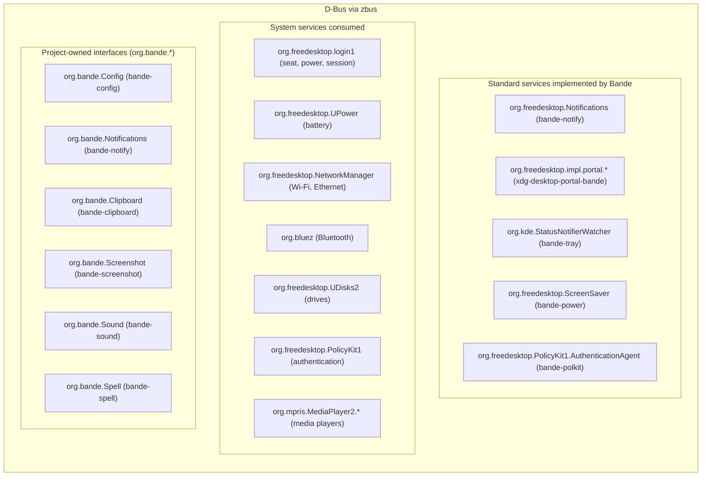

# Session services

A desktop needs a good deal of invisible infrastructure: clipboard, locking, notifications,
portals, power, authentication, audio, input methods. This document describes what Bande
provides and how. Behaviour decisions are in [behaviour.md](behaviour.md).

## Core services

```mermaid
graph LR
    subgraph "Session subsystems"
        T1_CLIP[Clipboard and selection<br/>wl_data_device, zwp_primary_selection, ext-data-control-v1]
        T1_LOCK[Screen lock and idle<br/>ext-session-lock-v1, ext-idle-notify-v1, idle-inhibit-v1]
        T1_NOTIF[Notification daemon<br/>org.freedesktop.Notifications with actions]
        T1_PORTAL[XDG portal backend<br/>xdg-desktop-portal-bande: Settings, FileChooser, Screenshot, ScreenCast, Wallpaper]
        T1_POLKIT[Polkit agent<br/>org.freedesktop.PolicyKit1 authentication agent]
        T1_AUDIO[Audio and media keys<br/>PipeWire, WirePlumber per-device memory, volume OSD]
        T1_POWER[Power management<br/>UPower battery, logind lid and sleep inhibitors]
        T1_INPUT[Input methods<br/>zwp_text_input_v3 and zwp_input_method_v2: Fcitx5, IBus]
        T1_LAUNCH[Launcher and search<br/>desktop entries, apps, files, settings]
        T1_A11Y[Accessibility<br/>AccessKit trees on AT-SPI2]
        T1_ENV[Session startup<br/>environment import, D-Bus activation]
    end
```

### Clipboard (`bande-clipboard`)

- The compositor offers `wl_data_device_manager` v3, `zwp_primary_selection_device_manager_v1`
  and `ext_data_control_manager_v1` on one seat; selections go to the keyboard-focused client
  only, and data control to `bande-clipboard` alone ([behaviour](behaviour.md)).
- The daemon takes over each new clipboard and primary selection once it has read it, so copied
  contents outlive the source app; a source silent for two seconds is skipped.
- It keeps a clipboard history (not the primary selection): the last 100 copies of seven days,
  at most 16 MiB each and 64 MiB in all, in `$XDG_STATE_HOME/bande/clipboard` (folder 0700,
  files 0600). Copies marked `x-kde-passwordManagerHint: secret` or
  `application/x-nspasteboard-concealed-type` are never kept. The launcher reads it through
  `org.bande.Clipboard` (`Items`, `Content`, `Paste`, `Remove`, `Clear`).

### Screen lock and idle (`bande-lock`, `bande-power`)

- Locking is built on `ext-session-lock-v1`. If the lock screen crashes the session stays
  locked: the compositor draws a blank frame and a new locker may take over.
- **Idle** ([`config.kdl`](overview.md#configuration) `idle`, Settings ▸ Lock Screen): the
  displays dim 10 s before the screen saver or the display turning off, whichever comes first
  (default 5 and 10 min). The screen saver is the lock screen resting (clock and date over the
  blurred wallpaper), so the saver hands over to the lock without a second surface. Input or
  waking fades in the picture, name and password field (see `behaviour.md`); a minute without
  input clears the field and rests again.
- "Require password after screen saver begins or display is turned off" (default immediately)
  is a grace period: until it passes, any input dismisses the saver. Locks from `Super+L`,
  logind, sleep and the power button always ask. The grace period is `org.bande.Power`'s
  `PasswordRequired` property; any process of the user could lengthen it through `config.kdl`
  anyway, so it adds no new trust.
- The computer sleeps with the display unless `suspend-after` is later or `"never"`, and only
  when logind's `CanSuspend` is `yes` (otherwise Sleep leaves the menus and the sleep row is
  hidden). A virtual machine never sleeps when idle: a sleeping guest looks like a crash and
  loses its network. Sleep never comes before the display turns off; Settings says so on a row
  whose choice is overridden.
- **Keeping the display awake**: a playing video holds off dimming, display off and the lock,
  whichever path the player uses:

  | Path | Used by | Bande |
  |---|---|---|
  | `org.freedesktop.ScreenSaver.Inhibit` | Firefox, Chromium/Electron | `bande-power`, held until `UnInhibit` or the caller leaves the bus |
  | `org.freedesktop.portal.Inhibit`, idle flag | sandboxed apps | `xdg-desktop-portal-bande` forwards it to `org.freedesktop.ScreenSaver` |
  | logind `idle` block inhibitor (`systemd-inhibit --what=idle`) | scripts | `bande-power` follows logind's `BlockInhibited` |
  | `zwp_idle_inhibitor_v1` on a surface | Player, Glance, mpv, Chromium, Firefox | the compositor, while the surface's window is on screen (covered or not); not while minimized |

  `bande-power` holds one logind `idle` inhibitor per `ScreenSaver` request, so every one shows
  in `systemd-inhibit --list`. Idle time restarts when the last inhibitor ends, so a finished
  film does not lock the screen at once.
- **Keeping the computer awake** only holds back idle sleep; Sleep in a menu, the power button
  and the lid always work, so these are not logind `sleep` block inhibitors (those would turn
  an explicit Sleep into an administrator prompt). Any app's running PipeWire stream (not a
  paused one, the system's filters or Bande's event sounds), the portal's suspend flag
  (`org.bande.Power.KeepAwake`) and someone else's logind `sleep` inhibitor keep it awake;
  after the last one the computer sleeps after a full `suspend-after`. Audio alone keeps the
  computer but not the display awake; CPU load, builds and MPRIS keep nothing awake.
- The power button always locks through logind, and the compositor asks for `Suspend` on a press
  shorter than the five-second hold when `CanSuspend` is `yes`.
- **Lock screen** (`crates/shell/lock`): date, time, the user's picture (AccountsService
  `IconFile`, or the initial on the accent colour) and name, and a secure field. PAM
  (`/etc/pam.d/bande-lock`) runs off the UI thread with a progress row after 200 ms; a rejected
  password clears and shakes the field. The compositor sets logind's `LockedHint`.
- **`bande-power`** (`crates/services/power`) locks the session through logind before sleep,
  holding a `delay` inhibitor until `LockedHint` is set or 3 s pass (below logind's
  `InhibitDelayMaxSec` of 5). Its idle state machine maps the compositor's
  `ext-idle-notify-v1` thresholds to dim, saver, password required, display off and suspend; it
  skips locking a locked session and turns the display off after 60 s on a lock it did not
  start. Dimming lowers each display with real brightness control to a quarter of its level.
  Battery alerts follow UPower's `WarningLevel`: a "Low Battery" notification at `Low`, replaced
  by one that stays at `Critical` or `Action`. The compositor follows `Lock` on the session's own
  logind path (from `GetSession("auto")`; logind never signals on `session/auto`).
- **Display brightness**: `bande-power` serves one model for all displays,
  `org.bande.Brightness` (`Displays`, `SetLevel`, `Refresh`), so Settings and Quick Settings
  never block on hardware. Brightness only changes a display's own light, never a software
  darkening, so a display without real control gets no bar. Internal panels (`eDP`, `LVDS`,
  `DSI`) use logind's `Session.SetBrightness`; monitors use VCP 0x10 over DDC/CI, natively on
  `/dev/i2c-N`, one worker thread each. Writes go out at most every 250 ms with the last level
  always sent, because a monitor's memory wears and its bus is slow. A monitor keeps its own
  level: it is read on connect, never written; a plugged-in monitor is asked again after 1, 3 and
  8 s, since many answer late. `bande-power` loads `i2c-dev` and gives the active session
  `uaccess` to the I2C adapters of PCI display controllers only, never other buses.

### XDG desktop portal backend (`xdg-desktop-portal-bande`)

The backend (`crates/services/portal`) lives in `/usr/libexec` and is D-Bus activated through
its user unit. `x-bande-portals.conf` (picked when `XDG_CURRENT_DESKTOP=X-Bande`) sends every
interface to Bande; no GTK or GNOME backend is used. Its dialogs are modes of
`bande-file-chooser`, one process per request, so the portal never links the toolkit; a
dialog that cannot start fails the request with response 2.

- **FileChooser**: the Bande Open and Save dialogs (open, save, save many, filters, choices,
  folders, cancellation). `bande-file-chooser` answers on standard output and exits 0 when
  chosen, 1 when cancelled. It has the Files sidebar, a path bar, a sortable list with
  type-to-jump, Save As with the name selected up to its extension, "Replace?", New Folder, Show
  Hidden Files (`Ctrl+H`), and remembers the last folder per app in
  `$XDG_STATE_HOME/bande/file-chooser-folders`. It is attached to the asking window
  (`parent_window` through `zxdg_importer_v2`, which every `bande-app` window exports) and modal
  through `xdg_dialog_v1`.
- **Access**: the permission question behind Screenshot, Wallpaper, Camera, Location and
  Background (the frontend exports none of these without it): an alert with the frontend's
  texts, Don't Allow and Allow, and each choice as a checkbox or pop-up. Allow is response 0.
- **AppChooser**: Open With for OpenURI. The frontend opens the default app itself unless asked
  or there is a real choice; the dialog lists the candidates with a search field and returns the
  app id with an xdg-activation token. `UpdateChoices` reaches the open dialog on standard input.
- **Wallpaper**: a local picture is copied to `$XDG_DATA_HOME/backgrounds/` (a portal or download
  path may not last) and set as both the light and dark wallpaper; `set-on` is not told apart,
  since the lock screen shows the wallpaper. The preview the app asks for is the user's consent,
  so the frontend's own Access dialog is skipped.
- **Email**: builds a `mailto:` URI (with `attachment=` paths from the document portal) and opens
  the default mail app with the caller's activation token.
- **Inhibit**: the idle flag takes an `org.freedesktop.ScreenSaver` inhibitor from `bande-power`,
  the suspend flag `org.bande.Power.KeepAwake`; closing the request releases both. Logout and
  user switch are not inhibited (Log Out asks running apps to quit instead). Monitors report
  `screensaver-active` from `LockedHint`; there is no query-end.
- **Notification** (version 2): posts to `org.freedesktop.Notifications` with `desktop-entry`,
  urgency from the priority and markup reduced to text; a picture is kept in
  `$XDG_RUNTIME_DIR/xdg-desktop-portal-bande/pictures` while used. An `app.` action goes to the
  app's `org.freedesktop.Application.ActivateAction` with the activation token, any other is
  signalled as `ActionInvoked`.
- **Background**: `GetAppState` asks the compositor's `org.bande.Apps` for apps with a mapped
  window (keyed by Flatpak id) and passes on its changes; `NotifyBackground` allows, since a
  background app keeps its running dot in the Taskbar rather than a prompt. The frontend writes
  the autostart file itself, hence `xdg-desktop-portal (>= 1.20)`.
- **DynamicLauncher**: "Add this web app to Applications?" with the icon, an editable name and the
  address. `RequestInstallToken` trusts only the app stores the other backends trust (GNOME
  Software, AppCenter, Discover).
- **Account**: "Share your name and picture with <app>?"; Share returns the login, the
  AccountsService `RealName` (else the passwd name) and the picture as a `file://` URI.
- **Secret**: only for calls from `xdg-desktop-portal` itself, hands a sandboxed app the 64-byte
  key kept in the keyring under its `app_id`.
- **Print**: `PreparePrint` shows the Bande print dialog and remembers the choice under a token;
  `Print` with that token goes straight to `bande-printd`, without one it shows the dialog with
  the app's PDF as the preview.
- **Settings** (version 2): `org.freedesktop.appearance` from `org.bande.Config`: `color-scheme` 1
  for dark (the default, what clients assume until the portal answers) and 2 for light
  (Automatic is dark from sunset to sunrise at the time zone's main city, 19:00 to 07:00 when it
  is unknown), `accent-color` the exact Datum colour, `contrast`. `org.bande.appearance` carries
  `frame-tint` and `text-size` for the toolkit. `org.gnome.desktop.interface` serves the icon
  theme, fonts, cursor and animations, `org.gnome.desktop.sound` `event-sounds`, and
  `org.gnome.desktop.wm.preferences` `button-layout` `:minimize,maximize,close`, so GTK,
  libadwaita, Firefox and Qt put their window controls on the right in Bande's order.
- Not implemented: GlobalShortcuts, InputCapture, RemoteDesktop, Clipboard and Usb; Lockdown is
  the frontend's default (nothing locked down).

**Capture lives in the screenshot tool.** The portal has no Wayland connection: Screenshot and
ScreenCast forward to `org.bande.Screenshot`, served by `bande-screenshot`, which the compositor
starts as a shell client and so holds the trusted connection that sees the capture globals. That
service answers only the owner of the portal's bus name, and sandboxed apps cannot reach it past
the Flatpak bus proxy. Capture runs on its own event queue and thread, so it never waits for the
UI.

- **Screen sharing**: `SelectSources` shows every display and open window (other workspaces and
  minimized included) as live thumbnails, keyboard-driven and published to screen readers.
  `Start` opens one PipeWire `Video/Source` per source (shared memory, at most 60 frames per
  second and only on change), with the cursor embedded or hidden as asked. While anything is
  shared a screen symbol sits in the Taskbar; clicking it stops sharing and closes the app's
  session. `persist_mode` restore data skips the picker unless a restored window has closed.
- **Screenshot portal**: a non-interactive request takes the whole screen, asking "Allow <app>
  to take a screenshot?" when the frontend has not checked the permission store; an interactive
  one lets the user drag out an area. The PNG goes to `$XDG_CACHE_HOME/bande-screenshot`, not the
  Desktop: the app asked for it, not the user. `PickColor` shows a loupe with the hex value.
- **Screenshot tool**: `Shift+Print` saves one picture per display; `Shift+Super+S` drags out an
  area, with Space switching to a window (taken alone with its corners and a shadow). `Print`
  opens a palette (Entire Screen, Window, Area, Record Entire Screen, Record Area, Options for
  destination, timer and pointer), remembered in `$XDG_STATE_HOME/bande-screenshot/options`. Each
  capture floats as a thumbnail for five seconds that can be dragged into any app or clicked to
  open Markup. Clipboard captures are offered as `image/png` without a file.
- **Markup** (`bande-screenshot --markup <file>`): Crop, Arrow, Rectangle, Text, Highlight,
  Undo, Delete (to the Trash), Copy and Done, which writes the marks into the file. Marks are
  drawn on the picture's own pixels by the CPU renderer, so what is saved is what was shown.
- **Screen recording**: a private PipeWire stream into `gst-launch-1.0`, MP4 (H.264, from
  `gstreamer1.0-plugins-ugly`) or else WebM (VP8). A stop symbol sits in the Taskbar; stopping
  sends end of stream, so the file is finalised. Without GStreamer the palette says what to
  install.

**Third-party toolkits** follow the appearance:

- libadwaita and GTK 4 read `color-scheme` and `accent-color` from the portal. libadwaita snaps
  the accent to its presets, so the portal writes `~/.config/gtk-4.0/bande.css` (Datum colours as
  libadwaita's variables, header bars drawn like Bande's title bar) and keeps
  `@import url("bande.css");` at the top of the user's `gtk.css`, leaving the rest alone. Its
  unconditional block is the current scheme; media-query blocks let GTK 4.20 and later switch
  live.
- GTK 3 reads the portal only with `GTK_USE_PORTAL=1`, which `bande-session` sets; it then takes
  `gtk-theme`, fonts, `enable-animations`, cursor and text size from the portal and sends its Open
  and Save dialogs to Bande's. A key the portal leaves out falls to GTK's default, not GSettings,
  so the portal serves them all. Adwaita for GTK 3 uses literal colours, so the portal writes the
  themes `Bande` and `Bande-dark` to `$XDG_DATA_HOME/themes`, importing GTK's Adwaita and adding
  the title bar and the accent; serving them as `gtk-theme` switches running GTK 3 apps live.
  Their `gtk-4.0/gtk.css` imports GTK's `Default`, so plain GTK 4 apps are unchanged.
- Qt follows dark mode and uses the portal dialogs through
  `QT_QPA_PLATFORMTHEME=xdgdesktopportal`, set by `bande-session`, once
  `qt6-xdgdesktopportal-platformtheme` is installed; `bande-desktop` does not pull it in, since
  it brings Qt Quick and GTK 3 to a system with no Qt app. Qt runs natively on Wayland through
  `qt6-wayland`, which Qt's packages recommend.

### Audio

- PipeWire and WirePlumber, with per-device volume memory and media keys with an on-screen
  level; `crates/libs/audio` is the client library, and the compositor forwards volume keys to
  the shell over `bande_shell_v1`.
- Device lists leave out a port that is unavailable (judged as WirePlumber's
  `haveAvailableRoutes`, followed live), so Headphones appear only while plugged in. Plugging in
  makes the jack the default once per session (`bande-sound`); unplugging falls back to the
  previous choice. Filter-chain streams are never listed as apps, and a `hide-parent` node hides
  its raw speaker. Settings ▸ Sound has a balance for stereo outputs.
- The display and keyboard brightness keys work the same way, also while locked: 16 steps
  (quarter steps with Shift+Alt) on the display under the pointer or the `kbd_backlight` LED, in
  the volume HUD, which names the display when there are several.

### Accessibility

- Every toolkit widget produces an AccessKit node, published on AT-SPI2 for screen readers
  ([toolkit](toolkit.md)).

### Keyring (`bande-secrets`)

- `crates/services/secrets` is the session's `org.freedesktop.secrets` (`plain` and
  `dh-ietf1024-sha256-aes128-cbc-pkcs7` sessions), D-Bus and socket activated, idle in epoll.
- Keyrings are oo7's v1 files in `~/.local/share/bande/keyrings/v1/<name>.keyring` (written 0600
  through a temporary file): `login` (alias `default`), the in-memory `session`, and any an app
  creates. GNOME Keyring's files are not read.
- `libpam-bande-secrets` (pam-auth-update profile `bande-secrets`): `auth` keeps the typed
  password, `session` hands it to the daemon over `/run/user/<uid>/bande-secrets/pam` (the
  module checks the socket is the user's, the daemon takes messages only from root; a failed
  send is logged through `pam_syslog`, never the password), and `password` re-encrypts the login
  keyring when the old password opens it. The lock screen runs `auth` only, so it unlocks
  nothing; the login keyring stays unlocked while the screen is locked. When the login password
  does not open the keyring, the next unlock offers to update its password or start a new one
  (the old file is kept).
- It is NetworkManager's secret agent (`org.bande.Secrets`, answering only NetworkManager's bus
  name): agent-owned secrets live in the login keyring under libnm's attributes, and new Wi-Fi
  or 802.1X passwords are asked through the keyring prompt. Wi-Fi joined from Bande keeps its
  password system-wide.
- Items record the app that saved them (`bande:creator`); another app sees them locked until the
  user confirms with the keyring password (`bande:allowed` remembers "Always Allow"). Prompts
  are `bande-secrets-prompt` processes, so the daemon never links the toolkit; the daemon is not
  dumpable.

### Updates during a session

The compositor and its private helpers are one build for the life of a session: the compositor
opens `bande-shell`, `bande-lock`, `bande-clipboard` and `bande-screenshot` at start and runs
them through `/proc/self/fd/N`, so a helper relaunched after an update is the build the session
began with (dpkg replaces by rename). A helper re-executing itself uses
`bande_xdg::own_executable()`, never the path.

Apps and services may be newer than the compositor, so the contracts only grow: `bande_app_v1`
and the other protocols add with `since` and clients check `version()`
(`ci/release/check-protocols.py` compares with the last release); `bande_shell_v1` is exempt,
since only held shell clients see it. `org.bande.*` interfaces only grow, and a client treats a
missing property as its default. `bande-audio` reconnects on its own, waiting on inotify for
PipeWire's socket.

### Session startup

- Before starting any shell client, the compositor exports `WAYLAND_DISPLAY`,
  `XDG_SESSION_TYPE` and `XDG_CURRENT_DESKTOP` to the user manager and D-Bus activation.
- `bande-session` sets `ELECTRON_OZONE_PLATFORM_HINT=auto`, `GTK_USE_PORTAL=1` and
  `QT_QPA_PLATFORMTHEME` (each unless already set), and takes the language and formats from
  `/etc/locale.conf`, then `~/.config/locale.conf`, into the user manager and D-Bus activation:
  greetd and a lingering user manager keep what they had, so a choice in Settings would
  otherwise need a restart. The login window reads the same file through
  `bande-greeter-session`.
- Settings ▸ Language & Region writes the person's file and, for an administrator, the system
  default through `bande-locale-helper` under `pkexec` (`org.bande.locale-helper`), since Debian
  forbids localed's `SetLocale` even to root; localed is only read. The helper accepts only UTF-8
  names from `/usr/share/i18n/SUPPORTED`, runs `locale-gen --keep-existing` before replacing
  `/etc/locale.conf` atomically, and writes the login keyboard (codes checked against xkb's
  `evdev.lst`) to `/etc/default/keyboard`, then applies it to udev and the console.
- Per-app languages are `<app id>=<code>` lines in `$XDG_CONFIG_HOME/bande/app-languages`;
  `spawn_detached` sets `LANGUAGE` for that app and restores the session's value
  (`BANDE_SESSION_LANGUAGE`) for anything it launches.
- `graphical-session.target` starts PipeWire, WirePlumber, `bande-config`, `bande-power`,
  `bande-sound`, `bande-tray`, `bande-indexer`, `bande-automount` and `bande-polkit-agent`.
  `bande-notify`, `bande-spell` (exits after a minute idle) and the portal are D-Bus activated;
  the compositor starts `bande-clipboard`, `bande-shell` (one process for the desktop, bar,
  notifications, Quick Settings and launcher of every display) and `bande-screenshot`. The lock
  screen, greeter, screenshot tool and file chooser stay separate processes: the lock must hold
  the session when the shell crashes, the greeter runs before any session, the screenshot tool
  owns the trusted capture connection, and the portal starts a chooser per request.

### Polkit authentication agent (`bande-polkit`)

`bande-polkit-agent` (`crates/services/polkit`, a user unit wanted by `bande-session.target`)
registers an `org.freedesktop.PolicyKit1.AuthenticationAgent` for the user's logind session and
authenticates through polkit's socket-activated helper at `/run/polkit/agent-helper.socket`
(Debian's helper is not setuid, so an agent cannot run it itself). A helper that cannot start
or stops early is an error in the journal and a refusal to polkitd, never a silent cancel. Each
request is a Datum dialog on an overlay layer with exclusive keyboard focus, one at a time; a
wrong password shakes it and it stays open until the right password or Cancel. The password is
kept in zeroized buffers up to the helper's socket. Settings checks its actions without
interaction and leaves rows changeable when polkit answers with a challenge, so changing them
brings up the dialog.

## Desktop integration

- **System tray** (`bande-tray`): `org.kde.StatusNotifierWatcher` at `/StatusNotifierWatcher`,
  for items registered by bus name or by object path (libappindicator, Ayatana); items and hosts
  drop when their connection leaves the bus. The Taskbar is the host: it shows items that are not
  `Passive`, a click opens the item's `com.canonical.dbusmenu` menu (or `Activate` without one).
  Apps show their own item with `bande_app_menu::StatusItem`.
- **App menus**: an app owns its app id as bus name and exports `com.canonical.dbusmenu` at
  `/org/bande/MenuBar` (`crates/libs/app-menu`, driven by `bande-app`, [apps.md](apps.md)). The
  App menu of a window's menu button shows that tree, a third-party window's menu at the address
  given with `org_kde_kwin_appmenu`, or a GTK window's `org.gtk.Menus` menu bar given on
  `gtk_shell1` (`bande_status::gtkmenu`, with `org.gtk.Actions`). The shell asks only when the
  name has an owner, so it never D-Bus-activates an app. Items marked `x-bande-shell-action`
  (About, Hide, Hide Other Apps, Show All Apps) are performed by the shell through
  `bande_shell_v1`, since an app cannot hide itself.
- **Network and Bluetooth**: NetworkManager and BlueZ for Wi-Fi and pairing in Quick Settings and
  Settings (`crates/libs/network`, `crates/libs/bluetooth`). Bande never rewrites
  `/etc/network/interfaces` or NetworkManager's configuration; a wired device that ifupdown or
  systemd-networkd manages is to be shown read-only in Settings, with Wi-Fi alone in the Taskbar
  and Quick Settings.
- **Service outages**: the bar, Quick Settings and Settings tell a stopped service from missing
  hardware (`bande_bus::Reading`): a failed UPower, NetworkManager or BlueZ read counts as absent
  only when sysfs has no battery, Wi-Fi radio or Bluetooth adapter; otherwise the item stays
  with a short reason, and recovers when the service returns.
- **Removable media** (`bande-automount`): every filesystem UDisks2 hints for automounting is
  mounted when it appears, but only while the session is active and unlocked; drives that appear
  while locked are mounted on unlock. A drive removed while mounted posts "Disk Not Ejected
  Properly"; encrypted volumes wait for the UI. `bande-volumes` holds the one UDisks2 client that
  automount, Files, the desktop and Disks share. Eject unmounts every filesystem of the drive,
  locks its encrypted volumes, then calls `Drive.Eject` or else `PowerOff`; a failure is reported
  to the caller, not only logged.
- **Theme propagation**: GTK, Qt (above) and the pointer (`XCURSOR_THEME=Bande-Cursors`,
  `XCURSOR_SIZE`) follow the desktop's appearance.

## D-Bus integration

## Display manager and greeter

Bande uses `greetd` for the privileged part of login and keeps its own UI unprivileged:

1. **The daemon**: `greetd` runs as root on `seat0` and owns PAM, through Bande's own service
   `/etc/pam.d/bande-greeter` (`[general] service` in Bande's greetd configuration). It follows
   Debian's `gdm-password`: `pam_nologin`, no root login, `common-auth`, `common-account`,
   `pam_loginuid`, `pam_keyinit`, `pam_limits`, `pam_env` (with `/etc/default/locale`),
   `common-session` (`pam_systemd`, and the keyring module through `pam-auth-update`) and
   `common-password`.
2. **The greeter**: `bande-greeter` runs as greetd's user (`_greetd`), talks to greetd over its
   JSON IPC socket inside `bande-compositor --greeter`, and shows the lock screen's layout
   (`bande_lock::LockScreen`, announced as "Sign in") with battery, Wi-Fi or cable or Offline,
   input source, and Sleep, Restart and Shut Down. Logind's answers are asked again when the
   devices change or the screen wakes, so a dock that changes them is followed.
3. **Handover**: after authentication the greeter asks greetd to start `bande-session` (which
   starts `bande-compositor.service` in the user's manager) with `XDG_SESSION_TYPE=wayland`,
   `XDG_CURRENT_DESKTOP=X-Bande` and `XDG_SESSION_DESKTOP=bande`, then exits, releasing the seat
   and VT before greetd opens the session through `pam_systemd`.

**People.** The greeter lists AccountsService's `ListCachedUsers` (no `SystemAccount`, no locked
account, no `nologin` or `false` shell), or without it `/etc/passwd` uids 1000–59999, and always
offers "Other…", which asks for a user name, so LDAP, SSSD and systemd-homed accounts sign in too.
The list is a row of avatars and names (an AccessKit list box) that a click, a tap, Tab and Enter
or Up and Down choose from; with no one listed, the window asks for a name.

**The conversation.** The greeter and the lock screen share one model (`bande_lock::Prompt`,
`Refusal`, `Messages`, `Backoff`): the greeter starts greetd's `CreateSession` as soon as a person
is shown, and the lock screen its PAM transaction (`bande-lock`, on its own thread) when it
wakes, so a fingerprint module's "Place your finger…" comes first. Each prompt becomes the
field's placeholder, a visible prompt (a user name, a code) shows what is typed, and a password
typed before the first prompt answers it. PAM's info and error messages stay under the field,
the last three of them, each at most 400 characters. Escape cancels; while checking it lets go
of the conversation and starts a new one (greetd answers a cancel only once the module returns).
greetd's and PAM's codes become sentences (wrong password, expired password or account, not
allowed, too many attempts, unavailable); the raw text goes to the journal. After four wrong
answers each further one waits 5 s, doubling to a minute, with a countdown under the field. The
lock screen changes an expired password with `pam_chauthtok`; greetd runs no `pam_chauthtok`, so
at login an expired password is only explained. greetd's messages are refused above 64 KiB.

**Keyboard.** The field shows Caps Lock and, with several layouts, the active one as a button
that switches to the next, as `Super+Space` does. The layouts and `XKBOPTIONS` are those in
`/etc/default/keyboard`; Settings ▸ Keyboard's "Use at Login Screen" writes the layouts through
`bande-locale-helper`.

**Accessibility.** The login window's compositor runs the screen reader and serves
`org.freedesktop.a11y.KeyboardMonitor` as the session does, and `_greetd`'s user manager starts
PipeWire and WirePlumber, so Orca speaks before anyone signs in. Its defaults are
`/etc/bande/login.kdl` (the `accessibility` block), written by Settings ▸ Accessibility's "Use at
Login Screen" through `bande-locale-helper accessibility` and followed by the compositor; the
greeter draws with them and with the shown person's own contrast, text size, reduced motion and
transparency. A screen reader turned on at the login window (`Alt+Super+S`) is kept in
`$XDG_RUNTIME_DIR/bande-login-accessibility.kdl` and passed to the session as
`BANDE_LOGIN_ACCESSIBILITY`, which the session's compositor turns on and remembers; a person
who has never signed in also gets the login defaults that way.

**Idle.** After a minute the login window rests like the lock screen, after 10 minutes the
compositor turns the displays off, and on battery the greeter then sleeps when logind allows it.

**Several displays.** The login window is on the main display, which alone decides when the
first frame is shown; the others show the blurred wallpaper (`greeter-backdrop` layers).

**A session that fails.** When the compositor service fails, ends within 5 s, or a session is
still running, `bande-session` writes a keyword to `/var/lib/bande-greeter/failed/<uid>` (the
same `3733 root:_greetd` pattern as the pictures); the greeter shows that person why their
last session ended, and the next session that starts removes the note.

**No black frame.** Each stage leaves its last frame on screen until the next has something to
show: a compositor leaving the screen closes its framebuffers with `DRM_IOCTL_MODE_CLOSEFB`,
which leaves them on their planes, and the next compositor's first commit replaces them without
a modeset when the mode is the same. Unlocking is one compositor: the last lock frame fades out
over the desktop, so input reaches the desktop at once. `Ctrl+Alt+F2` reaches a text console at
any time, and when greetd gives up `bande-console-fallback.service` brings the console forward.

**Ending the session.** Log Out stops `bande-compositor.service` in the user's manager, never
logind's `Session.Terminate`, which would leave the compositor holding the seat while greetd
starts the greeter and refuse the next login where the manager outlives the session. `BindsTo`
then stops `graphical-session.target` and everything `PartOf` it, including app scopes
(`TimeoutStopSec=5s`, so a hung app holds up neither a log out nor a shutdown). If something else
ends the login scope, `bande-session` traps the signal and stops the service. Restart and Shut
Down call logind's `Reboot` and `PowerOff`; the confirmation stays open until answered and shows
a refusal.

**Installation.** `/etc/greetd/config.toml` is greetd's conffile and stays untouched:
`bande-greeter` ships `/usr/share/bande-greeter/greetd-config.toml` and a drop-in,
`/usr/lib/systemd/system/greetd.service.d/bande.conf`, pointing `--config` at it. Which display
manager runs is chosen the Debian way (greetd >= 0.10.3-6 provides `x-display-manager` and
shares the debconf question `shared/default-x-display-manager`); `bande-greeter` never touches
it. To override:

- another greetd configuration: copy the drop-in to
  `/etc/systemd/system/greetd.service.d/bande.conf` and change its `--config`, or mask it with
  `ln -s /dev/null /etc/systemd/system/greetd.service.d/bande.conf` to go back to
  `/etc/greetd/config.toml`;
- another display manager: `dpkg-reconfigure greetd` (or the other manager's package) and pick it.

Either takes effect after `systemctl daemon-reload` and a restart of the display manager,
which ends the sessions it started.

**Wallpaper at login.** The login window shows the wallpaper of the person it offers, starting
with whoever signed in last (`$XDG_STATE_HOME/bande-greeter/last-user` in greetd's home,
`/var/lib/greetd`). Homes are 0700, so `bande-config` copies the dark picture (at most 64 MiB)
to `/var/lib/bande-greeter/pictures/<uid>`, a different light one to `<uid>.light`, and the
appearance, wallpaper fit and vision settings to `<uid>.look` whenever they change, so the
login window shows the variant and fit the desktop fades in with. That folder is
`root:_greetd` mode 3733: anyone may create files but no one may list them, the sticky bit stops
people replacing each other's files, and setgid makes a 0640 copy readable by its owner and the
login window alone. The greeter opens `<uid>` without following links, uses it only if it is a
regular file owned by that uid within the size limit, and decodes it through `/proc/self/fd`, so
the file it checked is the file it shows; anything else falls back to the default.

## Crash handling and supervision

Every failure is meant to end in a working desktop without a reboot, each stage only taking down
what the one before could not save:

- **An app hangs**: Force Quit marks it Not Responding after a 2 s `xdg_wm_base` ping and kills
  its whole scope, after `SIGQUIT` so its stack is kept ([behaviour](behaviour.md)).
- **The shell crashes or hangs**: the compositor restarts the shell clients and the clipboard
  daemon, at most once every 10 s; the session and its apps stay, and notifications live in
  `bande-notify`. A hung shell shows in Force Quit as "Taskbar & Desktop (Not Responding)" with
  Relaunch. The session stays locked if the lock screen dies, and a lock screen silent for 10 s
  while locked is killed and restarted.
- **Frames stop reaching the display**: a failed frame is retried four times a second (one log
  line per distinct error) and a page flip missing for a second is written off. After 3 s without
  a frame on every display the compositor makes a new renderer and resets each display's DRM
  state; after 15 s it exits. The login window, with no work to lose, asks logind to restart a
  computer up for over 5 minutes when it cannot reach the display for 15 s.
- **The compositor crashes or hangs**: `bande-compositor.service` has `WatchdogSec=20s`, pinged
  from the event loop, and `TimeoutAbortSec=10s`; the session ends, greetd shows the login window
  and the next session offers the open apps again. The login window's compositor arms
  `alarm(20)` every 10 s. `Ctrl+Alt+F1`…`F12` switch virtual terminals through logind while the
  compositor runs.
- **The GPU is lost, hangs or runs out of memory** (`VK_ERROR_DEVICE_LOST`, a fence unsignalled
  after 5 s, `VK_ERROR_OUT_OF_DEVICE_MEMORY`): the backend abandons the device, creates a new one
  and uploads and repaints everything; apps keep running. Without a new device the compositor
  exits.
- **Memory runs out**: the low-memory window, systemd-oomd on `app.slice` and the notification of
  a closed app ([decision 0004](../decisions/0004-memory-pressure.md)). The compositor, the session
  bus, PipeWire, WirePlumber and the portal sit at `OOMScoreAdjust=100` with oomd `avoid`, apps at
  200.
- **Session services crash**: every Bande user service has `Restart=on-failure` with systemd's
  start limit, runs in `session.slice`, and is D-Bus activated again on the next call after that.
- **Too many processes**: each app scope gets the default `TasksMax` (15 % of the kernel's limit)
  and `app.slice` 25 %, under logind's 33 % for the user, so a fork bomb leaves room for the
  session.
- **The disk is full**: configuration and state are written to a staging file and renamed
  (`bande_xdg::replace_file`), so a failed write leaves the old file whole.
- **After a crash**: the compositor keeps the open apps in `$XDG_STATE_HOME/bande/running`; after
  a session without a clean log out, the next asks "Reopen your apps?" before anything starts.
- **The record**: every failure of a Bande program leaves one report, kept on the computer unless
  sending is on ([fault reports](fault-reports.md)). Core dumps go to `systemd-coredump`
  (`bande-desktop` sets `DefaultLimitCORE=infinity` for the user manager, whose soft limit is
  otherwise 0). Programs that hold passwords (`bande-lock`, `bande-greeter`, `bande-polkit`,
  `bande-secrets`, `bande-clipboard`) are not dumpable, so only their panic text is recorded.
  Symbols are in [packaging](packaging.md).

## Backups

Scheduled, versioned backups with `restic` (`crates/services/backup`). `bande-backupd` is a
system service (`org.bande.Backup`), root because a whole-computer backup reads every file; it
runs `restic` with `--json`, started by a timer, a udev rule (a new disk, mains power) or D-Bus,
and exits after a minute idle. `bande-backup-alerts` runs only when there is something to say:
the service writes its problem to `/run/bande-backup-alert`, a user path unit starts the program,
and it posts one notification per problem.

A repository is `BandeBackups/<machine-id>` on any drive but the startup one, an SMB or NFS
share, or a restic rest server; Settings can erase a blank or foreign disk to make one. Two keys
open it: a random one in `/var/lib/bande-backup/key` that runs the backups, and the person's
password, for restoring when the machine is gone. The disk is mounted under `/run/bande-backup`
only during work. Files browses `restic mount` read-only under `/run/bande-backup-browse`, with
the old owner and mode enforced by the kernel, and restores by copying as the person, so nothing
privileged runs on their behalf.

## Updates

Packages come from Bande's signed APT repository ([packaging](packaging.md)).

**Nothing is fetched by itself** unless the person switches on "Check for updates automatically"
(`check-updates-automatically`, off by default) or automatic updates; until then the daily timer
and an opened pane show the last check, and Check Now always fetches. `update-check-every` sets
the interval (When available, Every day, 7 or 31 days); security updates follow it. Each check
leaves its outcome in `$XDG_STATE_HOME/bande/software-badge`, so Settings starts PackageKit only
when the pane opens or a check is due.

**Classes.** Software Update (`bande-packages`, through PackageKit) classifies each update:

- **Offline** (installed at the next restart): `libc6`, `systemd`, `libsystemd0`, `udev`,
  `dbus*`, the running kernel's own packages (an upgrade replaces them in place), security
  updates to `greetd` or `libpam*`, and anything PackageKit says needs a system restart.
- **Boot** (installed now, "Restart to finish updating"): other kernels, `firmware-*`,
  `initramfs-tools` and bootloaders.
- **Live**: everything else. Update Now simulates the live set first; if it would pull in an
  offline package, everything goes offline. Otherwise it installs with `UpdatePackages`, asking
  through the polkit agent unless polkit grants `system-update` (PackageKit grants it to active
  sudo members).

After installing, Settings restarts the user's `session.slice` services that map a deleted
`/usr` or `/opt` file (`TryRestartUnit`); if the compositor, the session bus or the login scope
are affected it asks to log out, and lists apps to quit and reopen. The daily user timer does
the same after an apt run from Terminal. A restart is always the user's choice, asked through
`bande_app_v1.end_session` so every app is asked to quit first; a pending one is remembered with
the boot id in `$XDG_STATE_HOME/bande/restart-pending` (or `/run/reboot-required`) and the timer
reminds about it. An interrupted dpkg shows "Finish Installing" (`RepairSystem`). While dpkg
runs, packagekitd holds a logind `shutdown:idle` inhibitor (not sleep).

**Flatpak** is dormant by default: no Bande package depends on or recommends `flatpak`, and a
missing `flatpak` command means no Flatpak apps. Once the user installs it and adds a remote to
their own installation, Software shows that remote's apps (Bande adds no remote) and Software
Update lists and installs `flatpak update --user` first, without a password or a restart. Software reads the remotes' cached summaries and asks the
remotes only when `bande_packages::schedule::check_due` says the automatic check is due. The
Taskbar and Search watch the `applications` folders on `XDG_DATA_DIRS`, so a first Flatpak app
appears without logging out.

**Automatic updates** (`automatic-updates`, off by default): the daily run downloads everything
in the background, waits for five minutes of idle (`ext-idle-notify-v1`, which honours
inhibitors), checks again and installs the live and Flatpak updates when polkit allows them
without a password. Boot and offline updates, and live ones that need a password, are never
installed by themselves: a notification says how many are ready and how many need a restart.
